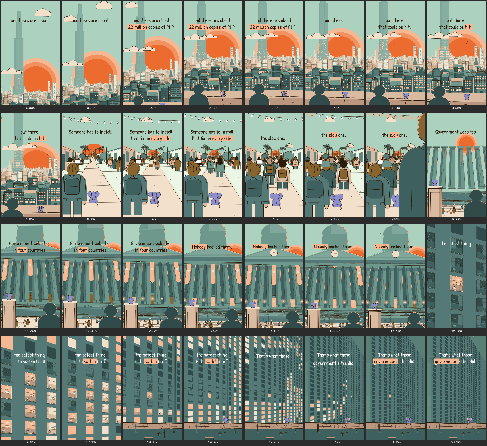

# CINE: the cinematic-scale kit (cine lane)

`src/lib/cine/**`: full-bleed pieces that make the viewer feel small (Arcane-scale vistas, worm's-eye monuments,
pull-backs to a wall of windows) in the reference's flat ink style, plus the reference-2 baseline street. Everything is
canvas coordinates (1080 x 1920 = the frame at camera rest), time-based in seconds (`useTime()`), deterministic
(`rng` / `rand` seeds), flat (no gradients, no blur, no masks, no animated opacity: things pop, wipe, grow or switch).

```tsx
import {CineCamera, Layer, Sky, BigSun, EndlessCity, Monument, WallOfWindows, WipeCut, TOD, ...} from '../lib/cine';
```

Demo: `src/dev/CineDemo.tsx` (composition `CineDemo`, 22 s): A Arcane vista (peak, the hook) -> D eye-level street
(baseline) -> B backlit monument (peak) -> C pull-back from one window (peak). Time of day only moves forward (golden,
golden, late golden, night), the sun only sets across cuts and HOPS from shot to shot after each wiper has passed, and
every wipe's midpoint sits on the first word of the incoming caption page. Contact sheet: `docs/cine_demo.png`.



```
scripts/sheet.sh CineDemo 0 21.9 32 out.png --cols=8                       # contact sheet (+ caption check)
node scripts/capcheck.mjs CineDemo --t0=0 --t1=21.9 --n=110              # caption legibility
scripts/still.sh CineDemo 0 s.png --props='{"mode":"speed"}'             # camera speed report per shot (camSpeed)
scripts/still.sh CineDemo 0.3 w.png --props='{"mode":"wipes"}'           # the wipers + their caption regions
scripts/still.sh CineDemo 0.5 l.png --props='{"mode":"lens"}'            # LensFigure: every hair, colour + paper
scripts/still.sh CineDemo 2.4 g.png --props='{"mode":"lod","view":"grid","zoom":1.2}'      # LOD check: the grid ...
scripts/still.sh CineDemo 2.4 c.png --props='{"mode":"lod","view":"closeups","zoom":1.2}'  # ... vs close-ups: identical
scripts/camspeed.py CineDemo 15.3 21.9 --allow=15.6-16.3 --chart cs.png  # ON-SCREEN speed + velocity steps of a render
npx remotion still src/index.ts CineDemo s.png --frame=75 --props='{"mode":"street"}'  # PerspectiveStreet + crowd
npx remotion still src/index.ts CineDemo t.png --frame=75 --props='{"mode":"tower"}'   # Tower / silhouettes (each ONCE)
npx remotion render src/index.ts CineDemo l.mp4 --frames=0-119 --props='{"mode":"loop"}'  # un-build + loop seam
# event density: render every frame at scale 0.25 with props {"lock": true, "capcheck": "bg"} (camera held on each
# shot's RESTING key, captions hidden), then count medium events (space-time blobs >= 500 voxels, diff > 18)
```

Camera speeds without a browser (the same numbers as `{mode: 'speed'}`):

```
npx esbuild speed.ts --bundle --platform=node --log-level=error > /tmp/speed.cjs && node /tmp/speed.cjs
# speed.ts: import {cineSpeedReport} from './src/dev/CineDemo'; console.log(cineSpeedReport());
```

| shot | move | max on-screen speed | at the wipe midpoints (in / out) |
|---|---|---|---|
| A vista | tilt 640 px down (`CAM.reveal`, 2.5 s) + push anchored on the far city, last key 1.5 s past the shot | 13.5 px / frame (1.3 s, observer layer) | - / 1.6 |
| D street | dolly push anchored on the VP, keys at -1.5 s and +1.35 s past the shot (one sine move) | 1.7 px / frame (string lights) | 1.1 / 1.1 |
| B monument | crane ~190 px (`CAM.reveal`, keys -0.9 s .. +1.15 s past the shot) | 2.0 px / frame (lens figure) | 1.2 / 0.8 |
| C pull-back | 8x -> 1.3x (`CAM.reveal`, starts 0.6 s before the cut, 6.2 s) | 16.8 px / frame (3.4 s) | 9.9 / - |

Flat inked art strobes above ~15-20 px / frame (`MOTION.camera.peakPxPerFrame` 18): every move stays under that (the
old 24x -> 1x in 4 s ran at 48-53 px / frame). Every camera is still MOVING at every wipe midpoint (gate 1: no stall at
a seam; before: A 0.3, D 0 / 0.3, B 0 / 0 (landed 0.2 s early), C held still until 0.3 s after the cut). The largest
frame-to-frame speed change (`maxDv`) is 1.07 (A's reveal lift-off), D 0.02, B 0.05, C 0.55.

**On a real render** (any composition, incl. Film transitions, World push, ShotCam layers, people): `scripts/camspeed.py
<Comp> [t0 t1]` measures the camera (tracked corners + RANSAC, the same 7 x 11 grid as `camSpeed`) and the fastest
inked edges (forward-backward-consistent optical flow, caption band excluded) per frame; FAIL on a camera above
`peakPxPerFrame` or a camera speed STEP above 2.5 px / frame per frame (a stall, slam or whip) outside the Film's
transition windows (allow-listed automatically) and `--allow` windows; fast local motion (a rise moves 50 % of its height
in frame 1) is a WARN. CineDemo C: camera peak 16.8, no step; a synthetic 6 -> 0 px / frame slam FAILs.

Speed (full 1080 x 1920, concurrency 2, 20 frames per shot, incl. page setup): A 118, D 125, B 133, C 122 ms / frame
with the machine at load ~3-6; ~200-250 ms / frame (60 frames over the demo: 197) while the other lanes rendered too
(load ~8-10). The heaviest pieces: the plaza + steps Persons in B (~75 kit Persons) and the close-up ring in C.

---

## 1. Camera + multiplane (`camera.tsx`)

```tsx
<CineCamera keys={[{t: 0, tilt: 640, push: 0, anchor: [600, 1000], anchorDepth: 0.85},
                   {t: 2.5, tilt: 0, push: 0.05, anchor: [600, 1000], anchorDepth: 0.85, ease: CAM.reveal}]} handheld={1.2}>
  <Layer depth={1}>   <Sky/> <BigSun/> </Layer>          // infinitely far: only the lens zoom (and pan / tilt) moves it
  <Layer depth={0.8}> far stuff </Layer>                  // slides / grows less
  <Layer depth={0}>   reference plane (1:1 with camera) </Layer>
  <Layer depth={-0.5}> foreground framing </Layer>        // whips past, grows fastest on a push
  {/* outside any Layer = screen space */}
</CineCamera>
```

Model: parallax factor `f = 1 - depth`; on screen `C + T + R(rot) * s_f * (p - C - o * f)` with
`s_f = zoom / (1 - softPush(push * f))`, C = (540, 960), T = (-pan, tilt).

| key field | meaning |
|---|---|
| `t` | scene seconds |
| `x, y` | world point at screen centre on the reference plane: a TRUCK / CRANE (the camera translates: near layers move more, the depth-1 sky not at all). Default 540, 960 |
| `pan`, `tilt` | the camera ROTATES (screen px; tilt > 0 looks up, pan > 0 looks right): every layer, the sky and the sun included, shifts by the same amount, so the horizon stays on the sky's horizon and vanishing lines keep converging on it. Arcane's tilt-up / tilt-down reveal. Applied after anchoring |
| `push` | dolly forward (fraction of the distance to the reference plane). Real parallax: far layers grow less |
| `zoom` | lens zoom (all layers equally) |
| `rot` | roll, degrees |
| `anchor`, `anchorDepth`, `anchorTo` | keep world point `anchor` (in the layer of `anchorDepth`) at screen `anchorTo` (default: its rest position). Two consecutive keys with the same anchor keep it pinned through the move. **Anchor a push on the FAR city / the VP** (`anchorDepth` 0.8+) so the world grows and the foreground slides out |
| `ease` | ease of a segment whose ends are both at rest. Default `CAM.ease` (inOutCubic); `CAM.slow` (inOutSine), `CAM.reveal` (trapezoid: sine ramp 25 %, cruise, soft landing 35 %; peak 1.43x the average speed), `CAM.settle` (outCubic: first segment only) |
| `inkComp` | OPT-IN ink compensation for the segment arriving at this key (like `ease`; 0.6 = house): every `<Layer>` draws the engine's strokes at width x (layer scale now / at the segment start)^-inkComp, held after the segment (ENGINE.md 4b). Default off |

**Crane vs tilt.** A `y` crane with the horizon in frame moves the depth-0 ground (and its vanishing lines) while the
depth-1 sky and sun stay put: the horizon slides against the sun. Crane only with the horizon off-frame (shot B), or use
`tilt` (shot A).

**Velocity-continuous** (`interp="spline"`, default): every channel (log zoom, dolly-log, rot, offset or anchorTo, pan,
tilt) is a monotone cubic (PCHIP) through the keys, so a move through several keys never stops dead at a key. A segment
whose two ends are at rest uses its key's `ease`. `interp="ease"` restores per-segment easing. `trapezoid(acc, dec)`
builds cruise eases. `push * f` is linear up to `CAM.pushKnee` (0.85), then saturates (tanh) toward 0.94.
`handheld={px}` adds a deterministic drift. **Anchor switches** (a key between an anchored and a free segment, or two
different anchors) keep the screen velocity: the free offset channel starts with the anchored offset's own velocity at
the key (before: a push that retargeted dropped 4.9 -> 2.9 px / frame in one frame; now 4.8 -> 4.8).

**Carry speed through a cut** (gate 1: a camera must not stall at a seam): put the outgoing shot's LAST key 1-2 s past
its end and the incoming shot's FIRST key 0.5-1.5 s before its start (negative `t`), so both cameras are mid-move at the
wipe midpoint; check with `camSpeedAt(keys, tMid)` (> ~0.8 px / frame) or the CineDemo `speed` mode. `CAM.settle` is
the other tool for an incoming shot that must start in motion (first segment only).

Hooks / math: `useCam()`, `layerScale(cam, depth)`, `layerMat`, `project(cam, depth, p)`, `unproject`,
`camAt(keys, t, interp?)`, `camFull(keys, t, {handheld, seed})` (with the handheld drift), `camPath(keys, depth, o)`
(layer -> screen matrix over time: precompute what a moving camera will show, e.g. `WallOfWindows keepDark.path`),
**`camSpeed(keys, {t0, t1, depths, handheld})`** (the fastest on-screen motion of a 7 x 11 screen grid, per layer depth, in
px / frame, plus when / where, the average and `maxDv`: the largest frame-to-frame speed change, the continuity check),
**`camSpeedAt(keys, t)`** (speed of one frame: use it at seams), `useScreenWidth(depth)(px)`. `<CineCamera stage>` folds the core
transition camera in. `<CineFrame bg overlay>` is a minimal full-bleed svg root; `<Shot from to>` runs children on a
local clock.

## 2. Atmosphere and time of day (`atmosphere.ts`)

```ts
TOD.day | TOD.golden | TOD.dusk | TOD.night | TOD.dawn   // TodPalette: every `palette` key relit + skyBands, haze, glow,
                                                         // cloud, stars, windowLit[], windowDark, facade[], silhouette, rim, text
useTodPal(tod?)                          // a piece's palette: its `tod` prop, else the core <Tod> context (+ its role)
ambient(palette.cream, 'night')          // -> sand: a palette STEP, never a mix (the shared todSteps table)
atmos(palette.tan, 0.8, 'dusk')          // FAR layers only (depth >= 0.3): stepped pull toward the sky haze
inkForDepth(depth)                       // 4.8 / 3.4 / 2.2 / 1.6 / 0 (fill-only far)
deep.teal78 / teal60 / teal45            // ink-dark silhouette values (below tealDark: silhouettes / dark panes only)
```

**One table for both lanes.** The caption-band sky (`skyBands[0]`) is READ from theme `todSky` and the caption tone
(`text`) from `todTone`: day and golden = the flat day sky `#ACD1BF` + ink (style_bible_ref2 8: "golden = the same flat
sky + peach-lit faces"), dusk = sage `#6D988B` + ink (ref 2 f_33), night = `#588077` + white. Dusk and night add value
steps toward the horizon, all below y 600. `todTableProblems()` (run by `engine-numbers --check`) fails if a TOD palette
and the core table ever disagree.

**Far layers at dusk / night: a LADDER of palette steps, not a mix.** `TOD.dusk.ladder` = teal, `#4B706B`, tealDark,
teal78 and `TOD.night.ladder` = `#4B706B`, tealDark, teal78, teal60: `atmos()` gives each far band (depth >= 0.75 / 0.5
/ 0.3) one step (light paints that step, dark paints the next), so a far row is a flat silhouette one value step
DARKER than the sky that is really drawn (dusk: teal on sage 1.36:1), stepping darker toward the viewer (style_bible_ref2
8, Arcane). `raw` colours (lit windows, rims, roof tops) keep their paint and take the shared FAR relight step past
depth 0.75. Before, `TOD.dusk.haze` mixed far rows toward a sky/peach mix that assumed cine's banded peach horizon: on the
core flat sage sky they came out as a light grey-green fog (1.2-1.4:1 LIGHTER than the sky). Day / golden / dawn keep
the stepped mix toward the sky (`haze`).

**`tod` defaults to the core context.** Every piece takes `tod?: TodLike | TodPalette`; when omitted it reads the core
`<Tod>` context (time of day AND relight role) through `useTodPal`, so inside a timed `<World>` cine pieces relight
with it. The hook runs in the piece itself (below the World); `useTod()` called in a scene body outside the World
returns 'day'. Pass `tod` to pin a piece. The type is `TodLike` (it was `Tod`, which clashed with the core `<Tod>`
component; a deprecated `Tod` alias stays in `./atmosphere` but is not re-exported by the barrel).

**Relight rule** (style_bible_ref2 4): time of day never mixes paint. Only the light fields step down one palette step at
dusk and the near ground a second step at night (`todSteps` in theme.ts, core `relight()`). Haze mixes (`atmos`) are for
far rows only.

## 3. Sky (`sky.tsx`)

```tsx
<Sky tod="golden" horizon={1010} />        // day / golden: ONE flat value (reference 2), no divider under the captions
<Sky tod="dusk" horizon={1010} />          // dusk / night / dawn: value steps below y 600 with hand-drawn streak edges
                                           //   (wobble +- 9 px: stepped tongues, no edge runs straight across the width)
<SkyCloud x y w h tod drift at />          // ref 2 cloud: inked (day / golden) or flat (dusk / night)
<Streaks y tod n color />   <Hills y amp color seed ink? />   <HazeBand .../> (static translucency; avoid)
<Stars tod region at span n avoid? />      // dots + sparkles; `avoid` boxes default to CAPTION_BAND [80, 270, 1000, 580]
<Birds at from to dur n size />            // keep flight paths out of the caption band
```

Step edges are placed in SCREEN space from the current layer matrix: `minScreenY` (default 600) keeps every step and
its tongues under the caption band even under a lens zoom > 1 (shot C's night step used to sit at y 498 at 1.3x).

`Sky` is the un-build SLAB: its glow / horizon bands shrink into the horizon WITH the fills, then the slab collapses
downward from e 0.5 (overlapping the last fills; <= 2 bare frames); it reaches 1600 px below the horizon so it covers the
whole frame. It keeps its colour in the paper / cascade Looks.

## 4. Big sun + light (`light.tsx`)

```tsx
<BigSun cx cy r horizon tod path={[{t, x, y, r, ease}]} moves hops beats bounce drift bob glow glowMode />
```

- r 150 default (ref 2 baseline 94-120; PEAKS 270-490). Default `drift` = `sunDrift(tod)`: ~10 px/s, SINKING (rising at
  dawn): never still, ENGINE rule 6. `drift={[0, 0]}` pins it (a match-cut frame); `bob={px}` floats it instead.
- **Shot-to-shot hops**: start the next shot's sun exactly where the last one left it (screen position and radius) and
  `hops={[{t, to, h, air}]}` (anticipation squash, stretch, landing squash) after the wiper has passed, landing on a
  stressed word; `moves={[{at, dur, r}]}` resizes it during the hop. CineDemo: A -> D (r 309 -> 110, lands on "that"),
  D -> B (r 110 -> 150, lands on "four").
- `<Glow cx cy r rings spread color opacity core at />` stepped flat discs; `<LightShaft .../>`; `<RimLight .../>`;
  `<FlatColor color at?>` recolours every fill + stroke; `<Silhouette color at?>`; `<Rimmed color dx dy silhouette? at?>`
  (backlit: an offset flat copy behind -> a rim sliver; with `silhouette` the element itself goes fill-only). **Light
  is colour-state only**: in the paper Look, fills 'none', or before the cascade wave reaches `at`, FlatColor /
  Silhouette / Rimmed render their children NORMALLY (white fills + ink; no rim copy) and RimLight draws nothing; in an
  un-build RimLight thins out first (like Glow) and a bare `Silhouette d` shrinks.
- **`<LensFigure x y r hair turn turns lean crop light rim color folds idle />`** (lens.tsx): THE backlit back view at
  the lens (Arcane's shot; CINE peaks): an irregular skull with hair clumps / a bun / a cap with its brim on the turned
  side / a hood with its seam / long hair, ONE ear on the turned side (the other a nub), a collar ridge, one shoulder
  lower (`lean`), sloping trapezius and hanging arms, a rim sliver INSIDE the outline on the sun side + top (the body
  misregistered away from the sun), a broken collar fold and one crease in ink, a whorl + one strand on the hair.
  `turns={[{t, to}]}` turns the head on a word; `idle` breathes. Paper = white + ink outline; un-build = it sinks into
  `crop`. Use it instead of `<Rimmed silhouette><Person/></Rimmed>` at lens scale (that read as a round "user" icon).

## 5. Windows (`windows.tsx`)

```tsx
<LitWindows grid={{x, y, w, h, rows, cols, fw, fh, jitter, skip, bay}} quad? initial events lit dark blinds pop flicker ink />
windowPaths(cells, events, times, t, look, precision, {keep?, dark?, override?})
```

Patterns `random | rows | cols | sweep | wave | collapse`; events apply in order (later switches win). `region: [u0, v0,
u1, v1]` limits an event to a district (its timing spreads over the region only): "a whole district lights up in one
sweep". `override(i, on)` has the final say (a hero window lit until its own off time).

## 6. Scale kit

```tsx
<EndlessCity horizon nearY rows farS tod seed towers beacons backFrom={4} vpX={540} street lampsOn={{at, dur}}
  build={{at: -2.6, span: 1, rowStagger: 0.45, order: 'center'}}
  rowProps={(r) => ({landmarks: r.i === 1 ? [{x: 330, w: 1300, h: 9800, kind: 'colossal', color, quietAbove: 640}] : undefined})}
  inRow={(r) => ({front: <SkyCloud .../>})} windows={{initial, events}} />
<Skyline base s depth tod seed ink light="back" vp street lampsOn build windows landmarks variety />
<Monument cx by bw ty taper tod light="back" quietY={720} people doorPeople build peopleAt banners doorAt sideLitAt emblem />
<Tower x y wl wr top vpy tod floors windows light crown at buildDur />
<WallOfWindows quad rows cols tod events exclude keepDark={{boxes, path, span, mode, inkPad}} lod={{cells}} override bandsBelow rooms />
wallQuadVP(...)  wallDarkFrom(spec, keepDark)  wallCellState(spec, row, col, t, {darkFrom, override})  windowQuad(...)
wallCloseupProps(spec, row, col, t, layerMat, {lit, dark}, {darkFrom, override})  wallLodDetailed(screenW, jitter)
<PerspectiveStreet vp f camH road walk heights roofs doors fence roadColor walkColor poleStart standing crowd lightsOn />
<GroundPlane vp y0 f camH every radial />        // a paved plaza: joints converge on the VP, broken pen strokes
<TinyCrowd n|spots area horizon k at span order walk walkDir tod silhouette personAbove />
<StringLights x1 y1 x2 y2 sag n r r1 tod on lit at />   <Pole/>   <Wires/>
<Ledge y top face tod floor detail />   <Balustrade .../>   <Plinth .../>
<WindowCloseup w h tod screenW lodJitter litColor darkColor on onAt offAt screenTick curtainAt flickerAt person chair desk />
<LensFigure x y r hair turn turns lean crop light rim color folds idle />
<WipeCut at dur dir kind tod rim a={<Shot/>} b={<Shot/>} />   <WipePass .../>   wipeEdge(...)   wipeToneRegions(T, wipe, before, after)
```

- **Skyline / EndlessCity** (hand-drawn rows): fills misregistered from the ink (theme `misreg`); the HAND: line ends
  jittered +-(0.6-1.2 % of the length), verticals drifting 0.5-1.4 deg, ~15 % of long verticals broken in two, three
  stroke widths per row (0.85 / 1 / 1.18x, by building); ~30 % of flat mid / near buildings get a setback storey;
  `variety` (inked rows s >= 0.42): ~10 % wall cells, sill plants, a balcony band with a railing; 2-3 window types,
  ledge bands, shop fronts / awnings, water towers, open ink window frames. **Looking down**: with `vp`, every roof
  whose top is below the horizon gets its TOP FACE (a thin parallelogram converging on the VP). **Street life**: tree
  clumps over the building feet and two lines of lamp dots per row (both kerbs) that shrink and crowd toward the horizon
  row by row; `lampsOn` pops them on along the street. **`light="back"`** (EndlessCity `backFrom`): the sun behind the
  row: facades teal / tealDark, roofs tealDark, roof tops sage (they catch the sky), warm windows the only accents, a
  peach rim along the sun-facing roof edges. **Landmark `kind: 'colossal'`**: podium, long finned shaft, two setbacks,
  crown and needle; `color` paints it fill-only (one atmospheric step from the sky), `quietAbove` drops its windows
  above a line so it can rise THROUGH the caption band as a flat field. Build: fill-first rising silhouettes, ink a beat
  later, windows once standing.
- **Monument**: elevation drawing through a worm's-eye homography. `light="back"`: flat shadow fields + a peach rim; ink
  stays BELOW `quietY` (screen y in the layer; default 600; shot B uses 720 because the crane carries the entablature
  through the band): capitals and bases as doubled lines overshooting 4-10 px, every step nosing broken every 80-160 px,
  1-2 hairline flutes per shaft, door frame + transom, entablature mouldings + dentils; above it only outlines (a
  backlit drum is one flat field: no shade strip, no slots). Fills misregistered 3-5 px per part. Long mouldings
  overshoot at most 12 px on screen. Human scale: door ~3x a person, people on the steps sized by step depth.
- **WallOfWindows**: `keepDark` darkens the cells whose screen quad touches the caption LINE BOXES (`boxes(t)`, + `pad`
  + a ragged per-cell noise) or a band. With a camera `path` (`camPath(keys)`), membership is decided ONCE per shot
  (`mode: 'static'`, default): every cell that touches a box at ANY time of the path is dark for the whole shot, so
  nothing switches off as the camera carries cells into the boxes (the old per-frame sweep drew a moving scan line of
  switch-offs along the box edge; `mode: 'sweep'` keeps it). Thin ink (floor bands, piers) is CUT OUT of the padded
  caption boxes (`inkPad` 14): no hairline through the glyphs. Floor bands end ON a pier line and DRAW ON from their
  near ends (staggered like pen strokes, ~0.15 s each) as the zoom falls through ~1.13x .. 0.93x `bandsBelow` (3x):
  no single-frame pop of a dozen bands. `rooms` (default on): big grid panes carry the same ROOM-LEVEL shapes a
  close-up melts through (curtain + transom, floor band; `ROOM_LOD`, `roomShapes`, `roomColors`, `roomLook` seeded per
  cell), and panes are parallelograms on the close-up's own affine frame, so a close-up and the grid pane beside it
  are the SAME picture at the same size. `lod={{cells}}` hands those cells to close-ups PER CELL while they are at least
  the lamp size (`wallLodDetailed`, ~56 px glass x the cell's jitter): below that the grid draws them, and the swap is
  invisible (CineDemo `lod` mode: grid vs close-ups at 1.2x differ in 82 px = 0.004 %). `wallCloseupProps(spec, row,
  col, t, layerMat)` returns everything a close-up over a cell needs (state, colours, room seed, jitter, screen width).
  `wallDarkFrom` / `wallCellState` give the exact grid state (events, darkness, override, one-frame flicker, k3).
- **WindowCloseup** degrades ITSELF with `screenW` (the glass's on-screen width) + `lodJitter`: small things drop one
  at a time (person < 80, chair / plant < 72, desk + monitor + frame ink < 64, lamp + glow + glints < 56; x 0.9-1.1),
  the big areas MELT instead of popping (frame band 84 -> 64, floor band 62 -> 44, curtain + transom 56 -> 42 px), and
  below ~42 px it is one flat pane in `litColor` / `darkColor`. Unlit rooms ARE the grid's dark pane colour, with a
  tealDark curtain one step off it (not a lighter teal block). `detail` ('full' | 'room' | 'glass') still pins a level.
- **PerspectiveStreet**: one-point street on `persp1`; pitched roofs (eaves overhang, inked eaves + rake), doors,
  `fence` (white railing along a walk), `roadColor` / `walkColor` (a narrow `road` reads as a central path),
  `poleStart` (push the first pole back so pole tops stay under the captions), `standing` share of the crowd, kerb ink,
  paving joints, specks; its zig-zag string lights shrink with depth (`r1`). Keep facades low (~1.5x camH) so the sky
  band stays clear. **StringLights `r1`**: a string receding to the VP: bulbs spaced evenly in depth (screen spacing and
  radius ~ 1 / z), bulbs under 3 px dropped into the wire.
- **Ledge `detail`**: brick courses on the face, a drain pipe, roof clutter on the floor (vents, hatch, pipe run on
  blocks, antenna mast, tar seams): the roof floor is never a dead slab.

## 7. Wipes (`wipers.tsx`, `props.tsx`)

The cine wipers live in a LEAF module (`wipers.tsx`: no runtime import of Film or the rest of cine) in the core
`WiperComponent` shape (`{x, p, dir, color}`, screen px, opaque over x +- 90, static `captionRegions`):

```tsx
import {CINE_WIPERS, CINE_WIPE_HALF, wipeEdgeX} from './cine/wipers';   // core Film: {...BUILTIN_WIPERS, ...CINE_WIPERS}
<ColumnWiper x p dir rim light />    // a stone column at the lens: doubled-ink capital + base, fill-only flutes, lit rim
<PasserWiper x p dir rim hair />     // a giant back-view passer-by (below)
passerPath(x)                        // its outline: ONE closed clockwise path (head, ear, neck, shoulders)
```

- **Passer**: an irregular, egg-shaped head with hair bumps and one ear, ochre hair with three ink clump strokes and a
  ragged nape, a collar whose ink overshoots, fold strokes; fills misregistered 3 px (toward the trailing side) + 4 px
  down; an ~8 px one-sided rim sliver inside the leading edge. The outline is a single subpath, so nothing can cancel
  under the nonzero rule (the old head circle and neck rect had opposite windings: a see-through hole).
- `WipeCut` / `WipePass` draw any kind (`column`, `passer`, core `figure` / `pole` / `foliage`, old `slab`) from one
  registry (`WIPERS`); the edge moves with in-out sine (`wipeEdgeX`). The element grows 8 % (parallax). The core Film
  registers the same wipers (`transitionIn: {type: 'foreground-wipe', element: 'column' | 'passer'}`), moves its edge
  with `wipeEdgeX` and eases its 50 px scene drift with the same sine: neither scene starts or stops dead (harness:
  outgoing 0 -> 0.4 -> 1.0 -> 1.5 px / frame, incoming ... 1.4 -> 1.0 -> 0.4 -> 0; before 0 -> 3.1 and 3.2 -> 0).
- **Captions over a wipe**: `wipeToneRegions(T, {at, dur, dir, kind}, toneBefore, toneAfter)` returns the unswept /
  swept tone rects + the wiper's own `captionRegions` (with its 8 % growth and the passer's walking bob): feed it to
  `SkyCaptions regions`.

## 8. Render states: un-build, loop, paper (`state.tsx`)

- **Un-build**: windows switch off at once; buildings, rows (and their masses: capped below slab size), monument parts,
  figures, poles and walls sink into their base with `exitFillProgress` (small first, ease-in); batched ink drops at
  `exitInkProgress >= 0.5`; string-light bulbs shrink, then the wire retracts; stars, glows, shafts shrink; the Sky's
  glow bands go with the fills and its slab collapses downward from e 0.5. The MASCOT: wrap it in the core
  `<ExitShrink x y>` (lib/exit: it shrinks to its feet); never `draw={1 - exit}` (that ramps its fill opacity: a fade).
- **Looks**: `paper` = white fills + ink (fill-only far rows and hills get a hairline outline so frame 0 / the loop frame
  reads as line art); `cascade` = paper until the wave from `origin` reaches each piece; light only in colour.
- Helpers: `useCineState()` -> `{t, e, look, m}`, `exitScale`, `inkGone`, `inkOn`, `lookPaint`, `isPaper`,
  `paperState`, `screenSize`, `<CineExitShrink x y size axis>` (renamed from `ExitShrink`: the barrels no longer export
  two different `ExitShrink`s; characters use the core one). Check: CineDemo `{mode: 'loop'}`.

## 9. Recipes (what the demo proves)

**Arcane vista (PEAK, the hook).** Golden, flat sky. Frame 0 is already the image: the sun (r 300) and the crown of ONE
colossal tower (3x anything near it, fill-only `mix(sky, sage)`, no windows above y 640) with a cloud band across it
(Arcane panel 4); the camera TILTS down 640 px over 2.5 s (`CAM.reveal`) onto the city and lands on a backlit observer
(`LensFigure` hair short, turned toward the city, shoulders up, cut by the bottom edge; he turns his head on "hit") and
the mascot on a parapet; a push anchored on the far city continues THROUGH the cut (last key past the shot). Six rows, the near two backlit with roof top faces, street lamps and tree clumps.
A big beat every 1.2-1.8 s: a district lights up in one sweep on "22 million" (1.15 s), the mascot turns on "PHP",
a second district on "out there" (3.55), the tower lights bottom -> top + beacons + the street lamps on "hit" (4.4);
the sun sinks 140 px.

**Eye-level street (BASELINE).** Reference 2 f_1: camera at 187 for 170 people (heads hug the horizon), a 240-wide
central path between lawn strips, low pitched-roof houses with doors, a right-hand railing; the queue starts at the lens
(z 150: the hero 0.55 H, cut by the bottom edge; the next ones 0.4-0.5 H) and recedes to the VP; the mascot at their
feet; the near 30 % dressed with kit pieces placed by the street's own camera (mailbox, bike, car, lamp post, trees,
palms, water tower), walkers (30 % standing) on both walks, bulbs shrinking toward the VP; a dolly push 0.09 anchored on
the VP (real parallax); the sun hops in from shot A.

**Backlit worm's-eye monument (PEAK).** `bw` 1950, `taper` 0.52: the pediment runs past both edges, the lantern leaves the
top, only flat pediment / drum fields sit in the caption band; scale chain plaza person ~70 px -> door ~160 px -> column
~700 px -> dome beyond. The colonnade stands at the cut (`build.at` -1.6) and the upper storeys keep building while the
camera cranes up (already moving at the cut, still moving at the next); a GroundPlane plaza with 44 back-view people
walking up; a backlit `LensFigure` (cap, brim on the turned side) at the lens, looking up on "Nobody"; banners on "four", lanterns popping one by one, the door opens on "Nobody".

**Pull-back (PEAK).** `WallOfWindows` 56 x 30 on `wallQuadVP`; 8x -> 1.3x, starting 0.6 s before the cut (6.2 s,
cruise <= 17 px / frame) anchored on the hero, which ends framed at (440, 1110), 35 x 41 px; the hero and every cell
the 8x opening shows (9 rows x 7 cols) as close-ups (`wallCloseupProps`) degrading element by element and handed to the
grid per cell at the lamp size (flat dark glass behind the caption words); keepDark on the caption LINE boxes, decided
once for the shot (static); an on-wave from the hero, then the switch-off: the block under
"switch it off" goes first, darkness closes in on the hero (a ragged collapse wave) punctuated by whole blocks of floors
going dark inside the final framing, the stragglers, and the hero last on "did." (0.55 s before the cut); our own
rooftop (Ledge with detail) rises into the frame and the mascot watches the blocks go dark, glances at us, and turns to
us when the last light goes out.

## 10. Captions and legibility

Captions own the band y 280-570. Keep busy detail out of it: stars avoid it, birds fly above or below it, sky steps stay
below y 600 (day / golden have none), shafts start below it, wall windows behind the caption lines go dark, backlit
monuments put only flat fields in it (`quietY`), street facades and poles stay under it, the colossal tower crosses it
as a flat field. Check with `scripts/capcheck.mjs` (fails when > 5 % of the background near the glyphs is below 3:1).
CineDemo: 110 sampled frames, 0 FAIL after the B `quietY` fix (earlier: 2 FAIL at 11.65-11.85 s, entablature ink
under "in four countries" during the crane).

## 11. Performance rules

1. **Batch.** Anything numerous (windows, stars, tiny people, bulbs, lamps, trees) goes into one `PathBuf` path per
   colour. Rows / monuments keep per-building / per-part strings so they build and un-build piece by piece.
2. **Memoise geometry, recompute only state.** Static geometry is cached by seed (rows, monument, wall darkness per
   camera path); per frame only switch states, positions and moving pieces are rebuilt.
3. **Fill-only far, ink near.** Use core `<Ink>` (taper, draw-on) only for a few hero lines.
4. **One `<g transform>` per layer.** Camera moves never touch geometry.
5. **No masks.** Silhouettes / rims are `FlatColor` copies; clip paths only for wipe splits and the passer's rim.
6. **Precision for deep zooms.** `PathBuf(precision)` / `WallOfWindows precision={3}` past 10x.
7. **Static translucency only** (haze, shafts, glows): never animate opacity.
8. Kit Persons cost ~20 elements each: fine for tens (the steps, the plaza, a queue), not hundreds (use blobs).

## 12. Known gaps

- Event density (camera held on each shot's resting key, captions hidden; the reviewer's `density.py`, strict: blobs
  >= 500 voxels at 1/4 scale, diff > 18): A 6.3 / s, D 5.1 / s, B 5.0 / s, C 17.1 / s (max gaps 1.00 / 0.53 / 0.63 /
  1.07 s). Grid switch-offs barely count (each window is its own one-frame sub-threshold blob), so C's tail is carried
  by the mascot's pose beats; the old "7.5 / s" came from an uncommitted tool (a committed copy in `scripts/` is the
  core lane's to add).
- `Monument light="back"` reads best at golden / dusk; at night prefer `light="front"` with lit windows.
- `scripts/camspeed.py` reads optical flow: a grid of identical windows switching can masquerade as fast local motion
  (it is a WARN, not a FAIL); the camera estimate is robust (RANSAC over the whole frame).
