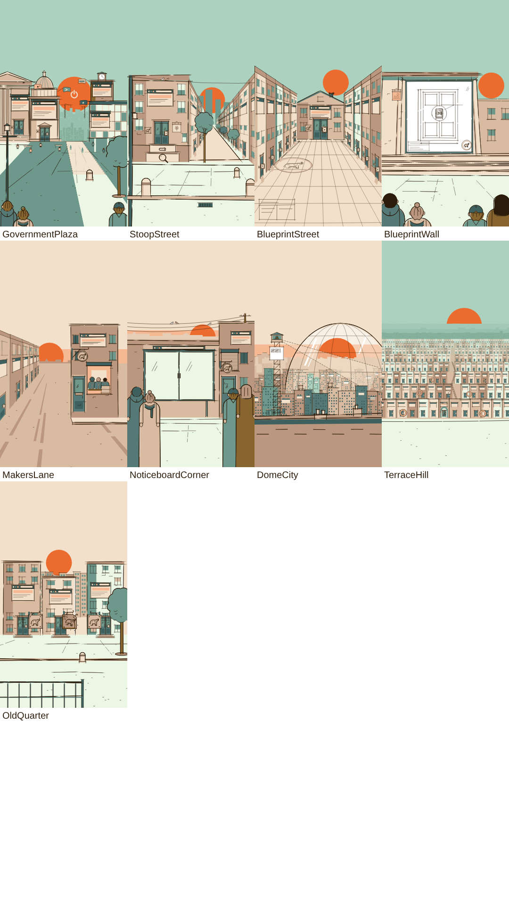

# SHARED SETS: the sets lane of the shared world kit

`src/scenes/shared/sets/**` (barrel: `src/scenes/shared/sets/index.ts`). Props live in `src/scenes/shared/props/**`
(docs/SHARED_PROPS.md); sets place props through ONE adapter file, `sets/propSlots.tsx`.

```tsx
import {GovernmentPlaza, PLAZA, StoopStreet, Stoop, StoopBeats, stoopStreetDoors, BlueprintStreet, BlueprintWall,
  MakersLane, Workshop, WORKSHOP_CORNER, NoticeboardCorner, TelephoneWires, WIRES, DomeCity, DomeTallies, domeArcY,
  TerraceHill, TerraceRings, TERRACE, TERRACE_FLAT, OldQuarter, SiteFacade, PerspRow, Foreground, groundMarks,
  GroundMarks, People, Furniture, EdgeFigure,
  // storyboard v3 (section 9)
  PLAZA_CIVIC, PLAZA_SHUTDOWN, plazaShutdownGov, crtPhase, CRT, rewindStep, latestState, domeArc, blindSignAnchor} from '../shared/sets';
```
`SET_CATALOG` (storyboard-v1 demo times, the preview DemoWorld / DemoSun) is NOT in the barrel: it is preview-only, and
SetsPreview / SharedKitSheet import it from `sets/catalog` directly, so no demo choreography reaches the film bundle.



## 0. Preview (its own Remotion entry: the shared registry stays untouched)

```bash
# one frame (or several) of a set preview: node <render.mjs> SetsPreview <outDir> <t1,t2,..> --props='{"set":..,"variant":..}'
node src/scenes/shared/sets/preview/render.mjs SetsPreview /tmp/o 1.2,3.6 --props='{"set":"plaza"}'
node src/scenes/shared/sets/preview/render.mjs SetsPreview /tmp/o 0 --props='{"set":"plaza","variant":"lineArt"}'
node src/scenes/shared/sets/preview/render.mjs SetsSheet /tmp/o 2          # every set's thumbnail
```

| set id | variants |
|---|---|
| `plaza` | (S01 demo build), `lineArt`, `off`, `closeup` (S11, `PLAZA.closeup` zoom 1.6), `dive` (`PLAZA.dive` zoom 2.4 into govB's lock box), **v3**: `v3` (S01 on the take: frame 0 = the press, CRT wave, civic skyline, govC half, lettered tags), `rewind` (S12: the shut-down state, the stepped rewind, ends = frame 0) |
| `stoop` | (S03 steps), `draw` (entrance draw-on), `tower` (S04: tower, seasons, ivy, cobweb), `night` (S09: night + check + ledge), **v3**: `v3` (S09 A: dusk key, lit windows popping off, dawn wipe up at 1.5 s, the sun RISING at the VP from the set's own sun slot, crate) |
| `blueprint` | (S02 wide: grid, stamp, pop-up, plaque count), `closeup` (zoom 2.0 on the lock), **v3**: `v3` (+ the title-block card L3 -> L4) |
| `wall` | (S05 at zoom 1.08), `draw` (blueprint draws outward from the lock), **v3**: `v3` (S05 at zoom 1.13 + the two-line L6 slip (205-650, 688-784) in the clean top margin; the bottom rail is default) |
| `lane` | (S06), `corner` (the same Workshop, S07 preset, + a blind sign), **v3**: `v3` (blind down + 'still fixing...') |
| `corner` | (S07) |
| `dome` | (S08 rest), `crane` (S08 start, zoom 1.3 on (540, 1260)), `push` (15 %), `dusk`, **v3**: `v3`, `v3crane` / `v3push` (multiplane by `DOME.depths` = S08's tuned table), `v3dusk` |
| `terrace` | (S10 pull-back 6.0 -> 1.0, + TerraceRings), `match` (zoom 6 hidden-match frame), `rest`, `flat` (sea of doors), **v3**: `v3` (pull-back + keeper + check-box wave), `v3match`, `v3rest` |
| `old` | (S12), `board` (S13 at zoom 1.12), **v3**: `v3` (S10: half old with readable gap plaques, support tags, caretaker tag, A-frame sign, cart, gap walker up the gap + bike) |

Demo event times live only in `sets/catalog.tsx` (storyboard v1 values), including the demo beat overlays
(`StoopBeats`, `TerraceRings`, `DomeTallies`). `SET_CATALOG[i].thumb()` renders a set at rest without a World (the props
lane's `SharedKitSheet` draws them in its bottom band; golden sets are wrapped in `<Tod value="golden">`). The preview
`DemoWorld tod="golden"` relights a set like a scene's World does (golden = the day sky + the core `todSteps.golden`
row); `DemoSun` is pinned (`drift={[0, 0]}`) so a preview frame shows the sun SLOT exactly (a scene's `<Sun>` drifts
10 px/s by default: see the S01 note in section 3).

## 1. The contract (every set)

- **World coordinates = canvas px at that scene's camera rest** (the storyboard numbers, 1080 x 1920). Sets author
  `world.bleed` past the frame edges for pushes, cranes and camera-continuous transitions. `x / y / scale` on a set only
  offset the whole set (thumbnails, reuse); they never change its layout.
- **Build-out on every set:** `outAt` / `outDur` (default `MOTION.unbuild.total`) run the measured un-build (lines
  loosen, fills shrink, slab collapses) on just that set, like every prop's `outAt`; scene-wide exits still use the
  engine's `ExitProvider` / `UnBuild` around the whole scene. Shared base type: `SetBase` in `common.tsx`.
- **Seconds, every event a prop.** Nothing is hard-coded: build-ins are `at` / `drawAt` / named `...At` props in scene
  seconds. Convention: a missing BUILD time = already built; a missing EVENT time = never happens.
- **Sets are LOCATIONS + anchors.** Storyboard beats that may move with a script rewrite live in small overlay
  components that read the set's anchors: `StoopBeats` (riser glyphs, tower, check, peach riser, ledge; pass it to
  `StoopStreet heroSlot`), `TerraceRings` (the 12 target rings), `DomeTallies` (the watchtower board count). States of the
  location itself stay on the set (shutters, lights out, lit windows, the plaque / Bit waves, the fixed door).
- **No fades.** Pop-ups (scaleY 0 -> 1.06 -> 1), 1-frame pops, wipes, draw-ons, swings. Static translucency only for light
  (the plaza sun path, the dome searchlight), and light exists only in the coloured state.
- **The World owns the sky and the camera.** Sets never draw the sky (exceptions: flat horizon bands, night stars, the
  dome's lighter glass sky). Put the scene's `<Sun>` in the set's `sun` slot: it is drawn exactly where it must sit in
  depth (behind the far city / rows / roofs).
- **Multiplane:** `wrap={(name, nearness, node) => <Layer depth={1 - nearness}>{node}</Layer>}` splits any set into its
  layers (nearness follows the storyboard: 0.05 sky ... 1.0 foreground). Layer names are listed per set.
- **Ink by depth** (4.8 / 3.4 / 2.2 / 1.6, far layers fill-only; the plaza's nearest building govD 4.0). Ink is in world px and scales with the camera (like the
  reference push-in). Exceptions: `detail="close"` thins govB (S11 close-up); TerraceHill uses a SCREEN-space ladder
  (row 0 3.4, row 1 2.2, rows 2-3 1.6, then none) with a world-unit floor for its zoom-6 match (row 0 0.85): on-screen
  width = max(world x zoom, screen), so there is no pop across the pull-back (`terraceInk(k, zoom)`).
- **Haze ladder** (style_bible_ref2 8): far layers are fill-only and step toward the sky, day `#84B09C` -> `#98C0AE` ->
  sky; on golden skies `HALF.sand` (#E6CEB6). No per-house rects under ~6 px at rest: distant rows collapse into stepped
  skyline bands with a few >= 3 px window dots (TerraceHill, the plaza's far city).
- **The layer against the sky sits 1-2 palette steps off it.** On golden (cream) skies no facade whose top meets the
  sky is cream (sand / tan, or half-sand for far silhouettes); the dome glass uses `glassStep` (never paper-white).
- **Ground = one flat field** with 2-3 broken kerb lines, a few broken paving lines that die toward the viewer and
  sparse specks (`groundMarks`, section 2); never a full perspective tile grid (BlueprintStreet's grid is the blueprint
  sheet laid on the street, drawn with the ink rules). **Foreground**: every street set takes `foreground` (ground.tsx
  presets). Review 5: the DEFAULT near layer sits INSIDE the visible band (y 1150-1500), because the platform UI covers
  the bottom band on a phone: a back-view figure cropped by a side edge (`edgeL` / `edgeR`, the plaza's left onlooker,
  the dome's observer) or a tree crown at a frame side; kerbs / railings / bottom heads remain as extra framing.
- **Life** (review 5, `life.tsx`): every street set has a seeded `people` layer (2-3 back-view walkers / standers at
  0.10-0.24 H on documented pavement anchors `SET.walkers`, `riseAt` / `walk` in seconds, `false` = nobody) and 1-2
  ink-led street-furniture props (`furniture`: bike, bench, planter, the makers' cart). Scenes stop re-inventing
  placement; they pass `people={false}` where the story says nobody (S04) and their own walkers otherwise.
- **Misregistration** is per object (core `Fill`); TerraceHill and the props use SCREEN-space offsets (/ zoom).
- **Render states**: `<Look fills="paper">` (line art), `<Look cascade>`, the un-build and `<Tod>` relight all work: sets are
  built from core `Ink` / `Fill` (batched paths where numerous). `LightsOut` = one palette step darker (`stepDarker`:
  cream -> sand -> tan, mintPale -> sage -> teal -> tealDark, peach -> tan; whites stay white); `Glass` = the dome glass
  (`glassStep`: a full step lighter for mid / dark tones, HALF a step for light ones: cream -> #F9F0E5, sand -> #E6CEB6,
  peach -> #F5CCAF); `Lighter` = a full step lighter. Night scenes that must KEEP day facades (S09) use a plain sky colour
  key, not `tod: 'night'`, and relight only their ground with `NightGround` (mintPale -> sage, cream -> sand, sand -> tan).
  Glows are `GlowDiscs`: OPAQUE stepped discs (never translucent rings), coloured state only.
- **Props via slots.** `propSlots.tsx` maps each slot to the props-lane component (Lock, ElephantPlaque, Bit, BrowserChrome,
  RollerShutter, ShutterPadlock, BackSoonTag, Bollard, Calendar, RailBoard, CheckFlag, TargetRing, WrenchTag, Magnifier,
  WrenchGlyph, ElephantStamp, ElephantEmblem, Citizen, EdgeOnlooker, Maker, MailSlot, CheckMark, QuestionMark). Change a
  prop's look there once and every set follows. Hero locks take the props-lane `LockProps` directly (`heroLock`, `lock`,
  `house4Lock`), so scenes drive screws / cover / bolt / cobweb / drop / pop-on through the set.
  Props kitv3b (no set file changed): every set figure follows the props fixes automatically: `OnlookerSlot` `acc:
  ['collar']` now draws a straight collar band (no V; under `hair: 'cap'` the BackHead band only), seeded sand hair on
  onlookers / citizens / makers becomes ochre or ink-brown (clay too on the citizens' and makers' plain-disc heads), and
  raised phones use the jointed arm with a hand on the phone. `CitizenSlot` / `OnlookerSlot` do not forward the new
  `hairColor` prop yet (sets lane: add it to the slot types if a set needs to pin a colour).

## 2. Building blocks

### Ground and foreground (`ground.tsx`)

```tsx
const g = groundMarks({vp, top, bottom: 1920, x0, x1, rays: 4, cross: 2, specks: 16, reach: 0.6, seed})  // pure paths
<GroundMarks marks={g} width={SI.far} />        // tapered broken lines + 3-10 px specks
<Foreground spec="kerb" | "heads" | "railing" | "treeL" | "treeR" | [...] | node | false at={...} />
```
`groundMarks`: 3-6 paving lines on rays to the VP, each 2-3 pen strokes with gaps, starting near the far edge and dying
by `reach` of the way down; 1-2 partial, broken cross joints; seeded specks (bigger near). `avoid(x, y)` keeps marks off
paths / props. Foreground presets (world coords at rest): `edgeL` / `edgeR` = a big back-view figure (props
EdgeOnlooker, head 124 at (46 | 1034, 1330), the near arm, a rim strip) cropped by the side edge, its head INSIDE the
visible band, coat running off the bottom; `treeL` / `treeR` = a teal crown r150-165 centred at y 1310 (in the band) cut
by the side edge, trunk into a tree pit at y 1640; bottom-band framing (under the platform UI): `heads` = 4 back-view
heads + shoulders at x 70 / 300 / 800 / 1015, the centre open; `kerb` = a sand kerb band at y 1660 with bold broken
lines, bollards at x 160 and 1046 and a drain grate; `railing` = a low iron railing (top rail y 1710) from the left edge
to an end post at x 700. Defaults: StoopStreet `['kerb', 'edgeL']`, BlueprintWall `heads`, OldQuarter `railing` (+ its
in-band tree and left stander; none while the S13 audience is on); GovernmentPlaza, NoticeboardCorner, DomeCity and
TerraceHill frame themselves (plaza left onlooker in the band, readers, the dome observer, the terrace standers).

### Street life (`life.tsx`, review 5)

```tsx
<People anchors={STOOP.walkers} vp={STOOP.vp} spec={people} />     // what every street set draws for you
people={false}                         // nobody (S04's "nobody did")
people={{riseAt: 1.2, walk: 1.6}}      // rise in (0.33 s out-exp, 0.06 s stagger), start walking at 1.6 s
people={{n: 1, walk: false}}           // only the first anchor, standing
people={{n: 1, walk: 2.1, stop: 3.4}}  // walk away from 2.1 s, stop (and stand still, no bob) at 3.4 s
people={{walkers: [{x, y, h, go: 'vp', body, hair, acc}]}}        // replace the anchors
<Furniture items={[{kind: 'bike' | 'bench' | 'planter' | 'cart', x, y, s, flip, at}]} />
<EdgeFigure side="L" y={1330} head={124} riseAt={...} />           // the in-band edge figure (any set, any spot)
walkerAt(anchor, vp, t, walkAt)        // feet / height of a walker at t (to place a prop on someone)
```
Walkers are props `Citizen` (back view, legs). `go: 'vp'` walks AWAY along the anchor's ray to the set's vanishing point
at constant speed in depth (`pace`, default 5 % farther per second) and shrinks with perspective; `go: 'stand'` idles
(bob 1.2 px). Nobody walks toward the camera or sideways (people are always seen from behind). Heights come from each
set's eye-level camera, h = (feet y - horizon) / 1.1. Furniture: kit `Bike` (ink only), a sand bench (150 px at s 1), a
tan planter with a sage shrub (110 px at s 1), props `MakersCart` (160 px bed at s 1).

### SiteFacade (S0) — a website building, frontal (or on a core `<Plane>`)

```tsx
<SiteFacade x={30} y={1300} w={315} storeys={6} storeyH={101.7} fill={palette.cream} browser={[100, 880, 190, 130]}
  door={[150, 1150, 90, 150]} plaque="new" lock="closed" at={61.2} offAt={...} lit={...} chromeAt={...} seed="L" />
siteFacadeLayout(props) // -> {top, browser, door, plaque, lock, windows, step}
```
x = left, y = base. Parts: brick hints, tan shade plane on the left 25 %, cream rim strip on the sun side, cornice band,
partial window panes, chunky browser window (BrowserChrome), teal door (`FacadeDoor`), plaque + lock slots. States: `at`
pop-up, `drawAt` fill-first draw-on (ink top -> bottom), `offAt` lights out (screen goes tealDark), `lit` night windows
(number = switch-on time, seeded order over `litSpan`). `lod`: `full | simple | dots | fill | auto` (auto by on-screen
width; pass it explicitly inside a `<Plane>`). `slots.{browser, door, plaque, lock}` replace parts per instance.

### PerspRow / perspRowLayout / quadRowLayout — receding rows of website houses, cheap

```tsx
const row = perspRowLayout({quad: wallQuad({vp, x: 520, top: 660, bottom: 1370, depth: 0.9}), n: 16, storeys: 4, side: 'left'})
const row2 = quadRowLayout({quads: [...], side: 'right', plaque: (i) => ..., plaqueK: 0.16})   // one quad per house
<PerspRow layout={row} popAt={(i) => ...} plaqueAt={(i) => ...} lit={night} litColor={palette.sand} lock={(i) => 'ghost'} />
row.houses[i] = {h, tier, door (quad), overDoor, lock {x, y, h}, plaque {x, y, size}, browser (quad), base, top, ...}
```
Every house is a handful of batched paths computed once in screen space through the wall homography; real props
(Lock, ElephantPlaque) only where the lock is >= `propMin` px (7), flat dots beyond. Ink 2.2 -> 1.6 -> none by tier
(`full` >= 330 px tall, `simple` >= 120, `dots` >= 36, `fill`).

## 3. Sets

### S1 GovernmentPlaza (S01, S11, S13 underlay = frame 0) — PEAK 1

```tsx
<GovernmentPlaza state="built" cascadeAt={0.03} sun={<Sun .../>}
  gov={{govA: {chromeAt, screenOnAt, shutterAt, offAt, tagAt, tagTapAt, padlockAt, glintAt}, govB: {...}, govC, govD}}
  pennantsAt={[1.23, 1.38, 1.53, 1.68]} pennantWaveAt={...} citizensAt={1.06} phonesAt={2.05}
  lanternOffAt={3.25} pigeonsAt={1.7} pigeonsFlyAt={3.3} />
<GovernmentPlaza state="lineArt" />   // frame 0 / the S13 un-build underlay (ink-only browser chrome by default)
<GovernmentPlaza state="off" />       // the S01 end state = S11's hard cut
<GovernmentPlaza detail="close" windowSlot={(id, r) => id === 'govB' ? <BrowserChrome ... progress={...} ring={...}/> : undefined} />
```
- **States share every path and seed** (pixel-identical geometry). `lineArt`: ink on white fills, people as white
  tombstones, browser chrome in INK ONLY (bar outline, dot rings, pill: frame 0 already says "building = website" on a
  silent autoplay; `chrome={false}` restores storyboard v1's plain windows — a proposal for the storyboard, see section 8),
  no pennants, no light. `built`: colour (optionally the cascade from the sun gap, `PLAZA.cascadeOrigin`) + the timed
  events. `off`: chrome on, every shutter down, padlocked and tagged, every building one step darker, the lantern sand,
  pennants up, the sun path and the clock face still bright.
- **PEAK-1 scale (review 5)**: the architecture is ~1.35x taller under the SAME y-600 ceiling: bases at y 1400-1470
  (was 1200-1290), the horizon / VP low at (720, 1384) = 0.72 H, so the plaza is shallow and the sun path sits in the
  visible band. govA Columned Hall x -40..400: the FULL colossal order (pediment apex (180, 614), entablature 712-794,
  two pairs of 46 px columns x 28/82 and 298/352 rising 806-1392, stylobate 1404, a 3-step crepidoma to 1462) with its
  browser window (118, 906, 144, 108) and door in the wide central bay (nothing covers a column). govB Domed Capitol
  x 396..640 (the hero): lantern tip (518, 600), dome ry 140, a TALL drum 792-904, cornice 904-926, facade to 1402, 3
  steps to 1450. govC Clock Tower x 800..1000 behind govD (spire 606, clock (870, 670) r26, window above govD's roof).
  govD Modern Ministry x 790..1240 (cut by the right edge), roof 880, base 1470: the NEAREST and biggest mass (ink 4.0).
  The sun gap x 640..790 holds the far city and the sun (kit v3b: the civic skyline in three depth tiers ending on a
  horizon line at y 1166, with the plaza's far steps below it; `farCivic={false}` = the old block city with two cranes). Colossus (the 4-building wall, cut by both
  edges: >= 1.0 W) vs readable citizen ~13:1.
- **People**: 6 READABLE back-view citizens 55-75 px on the VP axis (feet y 1452-1494, heads just under the horizon),
  4 x ~40 px far texture (two on govA's steps, two silhouettes deep in the gap); `phoneIdx` [2, 5] raise phones. The
  left onlooker is cropped by the left edge INSIDE the visible band (head (52, 1452)): the near layer a phone still
  shows; two more heads in the bottom corners (under the UI: framing only).
- **Ground** (kit v3b default `ground="light"`): one flat mintPale plaza field from the horizon with ONE sage shade wedge
  from govA's side (from the kerb under govA / govB's steps, x <= 440 at y 1460, diagonally down-left to x ~150 at the
  frame bottom: ~27 % of the visible plaza), so the teal / dark figures stand on a LIGHT ground; `ground="sage"` = the
  review-5 look (two sage wedges from govB's and govD's sides, ~60 % of the plaza). The
  cream sun path from the gap (668-774 at the horizon) widening to (700-930, 1530), 5 broken paving lines and specks
  (no tile grid), kerb lines in front of govA, two benches. Near layer: the lamp post at the left edge (x 50, lantern
  1066, crossbar 1126 with the pigeons), the tree cropped by the right edge in front of govD's ground floor (pit 1558),
  Pip's bollard. `foreground` takes extra presets (default none).
- **Anchors** (`PLAZA`, `PLAZA_REST`): `horizon` 1384, `vp` (720, 1384); sun slot (720, 900) r155 (frame 0 mid-rise
  (720, 950)); Pip's bollard top (812, 1426) 50 x 90; Bit (262, 742) on govA's cornice band, `bitSize` 22 (rendered by
  the set, `bit={false}` when the scene animates him); per building `window / door / padlock / tag / pennant / lock /
  plaque`; govB lock box (543, 1318) 22 x 27; clock (870, 670) r26; citizens, onlookers, pigeons, lamp; `closeup` =
  camera (518, 826) zoom 1.6 (lantern at screen y >= 603, window at screen x 374-707, y 1191-1425), sill y 1122;
  `dive` = camera (535, 1264) zoom 2.4 (the lock box lands at screen (560, 1090) at 52 x 65, S02's lock).
- **The sun in S01**: the gap is 150 px wide and the power glyph (r 0.37 x 155 = 57) fills most of it. A scene `<Sun>`
  drifts 10 px/s right by default, which slides the glyph behind govD after ~3 s: in S01 pin it, drift it up / left, or
  keep the total drift under ~12 px.
- **Layers** (`wrap` names / nearness): `sun` 0.12 (behind the far city), `far` 0.1, `ground` 0.7, `buildings` 0.55 (govC,
  govA, govB, Bit, 3 pennants), `govD` 0.62, `light` 0.7 (shadow wedges, sun path, joints, benches, citizens), `near` 1.0
  (lamp post + pigeons, tree, bollard, onlookers).
- Ceiling: nothing above world y 600 inside x 90-990 (lantern tip 600, spire 606, pediment apex 614); windows, padlocks
  and tags end at x <= 946 (out of the right rail).
- Note: in `built`, `citizensAt` makes the citizens RISE (absent before); omit it to keep them standing from frame 0 (the
  line-art frame always shows them).

### S2 StoopStreet (S03, S04, S09, S10 Part A) + Stoop

```tsx
<StoopStreet tod="day" sun={...} drawAt={...} chromeAt={...} heroLock={{cobwebAt, screwsOutAt, dropAt, rider, state: 'fixed', popOnAt}}
  stoop={{step1At, step2At}} heroSlot={<StoopBeats magnifierAt wrenchAt towerAt towerDownAt checkAt peachAt ledgeAt ledgeDur />}
  rowLock={(side, i) => 'ghost'} calendar={<Calendar ... tearAt={[...]}/>} season={[{t, s: 'green' | 'peach' | 'tan' | 'bare'}]}
  ivy={0.6} pigeonsFlyAt={...} foreground={['kerb', 'edgeL']} people={{walk: 0.4}} furniture={STOOP.furniture} />
<StoopStreet people={false} foreground="kerb" ... />   // S04: nobody did
<StoopStreet tod="night" nightUntil={1.6} />     // stars, peach windows, opaque lamp glow discs, tower dots, night ground
stoopStreetDoors()  // [{id: '#4' | '#5'.. | 'R1'.., side, overDoor, lock, plaque, h}] near -> far (ripples, "?", tags)
towerRise(t, towerAt, towerDownAt)  // the tower's height (camera tilt sync); never negative (the tower is an overlay)
```
- VP (720, 1060); hero house (40, 640, 480, 590); browser (170, 760, 220, 140); door #4 (230, 1030, 120, 200); lock4
  (330, 1130) 34 x 42; plaque4 (175, 1105) 50; calendar slot (385, 1040, 70, 80); step 2 riser (190, 1230, 220, 70), step 1
  (160, 1300, 280, 70); magnifier (300, 1335) r28, wrench (300, 1265); tower x 160-300 to y 700 (2 % overshoot up, 6 %
  undershoot down; the magnifier rides up at the top face); ledge (410, 1230) -> VP; lamp post x 0-60, wire (40, 650) ->
  right row, pigeons; near tree (655, 1040); bollard (930, 1420). Rows: 16 left doors, 22 right doors.
- `Stoop` is the location (two steps, pop-ups, draw-on); `StoopBeats` is the overlay of the S03-S09 beats (it reads
  STOOP anchors; magnifier / wrench `-1` = already there).
- Ground: pavement = one flat field with 4 broken paving lines + specks; default `foreground: ['kerb', 'edgeL']` (a
  hooded back-view figure cropped by the left edge, head at y 1330, in front of the lamp post; S04 passes `'kerb'`).
- Life: `STOOP.walkers` = a backpacker (792, 1240) h164 and a far walker (742, 1150) h82 heading up the road to the VP
  (clear of the near tree), a stander on the right sidewalk (888, 1338) h252; `STOOP.furniture` = a planter right of the
  stoop (482, 1394), a bike on the near pavement (760, 1446). Nothing on the stoop (x 160-440) or door #4.
- Far towers (review 5): the city beyond the VP on the day haze ladder (#98C0AE farther pair, #84B09C nearer pair:
  lighter than the facades, stepping toward the sky), stepped set-back tops with a mast / tank, a few 3.5 px window dots;
  at night the same silhouettes in tealDark with peach dots.
- Layers: `dawn` 0.1 (the dawn peach horizon band only), `sun` 0.12, `far` 0.1, `ground` 0.4, `rows` 0.4, `hero` 0.7
  (hero house + Stoop + heroSlot), `people` 0.8 (furniture + walkers), `near` 1.0. Paint order: dawn band -> sun slot ->
  far towers, so a sun rising at the VP (S09 'with') shows OVER the band between the towers.
- S09 night: use a World sky colour key (`skies.night`), not the World's `tod: 'night'` (facades keep their day fills);
  with the set's `tod="night"` it relights its ground plane, road, sidewalk, horizon strip and the foreground kerb with
  the night mapping (mintPale -> sage, cream -> sand, sand -> tan) and draws the lamp glows as opaque peach /
  half-peach / cream discs. Dawn = World `wipe: 'up'` to cream + this set's peach band (`dawnAt` / `nightUntil`).

### S3 BlueprintStreet (S02)

```tsx
<BlueprintStreet popAt={{L1, ..., R4}} pressAt={...} plaqueAt={{P, L1, R1, L2, R2, L4, R3, L3, L5, R4}} gridAt={7.07}
  stampAt={8.1} ventAt={...} signSwingAt={...} blinkAt={...} lock={{screwsOutAt, coverOpenAt, boltTestAt, gapMarkAt, rider}} sun={...} />
blueprintAnchors()   // {P, L1..L5, R1..R4: {plaque, lock, overDoor, base}}
BLUEPRINT.closeup    // {cam: [580, 960], zoom: 2.0}: the close-up framing of the same world
```
Press house 360..760 (apex (560, 770), eaves 870, base 1180), window (470, 900, 180, 110), door (500, 1010, 120, 170),
lock (595, 1100) 40 x 50, plaque (455, 1085) 50, pen-nib sign r34 at (795, 930), vent puff; side buildings at the
storyboard's screen boundaries (7 PHP plates P L1 R1 L2 R2 L4 R3, 3 blank L3 L5 R4). The floor (review 5) is a sand
street with a cream PLAN laid on it: a visible paper far edge at y 1238 (58 px of street show in front of the press house)
with a white dog-eared far-left corner, side edges just inside the kerbs, a margin line (inset 14 -> 40 px) with
dimension ticks along the far and left edges, dimension arrows inside the margin, a title block (190, 1700, 280, 160). The
grid follows the ink rules: every line is 2-4 broken pen strokes, rays overshoot the far edge by 15-30 px, cross lines
overshoot the side edges by 30-60 px, and the weight thins with distance (3 groups: near 2.0, mid 1.4, far 1.0 px, drawn
on near -> far from `gridAt`). Stamp (330, 1400) 320 x 120 sits on the sheet's left margin. `BLUEPRINT.walkers` (a walker
on the right heading for the press house, a stander by the stamp) are OFF by default (`people` opt-in: S02's lock
close-up needs the doorway clear). Layers: `sun`, `far`, `ground` 0.8, `press` 0.5, `sides` 0.6, `people` 0.9.

### S4 BlueprintWall (S05)

```tsx
<BlueprintWall drawAt={...} lock={{gapMarkAt, ...}} stampAt={...} calendar={<Calendar .../>} foreground="heads" sun={<Sun cx={930} cy={725} r={110}/>} />
```
Facade x -140..800 (pilasters lean ~5 deg), cornice 610-650 + tan band + sage shadow band, wing x 800-1220 (roof 840),
the sun notch, steps 1320-1480, ground below. Banner on a rod at y 680, sheet (200, 680, 576, 620), teal frame 12, the
LOCK DETAIL = props Lock `state="blueprint"` at (488, 960) size 75 (draws first: everything else draws outward from it),
stamp r40 (720, 1230). The forecourt is one flat field (4 broken paving lines + specks); default `foreground: 'heads'`
(an audience looking up at the blueprint, under the team's feet line). Anchors: `BLUEPRINT_WALL.perch` (700, 680),
`.calendar`, `.feetY` 1470. Layers: `sun`, `wing`, `facade`, `banner`, `steps`, `foreground`.

### S5 MakersLane + Workshop (S06; Workshop reused as the S07 corner)

```tsx
<MakersLane sun={...} curtainsAt={...} workshop={{glowAt, makersAt, blindDownAt, blindUpAt, signSwingAt, doorOpenAt, slotClickAt, chromeAt}} />
<Workshop layout={WORKSHOP_CORNER} blind="down" glowAt={false} makersAt={false} signSwingAt={...} doorOpenAt={...} />
```
Lane VP (430, 1040), sun (420, 985) r120 behind far-roof silhouettes, peach band 920-1040. Review 5, the ref-1 dusk-wall
recipe (sand / clay walls carrying tealDark / teal ~25-30 %, so S06 no longer plays into the beige S07): the left row
(PerspRow in sand / tan) has teal glass, teal shutters beside every window and a tealDark awning over every door
(`PerspRow glass / shutters / awning`); its curtains pop as PEACH lit panes at `curtainsAt`; a cream kerb strip runs along
its foot. The lane = one flat sand field with ONE flat teal shade wedge over the left third (the row's own shadow,
between its base line and a ray from the sun) and two WIDE, unbroken tan shadow wedges on rays from the sun (narrow far,
wide near: one direction) instead of the thin stripes, plus sparse specks. The Workshop sits on a cream kerb / step
plane (tread y 1500-1540, tan face to 1558) and a sand pavement brought FORWARD to y 1646 (cream kerb strip, tan face to
1676), so the dead lane is shorter. Life: `MAKERS_LANE.walkers` = two passers walking up the lane to the sun (512, 1250)
h190 and (360, 1340) h272, a stander in the shade (150, 1418) h340; `MAKERS_LANE.furniture` = the makers' cart parked on
the lane (300, 1600) s1.25 and a bike by the left row; clear of the Workshop door and the messenger's line (feet y 1520).
`WORKSHOP_LANE` (600-1000, roof 720: browser (680, 790, 220, 110), door (620, 1150, 100, 300) + MailSlot (670, 1300),
sign r45 (700, 980), shop window (740, 1060, 200, 240) + blind to 1180, bench + 3 Makers + crate) and `WORKSHOP_CORNER`
(780-1220, roof 700: door (800, 1150, 120, 310), sign r40 (850, 1080), blind window (800, 950, 140, 150)): one component,
one design. Anchors: `MAKERS_LANE.zzz`, `.messengerY`, `.pipY`, `.leakEntry`, `.walkers`, `.furniture`. Layers: `far`,
`sun`, `roofs`, `floor`, `houses`, `workshop`, `people` 0.85.

### S6 NoticeboardCorner (S07) + TelephoneWires

```tsx
<NoticeboardCorner sun={...} board={{riseAt, railLightAt, pane1: (r) => ..., pane2, paneDarkAt, pane2ScaleInAt}}
  workshop={{doorOpenAt, signSwingAt}} readers={{riseAt, phonesAt}} pigeonsFlyAt={...} />
<TelephoneWires spec={WIRES.S07 | WIRES.S08} pigeons={[{i, x}]} />   wireAt(spec, i, x) -> point (pegged copies)
```
Sand wall 0-780 (tan cornice 840-880 + bold roof line), far roofs in half-sand (#E6CEB6, so the cornice keeps its
silhouette on the golden sky), peach band 760-860, Workshop corner, pole (1000, 620-700), board frame (140, 930, 600,
430) + rail (220, 900, 440, 30) + legs to 1490 (props RailBoard), 4 edge readers (props EdgeOnlooker), ground = one
field with 3 broken paving lines + specks; `foreground` presets optional (default none: the readers frame it).
**Wire contract**: `WIRES.S07` = y 700 / 730 / 760 at x 540 (S07 world); `WIRES.S08` = 1211 / 1235.5 / 1260 (S08 world):
the same 3 wires on screen (896 / 928 / 960) across the tilt-up / crane cut. Anchors: `NOTICE_CORNER.pip` (705, 928),
`.cart`, `.readers`. Layers: `far`, `sun`, `roofs`, `wires`, `wall`, `ground`, `corner`, `board`, `readers`.

### S7 DomeCity (S08) — PEAK 2

```tsx
<DomeCity sun={<Sun cx={700} cy={990} r={165}/>} domeAt={...} domeDur={1.1} glassAt={...} footprintAt={...} dotsAt={...}
  duskAt={42.7} towerAt={...} searchAt={...} searchAngle={(t) => ...} sky={skies.golden} />
<DomeTallies n={count} />   // scene overlay: the count on the watchtower's white board
domeArcY(x)  tallyGatePath(x, y, size, n)  boardTallyPath(n)  DOME.{apex, feet, arc, rattlerDoors, tower, pip, stipple, rows, sun}
```
Rows 0-3 on the golden atmosphere ladder (row 0 half-sand / sand with the terraced-hill silhouette far left, row 1
sand, row 2 tan / sage + ink, row 3 tan / teal + ink; no row is the sky colour); every row is BACK-FILLED in the colour
of the row behind and the sun slot is clipped to y < row 0's base (1052), so the sun never shows below the first
skyline (dome draw-on, crane, dusk included). One bold 4.8 arc (260, 1300) -> (730, 700) -> (1200, 1300) drawn from both
feet up; inside it every fill takes the `Glass` step (the rows are drawn twice: the second pass clipped to the dome;
the glass sky is `glassStep(sky)`: #CCE4D2 on today's golden = day sky, the day sky #ACD1BF at dusk), cream rim strip, 3 white glint bars, 6 meridians + 3 parallels;
uncovered strip x 90-260 with 4 doors (rattler slots); dashed footprint; watchtower (rises, cabin with a sage window and
a back-view guard: shoulders, head, peaked cap; white tally board; searchlight: flat cream at a FIXED 0.55 opacity
with dashed edges, default sweep -20..+40 deg, drawn in the dome layer UNDER the arc / lattice ink).
Review 5: (a) the near layer is a real ROOFTOP: a PARAPET cut by both frame edges (`DOME.parapet`: a cream coping strip
sloping 1452 -> 1440 with doubled coping lines that overshoot, a tan face with joints to y 1600, our own sand roof deck
below with the parapet's teal shadow band), a brown chimney stack with two pots (x 590-690, top 1294) and the tealDark
antenna (x 990) standing ON the coping at near scale; Pip's perch `DOME.pip` (500, 1448) on the coping; one back-view
observer (`DOME.observer`, head (872, 1372) d104, a cap, never a hood: hoods belong to S08's attackers; `observer={false}`
hides him). (b) rows 2-3 carry 6-8 REAL BrowserChrome windows (dots + pill, 60-112 px wide, one per x quarter per row;
they pop with `dotsAt`); window grids are jittered (a dead column per building, 45 % seeded drop-outs, 30 % partial
fills top or bottom on rows 2-3, size / x jitter). (c) the guard is 56 px (the 34 px design x1.65) in a 124 x 86 cabin
(`DOME.tower.cabin` (128, 772)): the cabin reads as the figure. The rattler doors moved up to feet y 1428-1436 (above the
coping). Dusk: windows pop peach from the horizon outward; the glass
sky follows the dusk sage. Holds the crane start (540, 1260, 1.3) and the 15 % push. Layers: `sky`, `sun`, `city` 0.3,
`dome` 0.55 (glass, searchlight, ink), `near` 0.8, `fg` 1.0 (parapet, chimney, antenna, observer). The board count is `<DomeTallies/>`; the glass tallies on
the dome are scene choreography (use `tallyGatePath`).

### S8 TerraceHill / SeaOfDoors (S10 Part B) — PEAK 3

```tsx
<TerraceHill revealFloor={570} plaqueWaveAt={...} bitWaveAt={...} waveStep={0.06} extendAt={...} flagAt={...} fixedAt={...}
  house4Lock={{...}} mode="hill" | "flat" hazeFrom={8} foreground={...} sun={...} />
<TerraceRings at={...} />          // scene overlay (same camera): the 12 target rings, TERRACE.rings
TERRACE.{rows[k] {k, s, w, h, base, top, x0}, house4, matchCam, rings, flag, ridge, sun, hazeFrom}  terraceDoor(k, j, mode)
stairPoint(k, t, mode)  terraceInk(k, zoom)  TERRACE_HAZE
TERRACE_FLAT.{horizon 850, vp (540, 850), sun (540, 850) r240, rows, hazeFrom 6, avenue(j), avenueX}
```
`hill` (default): w_k = 90 * 0.8^k, h_k = 158 * 0.8^k, base_0 1500, base_k = top_(k-1) - 3 * 0.8^k (ridge ~700).
Rows 0-7 are houses (batched per row: fills per colour, a sand shade strip on the left 18 %, screens + bars, doors, plaque
/ lock / Bit dots never under 3 px; rows split into a core and two edge chunks, `extendAt` pops the edges). Ink by depth
in screen space (row 0 3.4, row 1 2.2, rows 2-3 1.6, none beyond) with a world floor for the match; per-house broken roof
lines with overshoot, a doubled cornice on rows 0-1, left wall edges (1 in 6 left open), window / door frames on rows
0-2. Rows from `hazeFrom` (8) on collapse into 3 haze bands (#84B09C, #98C0AE, #A2C8B6): stepped skyline blocks with a
few window dots and sand plaque specks that blink with the wave. House #4 is drawn in full detail (BrowserChrome,
FacadeDoor, plaque, props Lock `fixed`) at facade 482.5-572.5 x 1342-1500, window (500, 1372, 55, 35), door (515,
1439.5, 30, 50), lock (540, 1464.5) 8.5 x 10.5: at `matchCam` (540, 1407) zoom 6 it lands on Part A's door #4 / window /
lock and the cornice at screen y 570. THE FIXED DOOR: from `fixedAt` (default `flagAt`; -1 = on) two OPAQUE stepped glow rings in the SunGlowSteps language
(`TERRACE.fixedGlow`: cream r62, peach r46, centred on door #4, clipped at the street) behind a sage door, and a cream
path strip from the door down the near street (hill mode); the cream check flag (`TERRACE.flag`: foot (548, 1342), pole
90, 60 wide: the storyboard's legibility floor) flies over the tan house above it (hill row 1, j 0 is always tan). Rows
0-1 browser bars carry three cream dots (one extra batched path per chunk). Life: `TERRACE.walkers` = two back-view
standers on the near street flanking the path, looking up the hill, (372, 1690) h236 and (700, 1660) h206 (heads in the
visible band); default on in `hill`, off in `flat`. `revealFloor`: a row (or band) shows once
its top is below that SCREEN y (14 px spatial pop). Stairs zig-zag up rows 1-6 at x ~612 (`stairPoint`). The near
street is one mintPale field with two kerb lines and specks; S10's bollard + kerb are screen-space scene props.
`flat`: the same houses on a ONE-POINT ground plane (horizon 850, camera height 650 at scale 1): row k at scale 0.74^k,
base = 850 + 650 s, streets between the rows, house columns converging on the VP, an avenue every 7 columns (cream road
wedges to the VP seen through the gaps; row 0 gaps at x 122-212 and 752-842), haze bands from row 6 up to the horizon
where the sun sits half-set (its top at y 610, under the caption block). House #4, the flag and the fixed accent are the
same. The ring anchors are for `hill`; build flat ones from `terraceDoor(k, j, 'flat')`.
Layers: `sun`, `street` 0.9, `hill` 0.6 (ground plane + bands + rows), `house4` 0.6, `people` 0.95, `foreground` 1.0.

### S9 OldQuarter (S12, S13)

```tsx
<OldQuarter sun={...} sitePopAt={[tL, tM, tR]} plaqueSwingAt={...} oldPlaque={{flipOldAt, cobwebAt, dustAt, caneAt}}
  site={{M: {chromeAt, offAt}}} />
<OldQuarter board={{riseAt, railLightAt, pane1, pane2, paneDarkAt, pane2ScaleInAt, outAt}} audience={{riseAt}} />   // S13
```
Eye level 1150, bases 1300; siteL (30, 690, 315, 610) sand, siteM (360, 820, 280, 480) cream, siteR (740, 700, 310, 600)
mintPale (SiteFacades with browser windows, doors, locks, stoops; the facades whose tops meet the golden sky are a step
off it); hanging plaques (props ElephantPlaque `hanging`) at (300 / 590 / 800, 1190), siteM's turns old; street gap
640-740 with the second row (sand / tan, every third plaque old), far city and a peach band only in the gap; the tree is
cropped right and stands in a tree pit at kerb height (1464); sidewalk and street are flat fields with broken paving
lines + specks; kerb 1500, bollard (700, 1450); default `foreground: 'railing'` (none while the S13 audience is on). Rooftops (review 5,
`OLD_QUARTER.roofs`, all under the y-600 ceiling): siteL a teal MANSARD (690 -> 616) with two dormers, siteM a TV
antenna (x 616, clear of the sun disc), siteR two balconies (cream slab, sage glass rail) on its right bay, rooftop
plants and a water tank on legs (978, 618). Life (while the audience is off): `OLD_QUARTER.walkers` = a walker heading up
UP the street gap (696, 1262) h100 (v3: was (692, 1356) h186, which stood in front of siteM's plaque; pace 0.3, drawn
behind the cart line) and a stander cut by the left edge (64, 1478) h296; `OLD_QUARTER.furniture` = a planter
(420, 1486) and a bike by the tree (960, 1496); clear of the doors, the hanging plaques and the cart's line (y 1440). S13: board (300, 1090, 500, 310), rail
(380, 1060, 340, 28), legs to 1480; audience heads (90, 1290) (200, 1350) (890, 1320) (1000, 1280). Anchors:
`OLD_QUARTER.crates` (never siteM), `.pipBoard`, `.sun`, `.walkers`, `.furniture`, `.roofs`, `.gapPlaqueY`. Layers: `far`,
`sun`, `second`, `ground`, `sites`, `board`, `peopleFar` (people farther than the cart line), `cart`, `people`, `sign`,
`near`, `audience`, `foreground`.

## 4. Continuity contracts (storyboard section A)

| contract | where |
|---|---|
| frame 0 = S11 cut = S13 un-build: plaza `lineArt` / `built` / `off` share geometry; Pip's bollard top (812, 1426); Bit (262, 742) size 22 | GovernmentPlaza (review 5 PEAK layout, pending sign-off: section 8) |
| S01 govB lock box 22 x 27 at (543, 1318) -> S02 (props Lock size 27 / 50): `PLAZA.dive` camera (535, 1264) zoom 2.4 lands it at screen (560, 1090) 52 x 65 | PLAZA.gov.govB.lock, PLAZA.dive, BLUEPRINT.lock |
| S10 row-7 ring -> S11 govB loading ring in the close-up `PLAZA.closeup` (518, 826) zoom 1.6 | TERRACE.rings[7], PLAZA.closeup |
| S04 lock4 (330, 1130) 34 x 42 -> S05 blueprint lock (488, 960) 60 x 75 (props Lock `blueprint`) | STOOP.lock4, BLUEPRINT_WALL.lock |
| S10 Part A lock4 -> Part B house4 lock 8.5 x 10.5 at zoom 6 | TERRACE.house4, TERRACE.matchCam |
| S07 wires -> S08 wires (same screen height / spacing) | WIRES.S07 / WIRES.S08 |
| S08 sun set x 700 / S09 VP at screen (700, 1000) | DOME.sun; STOOP.vp (720, 1060) with S09's camera (560, 1020) |
| S10 row-7 ring r7 -> S11 loading ring | TERRACE.rings[7] |
| S06 workshop = S07 corner; S07 board = S13 board; S12 street -> S13; S03 street in S04 / S09 / S10A | Workshop presets; RailBoard in both; OldQuarter; StoopStreet |

## 5. Decisions (storyboard md vs JSON)

- S04 tower: JSON (600 px, top y 700), now in `StoopBeats`. S03 "everywhere": both supported (`rowLock={() => 'ghost'}`
  and wrench tags at `stoopStreetDoors()[i].overDoor`). S08 dome: JSON (~80 %, mirrored, action left). S10: `mode:
  'hill'` (JSON, default) or `'flat'` (md's "doors to the horizon", on a one-point ground plane). The S10 dive target
  stays the row-7 ring: rows 0-7 are houses, the haze starts at row 8. The S01 push (1.04 vs 1.08) and the S13 hope pose
  are scene / mascot calls.

## 6. Render cost

Review 5, measured with `preview/render.mjs`, full 1080 x 1920, concurrency 2, 12 frames over each demo (incl. page
setup) on a QUIET machine (load average ~1.1 on 4 CPUs; review 4's table was taken at load ~7, so the numbers are not
directly comparable: KitDemo idles at ~113 ms/frame).

| set (review 5 demo) | ms / frame |
|---|---|
| GovernmentPlaza (S01 demo: cascade, chrome, shutters, 10 citizens, 3 onlookers) | 133 |
| StoopStreet (+ 3 walkers, planter, bike, kerb + edge figure) | 127 |
| BlueprintStreet (broken-stroke grid in 3 weight groups, sheet edge, margin) | 146 |
| MakersLane (+ 3 passers, cart, bike, awnings / shutters batched per house) | 116 |
| DomeCity (+ parapet, observer, 7 BrowserChrome windows, jittered dots) | 115 |
| TerraceHill (during the 6x pull-back, + 2 standers, glow rings) | 116 |
| OldQuarter (+ rooftops, 2 walkers, planter, bike) | 125 |

The people layer costs ~5-8 ms per walker (kit Person); the BrowserChrome windows on the dome ~1 ms each. Rows, cities
and terraces stay batched (a few paths per house / row, the new shutters / awnings / bar dots ride in those batches);
static paths are memoised at module level; real props only where they are big enough to read.

## 7. Gaps / notes for scene builders

- Scene-owned by design: the sun (and its morphs), Pip, Bit's choreography (the plaza draws an idle Bit unless
  `bit={false}`), citizens' / readers' / walkers' timing beyond the slots (`people={{riseAt, walk}}`), where nobody
  should be (`people={false}`: S04), the beat overlays (`StoopBeats`, `TerraceRings`,
  `DomeTallies`: the sets lane ships them, the scene places and times them), S04 ghosts and leaf, S08 glass tallies /
  attempters / stipple, S09 flashlight and "?" ripple (anchors: `stoopStreetDoors()`), S10 keeper / snail / bollard
  (anchors: `stairPoint`, `terraceDoor`), the S11 progress bar (pass `windowSlot` for govB), crates and the ROLLING
  makers' cart (the parked one in S06 is `MAKERS_LANE.furniture`; pass `furniture={false}` when the scene rolls its own).
- Golden sets are previewed with `DemoWorld tod="golden"` (today's golden = the day sky + the core relight row): a scene
  must give its World the same `tod` for the warm light fields; the sets no longer assume a cream sky.
- The plaza's `built` cascade uses the core `<Look cascade>`; if a scene wants its own cascade, omit `cascadeAt`.
- Sets read the props through `sets/propSlots.tsx`; `NoticeboardPlaceholder` is kept there only for reference.

## 8. REQUESTS: need orchestrator / storyboard sign-off (review 5)

**R1. GovernmentPlaza PEAK-1 layout (S01 hook / frame 0 / S11 end / S13 underlay).** The art director judged the v1 frame
"a pleasant town square, not a peak" (architecture in a 0.32 H band, 36-44 px citizens, no visible near layer on a phone).
The set now ships the PEAK layout (section 3, S1) as its only layout; the trade-off and every anchor it moves:

| what | storyboard v1 | review 5 (shipped) | who must follow |
|---|---|---|---|
| building bases / horizon | 1200-1290 / VP (630, 1150) | 1400-1470 / VP (720, 1384) = 0.72 H | S01, S11, S13 framing notes |
| architecture band | y 600-1208 (0.32 H) | y 600-1470 (0.45 H), the 4-building wall cut by both edges (>= 1.0 W) | storyboard composition text |
| sun slot / frame-0 rise | (630, 800) r150 / (630, 850) | (720, 900) r155 / (720, 950), in a 150 px gap (x 640-790) | S01 / S11 sun, the S11 -> rest hop |
| sun drift | free | <= ~12 px total in S01 (10 px/s default drift slides the glyph behind govD after ~3 s) | S01 scene |
| govB lock box (S01 -> S02 dive) | (400, 1135) 16 x 20, zoom 3.25 | (543, 1318) 22 x 27, `PLAZA.dive` (535, 1264) zoom 2.4 -> screen (560, 1090) 52 x 65 (S02's landing unchanged) | S01 push-through `from`, scenes.json |
| S11 close-up | cam (375, 793) zoom 1.85, sill 1010 | cam (518, 826) zoom 1.6 (lantern >= screen 603), sill 1122; window 333 px on screen (was ~389) | S11 camera, S10 -> S11 ring dive target size |
| Pip's bollard | top (760, 1440) | top (812, 1426) | S01 / S11 / S13 Pip keys |
| Bit | (200, 705) size 16 | (262, 742) size 22 | S01 / S13 / loop |
| windows | govA 95,820,150,120; govB 270,860,210,150; govC 785,710,160,110; govD 775,960,155,120 | govA 118,906,144,108; govB 414,970,208,146; govC 812,734,132,106; govD 800,1004,146,124 | S01 chrome / shutter beats (times unchanged) |
| citizens | 9 x 36-44 px at y 1240-1300 | 6 readable 55-75 px on the VP axis (feet 1452-1494) + 4 x ~40 px far texture | S01 citizens beat (`citizensAt`, `phonesAt` unchanged) |
| near layer | 3 heads at y > 1700 (under the UI) | left onlooker in the visible band (head (52, 1452)) + 2 bottom heads; lamp post at the left edge (x 50), tree in front of govD | storyboard near-layer text |

Cost of saying no: the set would need the v1 geometry back (git history, review 4); nothing else in the kit depends on
it. Ask: approve the table (or name the anchors to keep), then the storyboard / scenes.json numbers above follow.

**R2. Frame-0 chrome (proposal for the storyboard).** `state="lineArt"` now draws the browser chrome in INK ONLY (bar
outline, three dot rings, pill) by default, so a silent autoplay's first frame and the loop's last frame already say
"building = website". The 'websites' beat still reveals the COLOURED chrome (tealDark bar, coloured dots) with the
cascade. Storyboard v1 says plain windows in line art: pass `chrome={false}` to keep that.

**R3. People in the storyboard.** Every street set now ships default walkers / standers (section 2, Street life). Scenes
whose beats need an empty street (S04 "nobody did") must pass `people={false}`; the storyboard may want to name the
walkers' `riseAt` / `walk` per scene.


## 9. Storyboard v3 additions (docs/storyboard_v3.json `requests.sets`)

Everything below is ADDITIVE: every v1 / review-5 export, prop and default keeps working. Preview variants (demo times
on the recorded take, `sets/catalog.tsx`): `plaza` `v3` (S01) and `rewind` (S12).

### GovernmentPlaza (S01, S11, S12)

```tsx
<GovernmentPlaza state="frame0" sun={...}                       // frame 0: govB's screen IS the bright line, all else lit
  gov={{govB: {screenOffAt: 0, shutterAt: 1.71, offAt: 1.85, padlockAt: 3.38, tagAt: 3.69, lanternOffAt: 3.96},
        govA: {screenOffAt: 0.63, shutterAt: 1.98, offAt: 2.12, padlockAt: 3.44, tagAt: 3.74},
        govC: {screenOffAt: 0.89, shutterAt: 2.35, shutterStop: 0.5, padlockAt: 3.5, tagAt: 3.79}}}
  civicOffAt={1.16} civicLanternsOffAt={1.41} phonesAt={1.41} phonesDownAt={3.04} lanternOffAt={2.69} />   // S01
import {S01_GOV} from '../scene01/plaza';                         // S01's own gov spec (lettered tags, rail offsets)
const g = plazaShutdownGov(-1, S01_GOV);                         // S12: EXACTLY the state S01 left (every event at -1)
// (plazaShutdownGov(-1) alone gives the same thing from the kit's copy of S01's numbers, PLAZA_SHUTDOWN)
<GovernmentPlaza state="built" idleOffset={-sceneDur} civicOffAt={-1} civicLanternsOffAt={-1} lanternOffAt={-1} phonesAt={-1}
  gov={{govA: {...g.govA, tagOutAt, padlockOutAt, liftAt, onAt, screenOnAt},
        govB: {...g.govB, tagOutAt, padlockOutAt, lanternOnAt, liftAt, onAt, screenLineAt},   // ends on the bright line
        govC: {...g.govC, tagOutAt, padlockOutAt, liftAt, screenOnAt}}}
  civicOnAt={2.24} lanternOnAt={1.94} phonesDownAt={0.86} />
```
- `farCivic` (default true): the far city in the sun gap is `PLAZA_CIVIC` = 6 fill-only civic silhouettes. **Kit v3b
  layout** (S01 review: the old dark step was ~1.3:1, the lanterns 5 x 9 px, and a ~150 x 280 px teal slab ran down to
  the plaza and merged with it on 'Europe'): left to right templeM, domeF, spireB, spireM, domeB, templeF in THREE depth
  tiers that shrink with distance (`depth` 0 back: spireB / domeB, 20-34 px wide, tops 966-982; 1 mid: templeM / spireM,
  30-48 px, tops 996-1030; 2 near: domeF / templeF, 60-64 px, tops 1036-1060), each standing on its depth's low roofline
  band (`PLAZA.civicBands` tops 1058 / 1092 / 1126; each silhouette owns a stretch `band` of it, with one raised roof
  block), all ending on the far city's HORIZON LINE `PLAZA.civicBase` = y 1166. Below it the plaza's far steps (a cream
  coping = the horizon line, three flights shrinking with distance, 8 / 12 / 20 px steps, cream nosings over half-sand
  risers, cream landings) run down to the plaza horizon (1384): a quiet light field under the skyline, no slab.
  Lit / dark per depth: back #A2C8B6 -> #6E9A88, mid #93BCAA -> #5E897A, near #84B09C -> #4E786A (a clear 1.7-2.1:1
  step; the depths ~1.2:1 apart when dark). Each silhouette's lit windows (drum windows, colonnade slits, clock face,
  band dots, >= 3 px) and its lantern (near dome 10 x 14 glazing, back dome 5 x 9) are cream and turn tealDark on the
  same step. `civicOffAt` (number = left to right 0.06 s apart, or an array per silhouette, PLAZA_CIVIC order: S11's
  6-array keeps working) steps each WHOLE shape (silhouette + its band stretch); `civicOnAt` relights them (number =
  right to left). `civicLanternsOffAt`: the two domes' lanterns turn tealDark (0.06 s apart; they relight with their
  dome). `tier` (0 / 1) is kept on each entry for old readers; `depth` drives size and colour. The old block city with
  window dots and cranes: `farCivic={false}` (unchanged).
- Per building (`gov.govX`), new: `screenOffAt` = CRT power-off of the browser screen (lit -> bright horizontal line ->
  dot -> dark, 0.15 s; the building stays lit until `offAt`); `screenLineAt` = from here the screen IS the bright line
  (from dark it steps back dot -> line); `screenOnAt` after an off = the reversed CRT (stepped); `liftAt` (+ `liftDur`
  0.25) = the shutter's slam played backwards, stepped; `onAt` = lights back on (undoes `offAt`); `shutterStop` (alias
  `stopAt`, a FRACTION) = a partial shutter (govC 0.5), the padlock and tag ride its rail; `tagOutAt` = the tag swings
  back up and pops off; `padlockOutAt` = the padlock pops off; `lanternOffAt` / `lanternOnAt` = govB's dome lantern on
  its own switch (else it follows the building); `tagProps` / `padlockProps` = extra props passed to the props-lane tag /
  padlock (the lettered 'back soon' tag once it lands). Without the v3 screen events the v1 behaviour is unchanged
  (`offAt` darkens the screen with the building).
- Set level, new: `state="frame0"`, `lanternOnAt` (the lamp), `phonesAt` / `phonesDownAt` (number or list; latest
  wins), `rewindFps` (12: the rewind's tape steps), `idleOffset` (seconds added to the idle clocks of Bit, the tree sway and
  the onlookers: S12 passes `-duration` so its last frame is pixel-identical to S01's frame 0; checked: 0 px differ).
- Helpers: `plazaShutdownGov(at, from?)`, `PLAZA_SHUTDOWN`, `crtPhase(t, ev)`, `CRT` {dur 0.15, rev 0.17, line 0.4},
  `rewindStep(t, at, dur, fps)`, `latestState(t, on[], off[], init)`, `PLAZA.civic`, `PLAZA.frame0` (sun (720, 900)
  r155, press 0.88).
- **The shut-down state = what S01 / S11 leave on screen.** `plazaShutdownGov(at)` returns S01's closures with S01's
  LETTERED 'back soon' tags and rail positions (`PLAZA_SHUTDOWN`, mirrored from scene01/plaza.tsx `S01_GOV`: tags
  govA 74 px at x 226, govB 104 at x 562, govC 62 at x 900; padlocks at x 152 / 462 / 838; govC half shut), never the v2
  clock tags. `plazaShutdownGov(at, S01_GOV)` takes S01's spec itself and returns it with every CLOSING event
  (screenOffAt, shutterAt, offAt, padlockAt, tagAt, lanternOffAt) at `at`, its look kept (shutterStop, tagProps /
  padlockProps lettered / size / text / x / y / inkPx) and every other time dropped (chromeAt, screenOnAt, glints, taps,
  twirls, rewind events): use it, and S12 opens on exactly S01's last state whatever S01 tunes. (S11 is a close-up of
  govB with its own lettered ['back', 'soon'] size-50 tag; S12 is a hard cut to the WIDE plaza, so S12 matches S01.)
  The rewind's tag swing-up / padlock pop now pivot on the tag's / padlock's REAL hang point when `tagProps` /
  `padlockProps` move it off the `PLAZA.gov` slot (they pivoted on the slot before: a visible jump on govC's tag).

### DomeCity + TelephoneWires (S08)

```tsx
<DomeCity dome="district" sun={<><SunGlowSteps cx={700} cy={1000} r={260} .../><Sun cx={700} cy={1000} r={260}/></>}
  domeAt={...} towerAt={...} searchAt={...} searchAngle={(t) => ...} dotsAt={...} duskAt={...} footprintAt={false}
  wrap={(name, nearness, node) => <Layer depth={1 - nearness}>{node}</Layer>} />
<TelephoneWires spec={WIRES.S08} />    // the 3 wires from the left edge to a rooftop pole at x 540 on our parapet
domeArcY(x, 'district')                // rim attempters on the district dome
```
- `dome`: `'wide'` (default: review 5, unchanged) | `'district'` (`DOME.district` {cx 390, by 1080, rx 210, ry 250}:
  feet (180, 1080) / (600, 1080), apex (390, 830), ~1/5 of the city) | an arc `{cx, by, rx, ry}` | `{feet, apex}`.
  Anything but 'wide' stages v3: glass step + cream rim + 2 glint bars (+0.07 s) + 4 meridians / 2 parallels; the
  WATCHTOWER at the right foot (`DOME.towerV3`: lattice x 600-650 from y 1100, cabin 600-650 x 892-934, roof apex 880) as
  a tealDark SILHOUETTE against the sun, dark cabin window, no guard (`towerAt` rises it); the SEARCHLIGHT from the
  cabin's left (598, 910) pointing LEFT at the dome: `searchAngle` = degrees below the horizontal, clamped -10..+25
  (`searchClamp`), length 520, cut so the cone never rises above world y 800 (= screen 600 at the baseline push); default
  sweep inside the clamp; `observer` default false; `doors` (default true) = the rattler doors.
- Anchors: `DOME.sunV3` (700, 1000) r260 + `glow` [1.25, 1.5] (outer ring top y 610; the sun slot is clipped below row
  0's base, so it is half-set); `DOME.rattlers.row3` = 5 doors x 110-455 with their feet just above the coping (y
  1438-1442, attempters 56-70 px); `DOME.rattlers.row2` = 6 doors across the width at street level y 1300 (x 50 / 210 /
  370 / 540 / 720 / 880, attempters 32-40 px), each in front of a LOW row-3 shed (top 1338) so door and figure show.
- v3 layers (wrap names / nearness = 1 - `DOME.depths`): `sky` 0 (band), `domeGlass` 0.02 (the glass sky, drawn under
  the sun), `sun` 0, `row0` 0.02 (+ its glass copy), `row1` 0.02 (+ glass copy), `dome` 0.02 (rim, glints, searchlight,
  lattice, arcs, tower), `row2` 0.25 (+ row-2 doors), `near` 0.62 (row 3 + row-3 doors), `fg` 1.0 (our rooftop).
- **`DOME.depths` = S08's tuned table** (scene08/layout.ts `F`; depths rows 0-1 / dome 0.98, row 2 0.75, row 3 0.38,
  rooftop 0, sky / sun 1). The storyboard's 0.85 / 0.7 / 0.45 / 0.2 (kept as `DOME.depthsStoryboard`) lift rows 1-3
  over the sun on the crane's first frame (camera (540, 1260) zoom 1.3), where the S07 match wants the sun HALF behind
  the skyline; with the tuned table the far rooftops sit on that skyline at the cut, row 3 stays mostly behind our
  parapet, the crane opens the city row by row, and rows 0-1 share the dome's depth so the glass copies stay registered
  on the arc through every move. The `v3crane` / `v3push` previews use it (they match the film's layering again).
- `WIRES.S08` now ends at a rooftop POLE (`pole` {x 540, base 1446 (coping), top 1178}; the wires keep the S07 / S08
  contract heights 1211 / 1235.5 / 1260 at x 540, where they tie off); draw the counter board AFTER the wires so it covers
  their ends. `WIRES.S08wide` = the review-5 wires across the whole frame. `WireSpec.pole` works on any spec.

### TerraceHill (S09 Part B)

```tsx
<TerraceHill revealFloor={570} flagAt={...} checkBoxWaveAt={...} bit={{outAt: ...}} keeper={{walkAt: ..., walkDur: 1.9}} ... />
```
- `checkBoxWaveAt` (+ `checkBoxStep` 0.085 = 0.6 s over rows 0-7; -1 = all there): EMPTY cream check-box tags over every
  door, batched per row, each row SPRINGING in (springs.pop: 0 -> 1.07 -> 1 about each tag's hang point, no fades); door
  #4's tag is the only TICKED one (props CheckBoxTag, the row-0 size, it springs + swings in with row 0). It replaces the
  wrench-tag wave (no set change needed: that was scene choreography). **Kit v3b sizes**: `TERRACE.checkBox` {hang
  (47.5, 64) house units, size 19, `k` 1.4, `minScreen` [22, 17, 13, 10]}: a tag is k x size x row scale (26.6 / 21.3 /
  17 / 13.6 px on rows 0-3 at rest) and never under `minScreen[row]` ON-SCREEN px at any zoom (rows 0-3), >= 4 world px
  beyond. Rows 0-3: a cream card with an ink outline (1.6 px on screen), an ink check box (2 px on rows 0-1, 1.6 on rows
  2-3) and a tealDark string loop (1.6 px); rows 4+: cream card + sand box (no ink). (Was 19 units: 16 px cream-on-cream on
  row 0, specks from row 2.)
- `bit`: Bit on house #4's right door jamb (`TERRACE.bit` (545, 1452) size 3, rot -90 = climbing: 18 px at screen
  (570, 1230) in the zoom-6 match); `true` or `{at, outAt, x, y, size, rot, flip}` (match Part A's pose).
- `keeper`: the keeper speck (props Keeper via `KeeperSlot`, `TERRACE.keeper`: 48 px, feet (581, 1500) beside door #4 ->
  (662, 1500) at door #5) walking on `walkAt` / `walkDur`, a dotted path (y 1513) drawing on behind him, then kneeling
  (`TERRACE.keeper.crouch` 0.86 + working hands) at `kneelAt` (default the arrival): 41 px kneeling at rest, so the held
  kneel stays >= 40 px (was 46 x 0.82 = 38); his ink keeps a 0.85 world floor through the pull-back.
  Layer `keeper` 0.6.

### OldQuarter (S10)

```tsx
<OldQuarter sun={...} sitePopAt={[...]} plaqueSwingAt={...} oldPlaque={{flipOldAt, cobwebAt, dustAt, caneAt}}
  people="gap" furniture="bike" secondOld="half" secondOldAt={...} supportAt={{L, R, second}}
  noticeSign={(box) => <LabelTag kind="sign" box={box} fontSize={30} text={L13} at={...} />}
  cart={<MakersCart x={...} y={OLD_QUARTER.cartY} roll={{at, to: [x1, OLD_QUARTER.cartY], dur}} .../>}
  site={{M: {...}}} />
```
- `noticeSign` slot: the A-frame on the left pavement, `OLD_QUARTER.noticeSign` box [125, 1262, 445, 1462] (LabelTag
  `kind="sign"` `box`), drawn in layer `sign` 0.9: in front of the cart and the walkers, behind the near layer.
- `people="gap"` = only the street-gap walker (= `{n: 1}`, walking away from frame 0; pass `{n: 1, walk: t, stop: t2}`
  to time his walk and his stop). The gap anchor `OLD_QUARTER.walkers[0]` now stands UP the gap (feet (696, 1262), h 100,
  `go: 'vp'`, pace 0.3 = S10's GapWalker): clear of siteM's old plaque, its corner and cane, and the cart line, so he
  never covers the S10 'old' event or Pip. He is farther than the cart line (`cartY` 1330), so the set draws him in a
  new layer `peopleFar` 0.75 BEFORE the `cart` slot (nearer people stay in `people` 0.85, after it). `furniture="bike"`
  = the bike only.
- `secondOld`: the second-row OLD mask (9 booleans) or `'half'` (`OLD_QUARTER.secondOldHalf`: 5 of 9, alternating);
  default = review 5 (every third). `secondOldAt`: the old ones paper-flip new -> old (one time = 0.04 s apart left to
  right, a dust puff +0.1 s each; or a list). Second-row buildings now have street doors (they show in the gap);
  `caretakerTag` (default true with 'half'): the old door IN the street gap carries a sage tag tied to its handle (a
  host's own patch, static; `OLD_QUARTER.caretakerScale` 1.6 = 14 x 15 px, >= 12 px on a phone).
- `gapPlaque` (default 20 when `secondOld` is given, else false = review 5): the second-row buildings that SHOW in the
  street gap (>= 20 px of wall between siteM and siteR: buildings 5 and 6) carry their plaque at that size on their
  gap wall at `OLD_QUARTER.gapPlaqueY` 1062 (above siteM's hanging plaque and bracket; the window on that storey gives
  way): with 'half' one CURRENT and one OLD plate (>= 21 px on screen in S10), so 'about half' reads in the gap too,
  not only from the front row. Their flip, dust and support tag (size 9 -> 18, on the plate's corner) scale with them.
  The other second-row plates stay at the eye line, size 10 (hidden behind siteM / siteR anyway).
- `supportAt` = props SupportTag landing on the hanging plaques L / M / R (`OLD_QUARTER.support`: over each plate's
  upper-right corner, size 34; give no M time to skip the old one) and `second` = tiny tags (size 9) popping onto the
  CURRENT second-row plaques, 0.04 s apart, skipping the old ones.
- `cart` slot: the makers' cart on the stoop line `OLD_QUARTER.cartY` (1330), layer `cart` 0.8: in front of the sites,
  behind the walkers, the sign and the bollard.

### BlueprintStreet (S03), BlueprintWall (S02 / S05), MakersLane + Workshop (S06 / S07), StoopStreet (S09 Part A)

```tsx
<BlueprintStreet ... titleBlock={(box) => <LabelTag kind="card" box={box} text={L3} at={...} flipTo={{at: ..., text: L4}} />} />
<BlueprintWall ... />                               // clean top margin + bottom rail are on by default
<MakersLane workshop={{blind: 'down', blindSign: (a) => <FixSign x={a.x} y={a.y} fs={27} .../>}} />   // props FixSign (J3)
<NoticeboardCorner workshop={{blindSign: (a) => <FixSign x={a.x} y={a.y} fs={27} .../>}} />      // the S07 corner preset (J4)
<World sky={[{t: 0, tod: 'dusk'}, {t: dawn, tod: 'dawn', wipe: 'up', dur: 0.4}]}>
  <StoopStreet tod="dusk" duskOffAt={[t1, t2, t3]} glowFlickerAt={t1} dawnAt={dawn} crate={<LockCrate x={395} y={1226} .../>} ... />
</World>
```
- BlueprintStreet `titleBlock` slot: the plan's title-block card `BLUEPRINT.titleBlock` [490, 1320, 910, 1440] (LabelTag
  `box`), drawn in layer `label` 0.85 (in front of the side buildings) over an inked double title-block frame on the plan
  (drawn with the grid). The old bottom-left title block stays (under the platform UI).
- BlueprintWall: the sheet's top margin `BLUEPRINT_WALL.topMargin` [212, 692, 764, 790] is clean (98 world px: two L6
  lines at 38 px on screen at zoom 1.13 need ~85, e.g. S05's slip (205-650, 688-784)); the door elevation's head and its
  dimension tick start at y 796, the panels at 832, and the paper glint sits low right (y ~1150): the S02 tight framing
  and the L6 slip read without touching plan detail. New `bottomRail`
  (default true): a wooden weight bar along the sheet's foot (`BLUEPRINT_WALL.bottomRail` x 178-798, y 1296, h 11, turned
  knobs) and Pip's S05 perch `BLUEPRINT_WALL.perchBottom` (620, 1296).
- Workshop `blindSign` slot (MakersLane `workshop`, NoticeboardCorner `workshop`, `<Workshop>`): rides the blind while
  it covers >= 30 % of the window; `(a) => node` with `a` = {x, y (the blind's upper third), w (S06 200 / S07 140), h,
  bottom}; `blindSignAnchor(layout, cover)` for static placement (S06 (840, 1137), S07 corner (870, 998), clear of the
  corner's hanging elephant sign). **Hang the props `FixSign` in it** (`blindSign: (a) => <FixSign x={a.x} y={a.y}
  fs={27} />`, hang point = the nail): the SAME component the props MakersCart `sign` slot carries in S09 (struck +
  'fixed!') and S10, so J3 -> J4 -> J5 is one sign (docs/SHARED_PROPS.md 9b "FixSign"; not a LabelTag card, not a shim).
- StoopStreet: `tod="dusk"` (with a World DUSK key; no stars, no night ground: the World relights): the lamp-post glow
  and the street lamps' glows ON and 3 lit houses (`STOOP.duskLit`, they pop off one by one at `duskOffAt`);
  `glowFlickerAt` = the lamp-post glow drops one step for two frames. Each dusk piece pops OFF as the World's dawn wipe
  reaches it (`useTod` at the piece: 'dawn'), or at `nightUntil`. `dawnAt` (or the dawn wipe reaching it) pops the peach
  horizon band (its own layer `dawn`, drawn BEFORE the sun slot: the S09 sunrise goes in `sun={...}` with no scene-side
  re-layering) AND the peach rim strips on the sun side (`STOOP.dawnRims`: [0] the hero house's right edge, in the hero
  layer; [1..4] the far towers' VP-facing edges; all below world y 650 = screen >= 600). Kit v3b: the TOWER rims are drawn
  in the FAR layer right after the towers (after the sun slot), clipped to each tower's silhouette (body + set-back top
  storey), so a sun in the `sun` slot passes behind them and a scene sun drawn over the far layer (S09 Part A's
  SunLayer) covers them: no stray peach bars across the sunrise (S09's RIMS_HOLE clip is now a no-op). `dawnRims`
  (default true = all; false = none; an index list, e.g. `[0]` = the hero's rim only). `crate` slot on step 2's tread (`STOOP.crate` (395, 1226),
  drawn on the stoop under `heroSlot`).

### Anchors moved (v3)

- `PLAZA.gov.*.padlock / tag` are spaced for the LETTERED tag (64-84 px wide): govA tag (246, 1009); govB padlock
  (488, 1121), tag (566, 1111); govC padlock (904, 845), tag (846, 835); govD padlock (900, 1133), tag (840, 1123). The
  tag / padlock of a partial shutter ride its rail (`shutterStop`). All x <= 930.
- DomeCity row 3 has LOW sheds (top 1338) in front of the six row-2 rattler doors (the same RNG stream: the rest of the
  city is unchanged; this also shows in `dome="wide"`).

### Render cost (v3, measured with `preview/render.mjs`, 12 frames per variant incl. page setup, concurrency 2, on a BUSY
machine: load average 9-10 while 12 scene agents rendered; two interleaved passes, so compare the pairs, not section 6)

| variant | ms / frame (pass 1 / pass 2) | v2 baseline in the same pass |
|---|---|---|
| plaza `v3` (civic skyline, CRT overlays, lettered tags) | 166 / 210 | plaza demo 149 / 211 |
| plaza `rewind` (time-remapped shutters, tag / padlock outs) | 199 / 160 | |
| dome `v3` (district dome, per-row layers, tower, doors) | 139 / 131 | dome rest 136 / 144 |
| terrace `v3` (+ keeper speck, ~600 batched check-box tags) | 223 / 174 | pull-back 158 / 141 |
| old `v3` (+ LabelTag sign, 9 support tags, flips, cart) | 227 / 258 | default 154 / 206 |
| stoop `v3` (dusk key + dawn wipe, glows, rims, crate) | 180 / 162 | default 220 / 237 |

The v3 pieces cost what the v2 sets cost within the noise; the visible extra is the OldQuarter labels / support tags
(~+50 ms at that load: props LabelTag text layout + 9 SupportTags) and the terrace keeper (+20-60 ms). Batched where
numerous (civic silhouettes 6 fills, check-box tags 3 paths per row, rattler doors 3 paths per row).

### Deferred / notes for scene builders (v3)

- The props lane's own rewind events (RollerShutter `liftAt` + `liftMode="reverse"` / `stopAt`, BackSoonTag `liftAt`)
  exist too; the plaza does the same through `gov` events (`liftAt`, `shutterStop`, `tagOutAt`) so it does not depend on
  them. Do not pass both for one shutter / tag (`tagProps.liftAt` + `tagOutAt` would animate twice).
- `crtPhase` steps the reversed CRT at `rewindFps`; the forward power-off is smooth (0.15 s). The plaza's frame 0 needs
  `state="frame0"` (or `gov.govB.screenLineAt <= 0`) AND `gov.govB.screenOffAt` at the release time.
- The S12 last frame equals the S01 frame 0 only for the SET: pass the same sun (bottom of its press), Pip, Bit (the
  set's Bit is idle; S12 animates its own with `bit={false}`), citizens' phones and pigeons states.
- DomeCity v3 rows 0-1, their glass copies and the dome arc share one depth (0.98, `DOME.depths`): the glass edge stays
  on the arc through the crane and the baseline push (the storyboard depths let it drift ~4 px).
- BlueprintStreet `sign` (scene request from S03): `false` hides the set's pen-nib sign (S03 hangs its own from the
  press roof), or `{x, y, r, wallX}` moves it (the default (795, 930) sits behind side building R4 in the S03 wide).

## 10. Kit v3b: shared-code fixes from the S01-S11 reviews

Everything stays backward compatible (every export / prop kept); the DEFAULTS that changed are marked.

| piece | change | default changed? |
|---|---|---|
| GovernmentPlaza z-order | govB's window sill strokes were drawn after its tag + padlock rigs (they struck through both). `WindowRig` now has `part` 'window' (screen + shutter) / 'hardware' (tag + padlock) / 'all'; every building draws its hardware LAST (govB: window -> sill -> hardware). govA / govC / govD already drew the rig last: no same-facade stroke crosses them. (govC's default unlettered tag in the full-shutter 'off' state still dips behind govD's roof fascia: that is govD in FRONT of govC, a depth occlusion, not a stroke; S01's half-shutter lettered tag hangs clear.) | no |
| GovernmentPlaza `ground` | `'light'` = mintPale plaza + ONE sage shade wedge from govA's side (~27 % of the visible plaza) + the cream sun path; `'sage'` = the review-5 two-wedge look (~60 %). S01 / S11 / S12 share it. | **yes: 'light'** (was the sage look) |
| GovernmentPlaza far city | `PLAZA_CIVIC` re-laid in 3 depth tiers that shrink with distance on a horizon line (`PLAZA.civicBase` 1166, `PLAZA.civicBands`), two-value dark step per depth, cream windows / clock faces / lanterns -> tealDark on the same step, bigger near-dome lantern (10 x 14); the plaza's far steps below the horizon line replace the teal slab. `civicOffAt` / `civicOnAt` / `civicLanternsOffAt` unchanged (6 silhouettes, left to right). | look only (same API) |
| GovernmentPlaza govA columns | ONE flute per column (a long broken pen stroke right of centre) instead of three: no barcode in S01's 3x dive. | look only |
| StoopStreet dawn rims | tower rims [1..4] moved to the far layer (after the sun slot), clipped to the tower silhouettes; new `dawnRims` (true / false / index list). | no (all rims still on) |
| TerraceHill check boxes | 1.4 x size with on-screen floors (22 / 17 / 13 / 10 px rows 0-3), cream card + ink outline + ~2 px ink box + tealDark loop (min ink 1.6 px on screen), each row springs in (7 % overshoot); door #4's ticked tag at the same size, springing with row 0. `checkBoxWaveAt` / `checkBoxStep` unchanged; `TERRACE.checkBox` gains `k` / `minScreen`. | look only |
| ElephantStamp (props, `Elephant.tsx`) | `print="solid"` rubber-stamp print (see docs/SHARED_PROPS.md 3) + `flip`; BlueprintStreet's ground stamp uses it, new `stampFlip`; BlueprintWall's corner badge passes `print="line"` (S02 / S05 unchanged, checked: 0 px differ in S05). | **yes: ElephantStamp `print` 'solid'** (BlueprintWall keeps 'line') |

Scene-side stand-ins these make redundant (scene lanes, not edited here):
- S01 `scene01/shims.tsx` `S01FarCivic`: draws the OLD civic geometry (bases at y 1388) with its own two-value dark step
  over the set's far layer from 'Europe' on, so until it is dropped the old teal slab comes back after 'Europe' over the
  new far steps. The set now does the two-value step itself: drop `S01FarCivic` (and `LanternOff` on the far domes if
  any; the lamp / govB dome lanterns are separate).
- S11 `scene11/shims.tsx` `S11Padlock` / `S11Tag`: the set's govB tag + padlock now draw over the sill (`gov.govB.padlockAt`
  / `tagAt` / `tagProps`), as the shim's comment asks.
- S09 `scene09/tags.tsx` `BigTags` (rows 0-3 at 26 units on top of the set's tags): the set's own tags are now that size
  (26.6 units row 0) with the floors above; `PartA.tsx` RIMS_HOLE: no longer needed (harmless).
- S03 `scene03/stamp.tsx` `StampS03`: the set's stamp (`stampAt`, `stampFlip`) is now the same solid print.

Renders checked (scale 0.5, scratchpad kitv3b/sets): S01 (0.3 / 1.5 / 3.95 / 4.6), S11 (1.0 / 4.5 / 5.7 / 6.4), S09
(0.9 / 1.3 / 1.55 dawn, 4.2 / 4.6 / 5.1 tags), S02 / S05 / S03 (stamp unaffected), set previews plaza v3 / off / lineArt,
stoop v3, terrace v3 / v3rest, blueprint.
