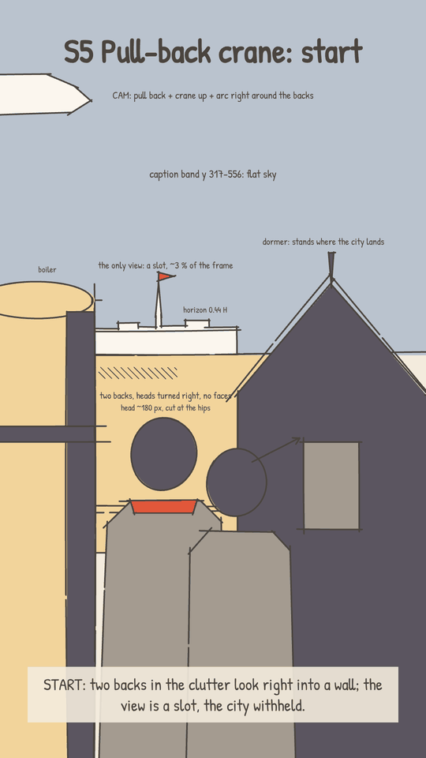
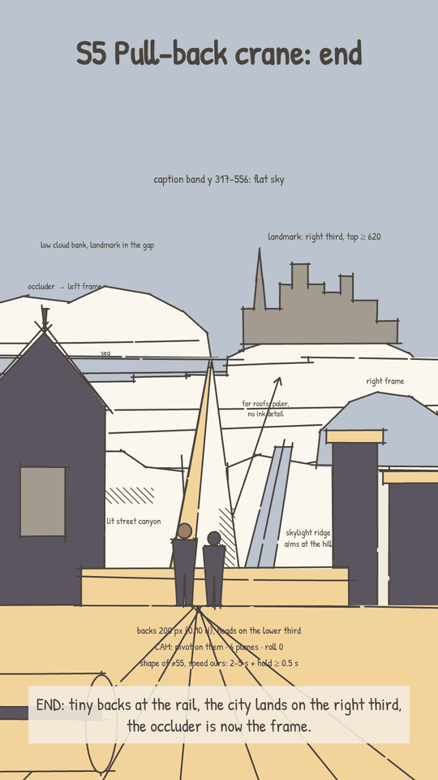

# CINEMATIC_GUIDE: Arcane environment shots (shot recipes and camera moves)

## Why
The owner (2026-10-26): from Arcane we take only environments, buildings and bigger shots, with no close-ups, people or
faces. Start simple, with a few high-confidence references that fit our flat ink style naturally.
The look (the clean pen by tier, one light rig per set, warm palettes) is `DIRECTION.md` and `CRAFT.md`, which win where
this guide differs. Each shot type below is ONE recipe (a move, a light or a composition): a tool to invent a frame with,
never a frame to copy. Its "Upgrades v1 @..." line is history (the past shot it was first written against), never a
shot to look at or remake (owner, 2026-10-30: "don't reference video 1 - i think this would put agents in a box
again").

Notation: frame 1080 x 1920, H = 1920 px; the screen zones (the caption band and block, the read zone, the platform UI)
and each shot type's framing numbers in one table: `LAYOUT.md` (it wins on where things sit, this guide on the moves).
`#94 @238.0` = Arcane shot 94 at 238.0 s into the source
video; `v1 @25` = 25 s into the v1 film. The sketch animatic (G3) names the S#; blocking (G5) sets the exact numbers.

## The opening: the first 3 seconds (owner rule, 2026-10-26; the most important shot of every video)
From the owner's reference (an explainer reel in our hand-drawn style, 1080x1350, a one-point-perspective street;
measured, not stored):
- **0.00-0.35 s, the scene is made:** frame 0 is bare ink lines only; flat colour floods in shape by shape within
  fast but unmistakable (a ~0.3 s pale draw-on was invisible on a phone: owner, 2026-10-28). Motion and "making" from the first frame.
- **The voice starts at ~0.05 s.** No silent lead, no title card. (Ours: the first word at ~0.12 s, the locked voice
  file's lead, `docs/voice/API_QUICKSTART.md`.)
- **0.3-2.2 s, the expectation:** the hook's claim is staged as what SHOULD happen (neat empty markers filling the
  street for "France expected 200,000 marchers"), building up row by row.
- **~2.2 s, reality overtakes it:** on the payoff number ("Half a million came") the scene escalates and overflows
  (a crowd pours in past the markers, signs pop up). The keyword is highlighted in the caption at the same moment.
- **Never still:** a new element every 3-6 frames through the first 3 s; the camera keeps moving (a slow ~5 % pull-out
  that gathers speed, ease-in, over the whole 7.7 s shot).
- **One continuous shot for the opening, no cut** until the hook's idea has landed.
- **The loop:** the last frame returns to the bare-line frame 0, so the rewatch starts seamlessly.

**For our videos** (the reference above is in a lined style; our film is drawn in the clean pen, `DIRECTION.md` rule 9):
stage the hook as "the expected thing, then the surprising reality overtaking it", inside one opening shot that is
drawn on from frame 0: the subject's line draws on, tier C lands as flat pale shapes,
colour floods in over the line (no outline stays: `DIRECTION.md` rule 4), as a bold visible event (not ~0.3 s: owner, 2026-10-28); the owner approves this build with the G4 look clip. Never still, but the novelty every
few frames comes from the subject's own build and its mechanism, one mover leading (`CRAFT.md` §b), never from extra
supporting life. Keep the first spoken line as frame 0's caption (never a title over it: playbook "Hook and pacing") and the first-second phone sound; the film loops back to frame 0's drawing
state. SketchReel supports it: `draw` (stroke draw-on) and `fillIn` (colour flood) per element.
**Show the real mechanism (v3 G3, 2026-10-26):** reality overtakes the expectation through the true cause, coupled
one-to-one to the viewer's stake: each unit of cause is one visible tick of the effect (one memory stick flies to the AI
data center, the laptop's price ticks up one step). The cause sits outside the home-base window, the effect in the
viewer's hand, and both change on the payoff word. Never a growth or consumption metaphor (v3's data center swallowing
the houses: "why is it growing and consuming the buildings?"). The opening's camera: one visible story move on the hook
(>= 3 % in <= 2 s, `COZY_AND_SCALE.md` 3b.5) or a locked / floating hold, never the reference's slow invisible
pull-out; the big scale move belongs to the reveal later in the film (S1 or S5).

## Shot types

### S1 Rise-over reveal (move). Confidence: highest, the only shot that passed all 3 reviewers (min 7, avg 7.7)
- **Idea:** stand behind the rooftop wall, then rise over it: the wall drops out the bottom and the whole city settles in.
- **Frame:** eye level at rooftop height. Start: the wall and the film's "you" from behind (never the mascot as an
  anchor: Pip hides, `DIRECTION.md` rule 2; never strangers in front: `CRAFT.md` §a.3) fill the bottom 25 % (top edge y ~1440),
  horizon at 0.37 H. Land: the wall is gone, horizon at 0.40 H (y ~770), city in the lower 60 %, flat sky in the top 40 %.
- **Planes (5), travel down during the rise:** wall + the "you" ~520 px (they leave the frame), near
  towers ~400 px (cut by both side edges, tops kept out of the caption band), mid city ~220 px, horizon ~60 px, sky 0.
- **Move:** 4-4.5 s, scale 1.00 -> 1.04, ease-out (fast start, lands in the last third), then hold 1 s: #94's measured
  shape. Retime it to the reel as S5 is (playbook Motion: the shape, never the speed; usually faster), so the scale
  moment stays within ~1.5-4 s (`DIRECTION.md` rule 7). Draw the city layers ~500 px taller than the start frame
  shows, so nothing runs out at the bottom.
- **Light:** sun upper-left on the sky plane; every tower gets one lit side and one shade side (`CRAFT.md` §d.4), a
  rim where the sun grazes it (§d.8).
- **Upgrades v1 @25** (rooftop wall, backs, skyline and sun, held static) into one reveal that ends on the whole city.
  Put it on a scale line ("tens of thousands", "every single server").
- **Ref:** #94 @238.0: a balcony railing drops away, and the skyline rises and lands with towers cut by the side edges.
- **The landing must feel vast:** run "Scale cues" (after S5); with no figures, the near towers and a 2x ladder of birds
  are the anchors (#94's airships: 0.14 / 0.06 / 0.03 / 0.015 W, the smaller ones lower).

### S2 Sun behind the roofline (light). Confidence: high (avg 7.9; one reviewer 5, since v1 already has the big sun)
- **Idea:** our orange disc becomes the subject, and everything in front of it is one flat silhouette (the disc is
  this shot's "look here", so it may be the pop; elsewhere the sun sits one step off its sky: `CRAFT.md` §g.2).
- **Frame:** eye level, long lens (flat, compressed). Disc ~650 px wide, centred at (580, 1060), top at y ~735. A roofline
  silhouette in our darkest teal runs across the bottom ~22 % (top edge y ~1500), and one dome or roof mass, cut by the
  left edge, rises to y ~880 over the lower left of the disc. The mint sky above the disc holds the captions.
- **Values (3 only):** disc, sky, silhouette. 2-3 thin cloud streaks, one value darker than the sky, cross the disc,
  painted, each swelling and pinching with its ends tapering at different rates, never a constant-width bar
  (`ORGANIC.md` §4.1). The disc is this shot's story light: a soft glow and gentle bloom AT it (`CRAFT.md` §d.7: three
  blurs, <= +6-8 L* at its edge, the wide ones stretched along the horizon), never a ring or a halo disc (playbook
  PROPER LIGHT, 2026-10-30; until then "one halo step of at most 1.7x, no bloom").
- **Move:** locked, 2.5-3 s. Only the clouds drift (~6 px/s); one bird may cross the top of the
  disc (~15 px/s).
- **Upgrades v1 @31** (the big ringed sun parked behind the glass dome) into a silhouette frame for a "time passes",
  key-line or closing beat. Don't put an info board in this shot.
- **Ref:** #60 @144.4: a huge setting sun crossed by thin cloud bars, behind a dome silhouette cut by the left edge.

### S3 Big sky, one landmark (composition). Confidence: good (avg 6.9), but only if the clouds stay 2-3 big, calm masses
- **Idea:** drop the skyline low and let one tall landmark stand alone in a big sky.
- **Frame:** eye level from a rooftop. The skyline is a band in the bottom 25-30 % (horizon ~0.73 H). One landmark on the
  left third (x ~220-420) rises to y >= 600. Sky ~70 %, with 2-3 big cloud masses in depth planes, painted (lit top,
  underside one value darker; the near mass biggest: `PAINT_RECIPES.md` §2.1, shapes by `ORGANIC.md` §4.1), kept below
  the caption band; the sun is half behind a cloud edge at the upper right.
- **Planes (4):** sky, clouds, far skyline, the landmark with the near roofs.
- **Move:** locked or the `COZY_AND_SCALE.md` 3b.5 float (a 1.6 % pull-out over 3 s reads frozen); clouds drift
  3-6 px/s.
- **Upgrades v1 @47** (the FBI dome tower, wide and close, filling the left half). Pull back so the dome stands whole
  against the sky on the left third and the city becomes a low band. The authority beat then reads as one icon, and the
  card stays on the tower.
- **Ref:** #24 @30.8: one slender tower on the left third over a low skyline band, with big clouds above.

### S4 Low-horizon breather (composition, pacing). Confidence: good (avg 7.0 for both refs). Use it once.
- **Idea:** almost all sky, with a thin strip of ground at the bottom, so the caption owns the frame for one pause.
- **Frame:** eye level, standing height. Horizon at 0.82 H (y ~1575), with a thin low city strip on it. A promenade or
  wall band runs across the bottom 15-18 %, with 3-5 posts 250-360 px apart on average, never evenly spaced (the gaps'
  CV >= 0.3: `ORGANIC.md` §4.1). Sky ~80 %: one painted cloud bank cut by the left edge (y ~700-1200) and open sky to the right. Add the "you" small (~0.08 H) at the bottom-left,
  its feet above y 1480 on a wall or a step rising out of the strip (the strip may run under the bottom UI as a mass, a
  figure may not: `LAYOUT.md` §1), or nobody (Pip only hidden: `DIRECTION.md` rule 2; never strangers in front:
  `CRAFT.md` §a.3).
- **Planes (3):** sky with the cloud, city strip, ground band.
- **Move:** locked or the `COZY_AND_SCALE.md` 3b.5 float.
- **Closer variant:** the sun as a half disc on the horizon at centre, right above a wall band with merlons every ~180 px
  (bottom 20 %), and 2-3 painted cloud streaks between y 650 and 1300.
- **Upgrades v1 @8.5** (the empty plaza with the sun, horizon at ~0.5 H) into a real breath. The horizon drops to 0.82 H
  and the plaza becomes a promenade strip. Use it after a dense or scale beat, before a key line, or as the outro.
- **Refs:** #61 @147.3: a low sea horizon at 0.85 H, a cloud bank on the left and bollards on the bottom strip.
  #108 @286.3: a crenellated parapet band at the bottom, with the sun on the horizon above it.

### S5 The pull-back crane reveal (the owner's favourite). Confidence: the owner's pick (2026-10-26), measured per frame
- **Idea:** the film's ONE big reveal, from the viewer's small world to the vast system. Two figures from behind (the
  film's "you" and a companion only if the story names one in W1, else the "you" alone; never Pip, which hides:
  `DIRECTION.md` rule 2; never strangers) in rooftop clutter
  look at something we can't see; the camera pulls back, cranes up and arcs round them until they are tiny at a rail and
  the whole city lands. The move follows their look, then pays it off. Owner: "It has pretty much everything: suspense,
  sense of scale, fantastic environment and composition, and the animation, the actual camera movement."
- **Shape (keep it):** one continuous move: a dolly back (not a zoom) + crane up + an arc of ~70-80 deg round the
  figures, on ONE ease curve; no secondary moves, no reversal, roll 0 (Arcane's apparent -15 deg is crane keystone). The
  figures are the pivot: they hold x ~0.45 W while the world slides past. Scale is graded by depth (source: far ~0.9,
  mid roofs ~0.4-0.55, the figures' deck 0.17 = 6x). The far plane slides ~1 W left with the horizon held within
  +/-0.04 H, while the near planes drop down the frame (the crane).
- **Parallax (sideways speed vs the far city; an orbit, not a truck):** sky 1.0, far 1.0, mid roofs 0.85, near clutter
  0.4, deck + figures 0 (locked), a foreground pot -7 (the other way). One law: shift = 1 - D/Z (D = pivot distance).
- **Easing:** cubic-bezier(0.55, 0.03, 0.50, 1.0): a creep that is never still (frame 1 at 3 % of peak), one peak at
  2.1x the mean speed, a long decelerate. The source's settle tail (20 % of the time, 2 % of the travel) becomes the
  hold.
- **Suspense (schedule by progress p, never by time):** p 0-0.1 the only view is a slot (3-5 % of the frame, the
  brightest and coolest patch in a warm dark frame) in their eyeline. p 0.15-0.40 the scale grows, but a dormer stands
  exactly where the landmark will land: the darkest beat. p ~0.48, at peak speed, a soft flat foreground mass (a chimney
  pot) wipes across the figures and hides the hand-off (they come out as backs; swap the drawing behind it): give it its
  own window of >= 8 / 10 / 12 f at 60 fps (up to ~90 px/f), or drop it at 2 s. p 0.5-0.55 a light burst (cloud bank,
  pale far) as the dormer slides on to become the left frame. p 0.77 the spire rises over the right roofline; it lands
  by p 0.96 as the camera slows. Birds (not airships) lead the life in the hold (Scale cues 11).
- **Start (u = 0):** sky y 0-840; horizon 0.44 H, seen only through a slot at x 240-600, y 780-900 (low skyline, one
  spire to y 720). Dormer x 600-1080 (finial y 640) down to the bottom edge; boiler x 0-240; parapet top y 1280. The two
  figures, 3/4 from behind, heads turned right (lost profiles: the cheek's sliver at most, `PEOPLE_DESIGN.md`), centre x 470, heads at most ~140 px (playbook; the source's
  ~180 px is too big) from y 1060, cut at the hips; the lead room hits a wall.
- **End (u = 1):** sky y 0-890, horizon 0.46 H. Landmark (a hill city) x 540-1010, spire top at y >= 620, centre (760,
  760) on the right third, ~1.4x the figures' height; sea strip and far roofs (y 900-1150) step up to it. A lit street
  canyon from behind their heads to a vanishing point at (520, 900) and a skylight ridge (600, 1540) -> (700, 1100) aim
  at it. Frames: the dormer, now x 0-260, and a brass cylinder bottom-left; chimney stacks and a glass dome at x
  780-1080. The two figures at x 420-560 (heads y 1290 on the lower third, feet y 1490: 170-200 px) at a parapet (top y 1400);
  a deck below with tile lines converging on them. 6 planes. Their look runs ~65 deg up-right (no 9:16 crop holds
  Arcane's 45).
- **Light:** one sun high beyond the city (3/4 backlight): tops lit, camera-facing walls and the backs in shade, shadows
  toward us. Each farther plane is a fixed flat mix toward the sky (0 / 12 / 22 / 40 / 65 %, measured: Scale cues 5),
  its shade leaning to the dusk blue (warm near, dusty-cool far, never grey-blue), with fewer value steps (5 / 5 / 4 /
  3 / 2); no outlines, never lines by depth (`CRAFT.md` §c: edges from light and shade on every tier and plane, thin
  lines only for things that ARE lines). Eye path: lit deck -> warmest lit facades up the canyon ->
  pale hill base -> the landmark, the darkest far shape, against the palest cloud (a low flat bank on the horizon, the
  landmark in its gap). Over the move: bright slot in a dark frame -> darkest at the dormer -> light burst BEFORE the
  landmark lands -> settle. Flat mist cuts: ask the owner first.
- **Retime: the shape, never the speed** (owner: "speed up or slow down where it feels appropriate; in a short reel we
  would usually speed it up"). Source 11.5 s; ours at 60 fps: 2.0 s = 90 f move + 30 f hold, pivot 3.5x, far peak 25
  px/f; **3.3 s (default)** = 156 + 42 f, 5x, 14 px/f (creep/accel/cruise/decel/settle 10/59/25/51/11 f); 5.0 s = 240 +
  60 f, 6x, 10 px/f. The far slide stays 1.0 W; detailed layers inside the one speed budget (`PIPELINE_V2.md` "Frame
  rate": ~15 px/frame, a WARN; the 2.0 s variant's 25 px/f must pass the readable-at-1x check), the zoom at the subject
  <= ~3 %/f (flat masses may exceed it). Landing hold >= 30 f (0.5 s) below 5 % of peak, drifting the last ~2 % of travel, so the eye
  finds the tiny figures, then the landmark. At 3.3 s the spire rises at ~1.7 s and lands by ~2.2 s: the payoff word.
- **Upgrades v1 @25** (rooftop wall, backs, skyline, static) when the reveal must travel from the small world to the
  whole system; S1 when the city only needs to land. **Ref:** #55 @109.46 (11.46 s; S1E1 "Welcome to the Playground",
  ~2:30). **The end frame must feel vast and alive:** run "Scale cues" (next section) on it.

## Scale cues: why a wide feels vast (owner, 2026-10-26: "how GREAT the SCALE feels"; every video)
Measured on #55's end (@120.5 s; with #94 @242.8, #24 @33.6; the sky also on #60/#61/#108). Ruler F = figure height = 200
px, horizon y ~890, feet y ~1490 (the S5 end). Scale is felt, not counted: Arcane's counts are a warning signal, never a
quota. Breathers (S3, S4) take theirs from the sky (9-10).
1. **The world keeps going:** nothing ENDS inside the frame. Every band runs past both side edges, behind near side masses
   (x 0-30 % and 78-100 % W) that cut the far rows; something is cut by all 4 edges; the horizon exits at least one side;
   a tiny second landmark on it (~28 px, one step toward the sky) proves the city runs on to the coast.
2. **The size gradient:** 5-7 planes, each 2.2-3x smaller than the one in front (never two neighbours within 2x). Building
   widths near : mid : far = 17 : 3 : 1 (near 120-520 px, mid 21-35, far 7-17 x 6-8 tall); windows shrink with them (near
   7-11 px on a 21-30 px period, near-mid 4-6 on 12, mid 2-3 px tone-on-tone squares on 5 (within dL* 15 of the wall,
   never dark specks: `CRAFT.md` §c), far none), each never a template: sizes varied 5-12 %, places +-1.5 px, states
   mixed (lit, dark, sky-reflecting), twins <= 5 % of the shapes (`ORGANIC.md` §4.1; owner, 2026-10-30, ORGANIC, NOT
   GEOMETRIC).
3. **Most of the city is in the thinnest band:** the far field (0-11 % of the horizon-to-feet span) plus the hill town
   hold ~60 % of Arcane's ~400 roofs: 5-7 rows every 9-10 px, each hiding half the row behind, no sky gaps, a chimney (a
   flat shape, never a tick) per 3-4 roofs. Generate the rows from seeded motifs (+-15 % width, 3-4 roof colours), never
   a few hand-placed blocks.
4. **Detail rises toward the horizon:** shapes per building fall (near 30-60, mid 5-8, far 2), so shapes per 100 px tile
   (flat shapes, not lines) stay level or rise 1.0-1.5x and PEAK just under the horizon (Arcane edge density 23-25 %
   there, 8-11 % near). Motifs repeat in runs of 4-6, their gaps uneven (CV >= 0.3) and each repeat carrying one
   difference, never at a fixed period (`ORGANIC.md` §4.1: no template). Calm zones only: the landmark (0.4x the city),
   the deck (0.65x), the sky.
5. **Atmospheric steps, one per plane (never a haze gradient over the frame; the sun's in-scatter veil and the light's
   falloff, baked per plane, are light, not the step: `CRAFT.md` §f.2, §d):** each plane is one fixed mix toward the sky
   that about doubles per plane, its paint coarser and its marks fewer with distance (`ORGANIC.md` §5): near 0 / near-mid 12 / mid 22 / far 40 / infinity strip 65 %, shade leaning 0-50 % to the dusk blue (how, in
   our colour: `CRAFT.md` §f.2, `lib/depth.ts` `recede`: toward the sky's lowest step behind the plane, never through
   grey or olive). Autumn
   Ember darkest swatches `#3A1F16` L15 | `#533D38` 28 | `#695653` 38 | `#8C7D7C` 54 | `#BAACA8` 71 (the L* 15 step only
   in the anchor's small dark pieces: `CRAFT.md` §f.8); values 5/5/4/3/2; no outlines on any plane (`CRAFT.md` §c);
   warm near, the sky's hue farthest.
6. **The drop below the camera:** a low crane, not a drone: feet 2-3 F below the horizon (Arcane 2.0-2.4; the S5 end's 3.0
   is the limit; past 3.5 reads as a map), every city roof under it. Ridges halve per plane (infinity 0-12 px under it,
   far 15-40, mid 60-100, near-mid 140-220), then the rail jumps to 480-560: that gap IS the drop. Never draw a street
   floor or a far base; one dark canyon slot (50-90 px) falls from a VP on the horizon over the figures.
7. **The landmark, huge yet far:** the only far shape over the horizon, rising 1.1-1.4 F above it (cluster 1.5-2.4 F wide,
   top y >= 620) on a hill the town climbs in 5-6 rows. Huge: its units are 2x the mid windows though 2 bands farther
   (lancets 6 x 11 px, one rose or clock 22-28 px). Far: the narrowest value range (0.58x the near), the least detail,
   tone-on-tone in its shade colour with no line (`CRAFT.md` §c), behind the hill town and the sea strip, birds
   crossing in front.
8. **Tiny anchors, lines up:** the figures from behind (the "you", with a companion only if W1 names one; never Pip,
   which hides: `DIRECTION.md` rule 2) at 1.0 F, heads on a lighter mid
   wall; the near frame mass 30-35 % of the frame, a tier-C mass at L* >= ~30 (the darkest step only on its edge; the
   anchor colour in small pieces, `CRAFT.md` §f.8; §b-§d), cut by 2 edges. Lines lead UP to the landmark: the canyon VP over their heads, the far skyline
   stepping up 40-60 px before the hill, one diagonal (a skylight ridge) at its base; the rail is the one level line.
9. **A big sky with huge clouds:** sky 30-40 % on a scale end (65-85 % on breathers), clouds 45-55 % of it outside the
   caption band (`LAYOUT.md` §1). One hero mass >= 1.0 W (cut by a side), >= 2.5x the landmark's width and BEHIND it (farther, still bigger): on
   S1/S5 a bank on the horizon (150-280 px tall), the landmark in its gap. Flat base, lobed top (lobes 180-450 px, built
   from ellipses on a size ladder, never a union of circles: `ORGANIC.md` §4.1), 3 values: crown `#FAF1EA` 15-25 %,
   body `#ECD8CB` 30-40 %, belly `#CFC5C4` on the base, painted (`PAINT_RECIPES.md` §2.1); new, so show the owner at G4.
10. **Huge means slow:** hero cloud 0-6 px/s, thin bars 5-15 px/s, all one way and <= 1/10 of the birds (a fast cloud
    reads small). Light constant through the hold: no flicker, no moving shadow patches.
11. **Life in the hold (the owner's "alive"):** the city's static density IS its life; nothing moves inside it. Motion
    goes in the sky and by the figures: 3-4 kinds of mover on 3 speed tiers, something always moving (> 1 s without is a
    dead frame), <= 2 % of the frame, never competing with the figures and the landmark. Fast: a flock of 3-6 V's, 24-44
    px (far ones paler), 5-6 wingspans/s, flap 3-4 Hz, one gliding, entering at 70-80 % of the move and crossing toward
    the landmark in 1.5-2.5 s, outside the caption band. Periodic: a pennant on the near frame, 1-3 Hz. Mid-move: 1-3 white steam
    wisps; cloth 1-3 px. All of it at tier B / C weight (`CRAFT.md` §b). The film draws its own birds; `Birds`
    (`cine/sky.tsx`: size 24-44, flap 3-4, dur = path / (5.5 x size)) is the reference, not clean-pen-aware.
**Checklist:** nothing ends inside the frame | 5-7 planes 2.2-3x apart | far band packed, detail peaking under the horizon
| darks climb to the sky | (feet - horizon) / F = 2-3, then the drop | one huge-yet-calm landmark over the horizon | a
hero cloud behind it | 3 tiers of life, never 1 s still. Then, at phone size: does the world keep going, and is it alive?

## Rules (all types)
1. **One change per shot.** Each type brings ONE thing to a shot (the move, the light or the composition). The palette
   (`PALETTE.md`), the people (`PEOPLE_DESIGN.md`) and the words on screen (`TYPE_GUIDE.md`) are the film's own; the look
   is today's (`DIRECTION.md` rules 4-6: the clean pen with no outlines, edges from light and shade, ONE painted
   language, the proper light).
2. **Captions sit on one calm flat field.** The caption band (`LAYOUT.md` §1) stays one calm flat field in every frame,
   from the start to the end of a move: outdoors the one sky (`DIRECTION.md` rules 6, 10), a flat light wall or facade
   where there is none; no tower top, disc, cloud or roof in it (tops at y >= 600).
3. **One big move per video (S1 or S5, never both).** Every other hold, cozy or breather (S2-S4 too), is locked or the
   `COZY_AND_SCALE.md` 3b.5 float (8-15 px/s, legs that turn back); never a slow pull-out or push in a hold (a 2 %
   pull-out moves the frame edges only ~4-8 px/s and reads frozen). A zoom is a visible story move or a carrier
   (`CRAFT.md` §a). No roll, no compound moves, no cut mid-move.
4. **Depth in steps, light done properly.** Use 4-6 planes, 5-7 on a vista (`CRAFT.md` §f.1, which wins; S1 5, S5 6;
   S4's 3 is its declared exception, a breather that is almost all sky), each farther plane one value step paler and
   nearer the sky's hue (as in #75 @185.3; scale wides: Scale cues 5). One light rig per set (`CRAFT.md` §d.1) and ONE
   story light per scene (§d.2; playbook PROPER LIGHT, 2026-10-30): by day the sun is the key, one lit side and one
   shade side per building; at dusk and at night a lamp, a lit door or a window as the story light, on a light night
   (§d.2); silhouettes in the palette's anchor; a soft glow and gentle bloom only AT a source, real falloff, rims by tier
   (§d.7-§d.8). Never a haze or a gradient over the frame, a glow on a lit surface, or a vignette.
5. **Dose.** Per video: S1 or S5 once, S2 and S4 at most once each, never two of these back to back. These are the scale
   and breather beats, framed in the film's own places (the view from the home place, the street outside it), never a
   new place made for a beat (`CRAFT.md` §a.2); the cozy, enclosed streets stay the majority (`COZY_AND_SCALE.md`).

## Not for us
- Close-ups and people as the subject (owner, 2026-10-26: from Arcane, environments only): people stay small, seen
  mostly from behind, in profile or turned away, their faces only the generic LASH (`PEOPLE_DESIGN.md`; owner,
  2026-10-30), never a face close-up; in the foreground only the film's "you" or the mascot (`CRAFT.md` §a.3).
- Darkness: near-black frames (#81's arch), red and crimson skies, smoke and embers. A night is a light night:
  temperature, not darkness (`CRAFT.md` §d.2, `COZY_AND_SCALE.md` §3).
- Arcane's own painterly effects: a haze over the frame, god rays and volumetric light as a show, its billowing
  cumulus as a model. Our paint is our own pass by plane (`PAINT_RECIPES.md`; clouds in 2-4 painted planes), our glow
  and bloom only AT a source and our shafts at most 2-3 soft wedges (`CRAFT.md` §d.7).
- Arcane's props and VFX: airships (we use birds instead), energy beams, glowing rings, steampunk spires.
- Hard angles and source-speed moves: 3-point convergence (#3's worm's-eye; a low camera itself is fine:
  `STORYBOARD_STYLE.md` §7, `COZY_AND_SCALE.md` K7); any long move played at its source speed
  (#55's 11.5 s is S5 only once retimed to 2-5 s); real roll.

## Source and method
53 environment shots (wides and extreme wides, with no figures or tiny ones) from "Amazing Shots of ARCANE SEASON 1"
(YouTube HzJ7Nvwz1e8), with the camera move of each measured (zoom %, pan %, easing). An art director, a layout reviewer
and a sceptic scored every shot. Only #94 passed all three with every score >= 7; S2-S4 come from the next best (avg
6.9-7.9) and keep only what all three agreed on. Full research: `research/CINEMATIC_GUIDE_full_v1.md`.
S5 is the owner's own pick (2026-10-26), re-measured frame by frame (tracked corners, per-plane fits; camera,
composition and light analysts). `measure_camera.py` splits #55 at 114.8 s: a false cut (a foreground chimney pot
wipes the frame), so its totals undercount. A Netflix screen recording comes out black (DRM): identify the scene from
the subtitle and the timecode, then find it in the YouTube compilation recording. Frames stay in the scratchpad; only
numbers, words and our own drawings go into the repo.

## Sketches (our 9:16 version of each type; data `public/look/cine_sketches.json`, `ShotSketch` composition)

| S1 Rise-over reveal | S2 Sun behind the roofline | S3 Big sky, one landmark | S4 Low-horizon breather |
|---|---|---|---|
|  |  |  |  |

| S5 Pull-back crane reveal: start (u = 0) | S5 Pull-back crane reveal: end (u = 1) |
|---|---|
|  |  |
