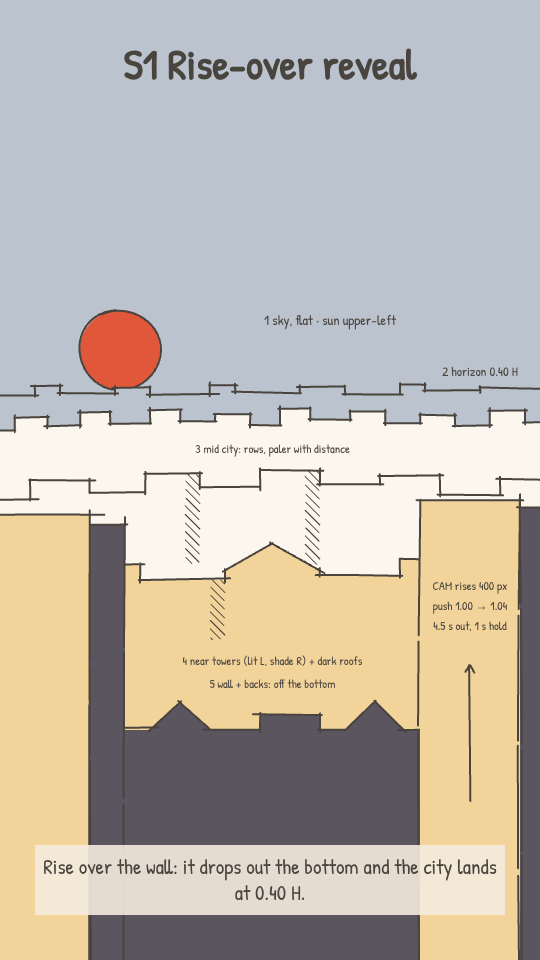
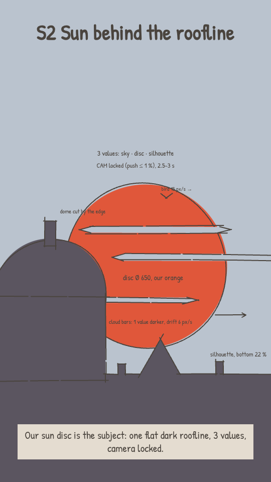
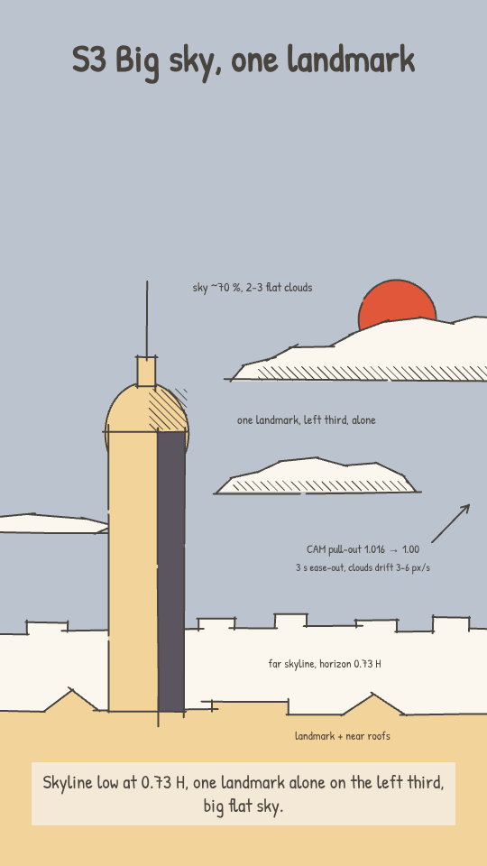
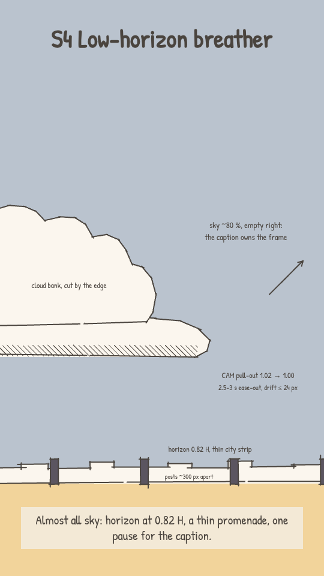

# CINEMATIC_GUIDE: Arcane environment shots as small upgrades to v1

## Why
The owner (2026-10-26): from Arcane we take only environments, buildings and bigger shots, with no close-ups, people or
faces. Start simple, with a few high-confidence references that fit our flat ink style naturally.
v1 (`deliverables/v1/php2shell_final.mp4`) is the baseline and stays the look. Each shot type below is ONE targeted
upgrade of a v1 shot (a better move, light or composition), and nothing else changes.

Notation: frame 1080 x 1920, H = 1920 px, captions at y 317-556. `#94 @238.0` = Arcane shot 94 at 238.0 s into the source
video; `v1 @25` = 25 s into the v1 film. The sketch animatic (G3) names the S#; blocking (G5) sets the exact numbers.

## Shot types

### S1 Rise-over reveal (move). Confidence: highest, the only shot that passed all 3 reviewers (min 7, avg 7.7)
- **Idea:** stand behind the rooftop wall, then rise over it: the wall drops out the bottom and the whole city settles in.
- **Frame:** eye level at rooftop height. Start: the wall and people's backs fill the bottom 25 % (top edge y ~1440),
  horizon at 0.37 H. Land: the wall is gone, horizon at 0.40 H (y ~770), city in the lower 60 %, flat sky in the top 40 %.
- **Planes (5, the only 5-plane type), travel down during the rise:** wall + backs ~520 px (they leave the frame), near
  towers ~400 px (cut by both side edges, tops kept out of the caption band), mid city ~220 px, horizon ~60 px, sky 0.
- **Move:** 4-4.5 s, scale 1.00 -> 1.04, ease-out (fast start, lands in the last third), then hold 1 s. Draw the city
  layers ~500 px taller than the start frame shows, so nothing runs out at the bottom.
- **Light:** sun upper-left on the sky plane; every tower gets one lit side and one shade side, flat.
- **Upgrades v1 @25** (rooftop wall, backs, skyline and sun, held static) into one reveal that ends on the whole city.
  Put it on a scale line ("tens of thousands", "every single server").
- **Ref:** #94 @238.0: a balcony railing drops away, and the skyline rises and lands with towers cut by the side edges.

### S2 Sun behind the roofline (light). Confidence: high (avg 7.9; one reviewer 5, since v1 already has the big sun)
- **Idea:** our orange disc becomes the subject, and everything in front of it is one flat silhouette.
- **Frame:** eye level, long lens (flat, compressed). Disc ~650 px wide, centred at (580, 1060), top at y ~735. A roofline
  silhouette in our darkest teal runs across the bottom ~22 % (top edge y ~1500), and one dome or roof mass, cut by the
  left edge, rises to y ~880 over the lower left of the disc. The mint sky above the disc holds the captions.
- **Values (3 only):** disc, sky, silhouette. 2-3 thin flat cloud bars, one value darker than the sky, cross the disc.
  At most 1-2 flat halo rings, no bloom.
- **Move:** locked (push of 1 % at most), 2.5-3 s. Only the clouds drift (~6 px/s); one bird may cross the top of the
  disc (~15 px/s).
- **Upgrades v1 @31** (the big ringed sun parked behind the glass dome) into a silhouette frame for a "time passes",
  key-line or closing beat. Don't put an info board in this shot.
- **Ref:** #60 @144.4: a huge setting sun crossed by thin cloud bars, behind a dome silhouette cut by the left edge.

### S3 Big sky, one landmark (composition). Confidence: good (avg 6.9), but only if the clouds stay 2-3 flat shapes
- **Idea:** drop the skyline low and let one tall landmark stand alone in a big sky.
- **Frame:** eye level from a rooftop. The skyline is a band in the bottom 25-30 % (horizon ~0.73 H). One landmark on the
  left third (x ~220-420) rises to y >= 600. Sky ~70 %, with 2-3 flat cloud shapes (lit top, underside one value darker)
  kept below the caption band; the sun is half behind a cloud edge at the upper right.
- **Planes (4):** sky, clouds, far skyline, the landmark with the near roofs.
- **Move:** pull-out 1.016 -> 1.00 over 3 s, ease-out (most of it early, then it settles); clouds drift 3-6 px/s.
- **Upgrades v1 @47** (the FBI dome tower, wide and close, filling the left half). Pull back so the dome stands whole
  against the sky on the left third and the city becomes a low band. The authority beat then reads as one icon, and the
  card stays on the tower.
- **Ref:** #24 @30.8: one slender tower on the left third over a low skyline band, with big clouds above.

### S4 Low-horizon breather (composition, pacing). Confidence: good (avg 7.0 for both refs). Use it once.
- **Idea:** almost all sky, with a thin strip of ground at the bottom, so the caption owns the frame for one pause.
- **Frame:** eye level, standing height. Horizon at 0.82 H (y ~1575), with a thin low city strip on it. A promenade or
  wall band runs across the bottom 15-18 %, with 3-5 evenly spaced posts (250-360 px apart). Sky ~80 %: one flat cloud
  bank cut by the left edge (y ~700-1200) and empty sky to the right. Add 1-2 small backs (~0.08 H) bottom-left, or none.
- **Planes (3):** sky with the cloud, city strip, ground band.
- **Move:** pull-out 1.02 -> 1.00 over 2.5-3 s, ease-out, drift of 24 px at most.
- **Closer variant:** the sun as a half disc on the horizon at centre, right above a wall band with merlons every ~180 px
  (bottom 20 %), and 2-3 flat cloud stripes between y 650 and 1300.
- **Upgrades v1 @8.5** (the empty plaza with the sun, horizon at ~0.5 H) into a real breath. The horizon drops to 0.82 H
  and the plaza becomes a promenade strip. Use it after a dense or scale beat, before a key line, or as the outro.
- **Refs:** #61 @147.3: a low sea horizon at 0.85 H, a cloud bank on the left and bollards on the bottom strip.
  #108 @286.3: a crenellated parapet band at the bottom, with the sun on the horizon above it.

## Rules (all types)
1. **One change per shot.** Each type changes ONE thing in a v1 shot (the move, the light or the composition). The
   palette (`PALETTE.md`), ink line, flat fills, people seen from behind and caption style stay exactly as in v1.
2. **Captions sit on flat sky.** y 317-556 stays plain sky in every frame, from the start to the end of a move: no tower
   top, disc, cloud or roof in it (tops at y >= 600).
3. **One big move per video (S1).** Every other wide is locked or breathes: a 1.5-2 % pull-out (or a push of 1 % at
   most) over 2-3 s, ease-out. No roll, no compound moves, no cut mid-move.
4. **Depth and light in flat steps.** Use 3-4 planes (5 only in S1), each farther plane one value step paler and mintier
   (as in #75 @185.3). The sun is the only light: one lit side and one shade side per building; silhouettes are in our
   darkest teal. No bloom, haze, glow or gradients.
5. **Dose.** Per video: S1 once, S2 and S4 at most once each, never two of these back to back. These are the scale and
   breather beats; the cozy, enclosed streets stay the majority (`COZY_AND_SCALE.md`).

## Not for us
- Faces, close-ups and people as the subject (owner, 2026-10-26): people stay small backs at the bottom.
- Darkness: night, near-black frames (#81's arch), red and crimson skies, smoke and embers. We stay in daylight colours.
- Painterly texture: haze, bloom, god rays, volumetric light, billowing cumulus. Clouds are 2-3 flat shapes.
- Arcane's props and VFX: airships (we use birds instead), energy beams, glowing rings, steampunk spires.
- Hard angles and long moves: worm's-eye 3-point perspective (#3), or an 11.5 s pull-out with an arc and roll (#55).

## Source and method
53 environment shots (wides and extreme wides, with no figures or tiny ones) from "Amazing Shots of ARCANE SEASON 1"
(YouTube HzJ7Nvwz1e8), with the camera move of each measured (zoom %, pan %, easing). An art director, a layout reviewer
and a sceptic scored every shot. Only #94 passed all three with every score >= 7; S2-S4 come from the next best (avg
6.9-7.9) and keep only what all three agreed on. Full research: `research/CINEMATIC_GUIDE_full_v1.md`.

## Sketches (our 9:16 version of each type; data `public/look/cine_sketches.json`, `ShotSketch` composition)

| S1 Rise-over reveal | S2 Sun behind the roofline | S3 Big sky, one landmark | S4 Low-horizon breather |
|---|---|---|---|
|  |  |  |  |
