# CINEMATIC_GUIDE: Arcane's camera, translated into our 9:16 kit (every video, G3 storyboard -> G5 blocking)

The owner's request (2026-10-26): Arcane's cinematography as one guidebook for ALL videos. Evidence: `research/`
`cine_shots.md` (sizes, angles, composition), `cine_motion.md` (moves, timing), `cine_light.md` (light, cuts). With
`COZY_AND_SCALE.md` (cozy >= 50 % of every film, scale occasional) and `PALETTE.md`; where numbers differ from COZY §4-5,
this guide wins (§7). **[M]** = our flow fit, **[P]** = pixel measure, **[L]** = labelled by eye; untagged = our
proposal, tested at G4/G5. `#13 @14.6` = shot 13 at 14.6 s (§8). Frame 1080 x 1920: captions y 317-556, the read
y 600-1250 (x 120-880), UI below y 1250 and right of x 780 below y 840. G3 at 30 fps, G5 on at 60: times in s, speeds in
px/s. **At G3** each shot names its V#, P# and T# in `note` / `transition.label`; numbers are exact only at G5 (PIPELINE_V2 rule 6).

## 1. The 10 rules (one screen)
1. **Length follows the job:** action 0.5-1 s, transitions ~1.5 s, scale and establishing 2.5-3.5 s, intimate 3 s, the
   cozy refuge 3-6 s (it is held longest) [M]. That gives ~15 shots in a 40 s film.
2. **Half the shots barely move:** 48 % are locked or breathing (zoom, pan and tilt all < 3.5 %) [M]. A hold still
   floats 1-1.5 px; the life is in the frame (steam, light, a walk).
3. **On a wide, breathe out:** default a 1.5-3 % pull or a hold (pulls beat pushes 46:34; 27:12 on wides). A push needs
   a reason (attention, threat, impact). Closer = bigger: moving shots zoom a median 4.8 % wide, 6.5 % mid, 7.5 % close [M].
4. **No house ease:** of 92 moves, 36 % are front-loaded, 34 % back-loaded, 28 % peak mid-move [M]. `out` for arrivals
   and breath-outs; `in` for the pushes that matter (all 6 pushes >= 10 % are back-loaded, cut at speed); `inout` for lurches.
5. **ONE big move per video (P6 or P8):** a rise of 0.2-0.25 H with a 1.3-1.6x pull (or a 4 % push) in 3.5-5 s, then
   1-1.5 s near-still. It is the only 5-plane shot (default 3; 4 when establishing). Every layer <= 450 px/s.
6. **Scale is a cut, 1-2 per video:** cut from a close shot (< 1 s in 6 of 14) to an observer at 0.04-0.08 H, a 6-20:1
   drop (median 10:1) [L]. The light and the temperature hold across the cut. A face or hands follow within 5 s.
7. **Eye level is home (48 %); low is power (33 %)** [L]. High or overhead (13 %) Arcane spreads over institutions,
   vistas and bodies seen from above; ours is institutions and vistas only, never down on one person (COZY §5). Roll:
   <= 2° of drift (<= 6° in action); never a held dutch angle, no spins.
8. **One light, behind the head, in the middle third (72 % [P]):** its field rises into the captions at L* >= 70; a
   silhouette is >= 25 L* darker. Copy Arcane's value ORDER, never its darkness (our frame mean >= 55; its median 19).
9. **One hue per place (78 % of shots [P]).** The ONE pop is our hot accent (1-3 %, "look here"): in a cold place it is
   Arcane's opposite point (median 1.0 %); a warm place takes no cold accent. A warm/cold flip happens across a cut,
   only under motion (a wiper or a whip), once per video.
10. **One change per cut** (size OR value OR temperature [P]). The bright spot stays within 0.2 H (in-scene median
    0.13 H). A jump of >= 25 L* means a new world or an impact. Never more than 3 flashes per second.

## 2. Shot vocabulary
Figure sizes are fractions of frame height, kept from Arcane's frame to ours (§4). "Preset" refers to §3.
| V | name | size | angle | lens | composition in 9:16 | s | preset | purpose | refs (# @ s) |
|---|---|---|---|---|---|---|---|---|---|
| V1 | **Establisher** | XW / W | eye (high for a city) | normal | 4 planes; the place AND its one light in frame; horizon 0.52-0.59 H (0.70-0.85 when the sky is the subject); flat sky over the captions | 2-3 | P2 | sets the place, the light, the temperature | #24 @30.8 gilded clouds, a beam over the city; #29 @45.5 one lit pavilion in mist |
| V2 | **Refuge portal** | W | eye | normal | frame within frame: ONE opening 15-30 %, or figures IN a circle 760-1000 px at x 540 (centre y 800-1050, sill y 1230-1250); walls in mids on 2-3 edges | 3-6 | P1, P2; P3 to leave | the cozy home base | #13 @14.6 pair on a moon-gate sill; #81 @193.9 one arch in a black mass |
| V3 | **Silhouette before the light** | M, back or 3/4 | eye or low | normal | head centred on the brightest field; figure `#8A9AA8` + `#545F6D` lip; 2-3 px rim | 2.5-3.5 | P4a | brooding, longing, a decision | #23 @27.8 back view before tall windows; #73 @179.2 seated figure in a halo |
| V4 | **Tiny observer** (K6) | XW | eye (43 % of scale shots) | normal / wide | observer 0.04-0.08 H (77-154 px) on the axis; the colossus cut by the frame; 60-90 % flat field | 2-3.5 | P1 or P2 | scale: stillness, being watched | #97 @246.5 two walkers under a storm sky; #103 @271.4 a figure by a glow under a giant ruin |
| V5 | **Worm's-eye colossus** (K7b) | XW | worm's-eye | wide | no horizon; VP at y -200 to -1500; verticals lean 12-20°; no person (one in the next shot); the lit V of sky holds the captions | 2-3 | P2 (2 %) | the place overpowers you | #3 @2.4 two towers lean into a red V; #62 @150.2 straight up a library well |
| V6 | **Vista back view** (K5) | W | eye or high | normal; tele for a huge disc | back view 0.28-0.38 H (540-730 px), cut by the bottom; the world above it | 3-5 | P4a = resolve; P3 = isolation | a person facing the world | #37 @68.6 figure on a boat deck; #72 @173.5 rooftop over the night city |
| V7 | **Low power** | F / M | low | wide or normal | horizon 0.75-0.9 H or below; head at y 600-700, cut at the shins; verticals lean in 3-5°; a lit face = agency, backlit and faceless = menace | 1.5-3 | P1 or P4b | agency, the turn; the system as a faceless mass | #51-54 @106.6 masked figure looming in failing light; #139 @350.5 raised fist between banners |
| V8 | **Feeling close-up** | CU / MCU | eye | tele | face 0.35-0.5 H, eyes at y 800-950; the background flat, one value lighter, no ink; forehead or sky flat under the captions | 2-4 (hits 0.4-1) | P4b; P3 for loss | the human beat after a big one | #47 @86.2 hooded face in white blossoms; #124 @330.3 face and reaching hand |
| V9 | **Symbol insert** | insert | eye or overhead | tele | the story object, 320-650 px at x 540, y 820-900, on flat bands; hero colour, the pop on one detail | 1.5-2.5 | P1 (5 of 8 locked: the object moves) | what the video is about | #14-19 @16.3 butterfly landing on a fingertip; #116-117 @309.2 small orb, then a fist |
| V10 | **Lone light** | W / insert | eye | normal | one lamp, window or tag in 60-90 % flat page; the light is the subject | 2.5-4.5 | P4b | "this small thing matters"; opens a sequence | #25 @34.0 lit window in a cavern; #122 @322.9 one caged lamp |
| V11 | **Institution high** (K10) | W | high / overhead | normal | centred symmetry; figures 7-10 % H; plan view with 2-3 planes; cold, even light + 1-2 tiny warm points | 2.7-4 | P9 | the system: order, ceremony | #20 @19.3 caskets from above, two braziers; #38 @71.5 council round a cog-shaped table |
| V12 | **Impact** | F / MCU | low; roll <= 6° | wide (near:far 1.5-2.5) | foreground at f 1.6-1.9; a diagonal of reach | 0.4-1 | P5 + P10 | the turn, the breach (<= 1 per video) | #104 @276.5 head snaps back; #126 @336.1 dive along a bridge |

**Mix for 30-45 s (14-18 shots):** 2-4 wides (1-2 scale: V4-V6); 5-7 wide-to-medium on our person with the object (V2,
V3, V7); 5-7 close-ups or inserts (V8-V10); <= 1 ECU, <= 1 overhead (V11), <= 1 impact (V12); never two scale wides in a row.

**Sketches (our 9:16 translation of each type; source data `public/look/cine_sketches.json`, render with the
`ShotSketch` composition):**

| V1 Establisher | V2 Refuge portal | V3 Silhouette before the light | V4 Tiny observer | V5 Worm's-eye colossus | V6 Vista back view |
|---|---|---|---|---|---|
| 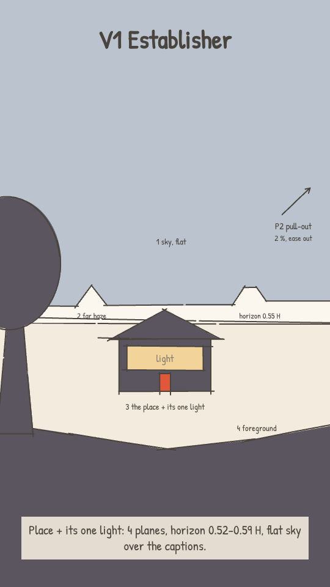 | 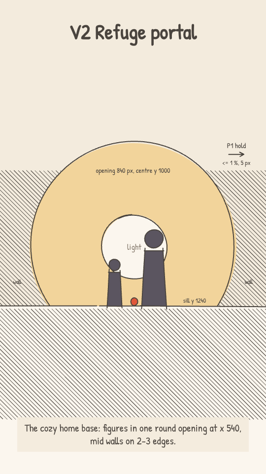 | 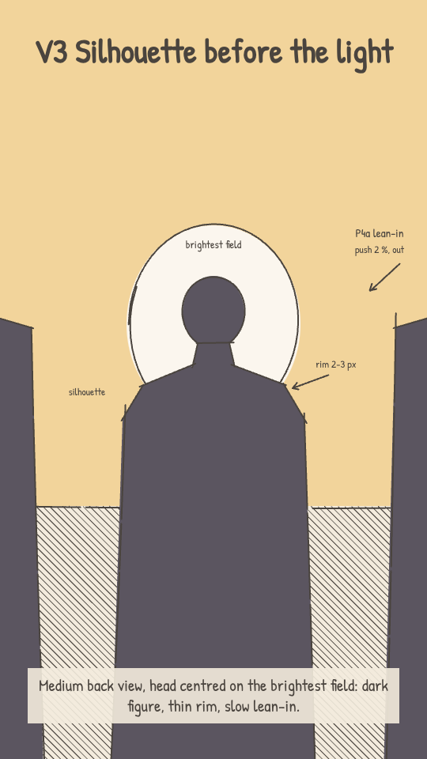 | 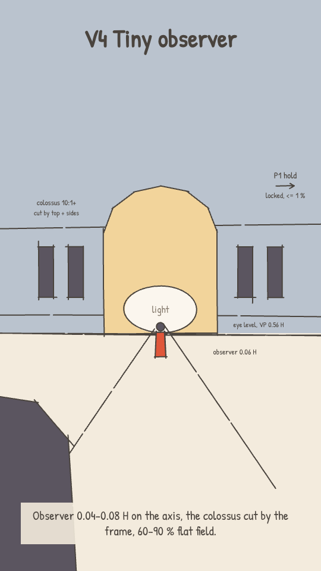 | 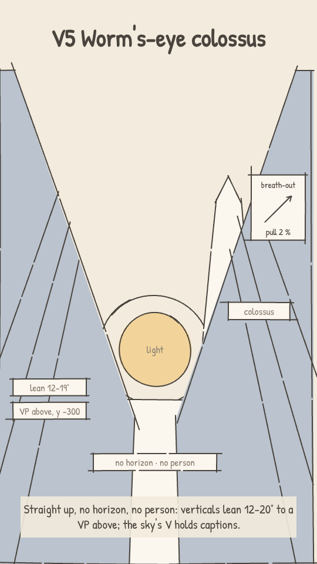 | 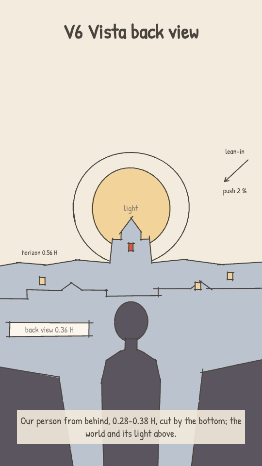 |

| V7 Low power | V8 Feeling close-up | V9 Symbol insert | V10 Lone light | V11 Institution high | V12 Impact |
|---|---|---|---|---|---|
| 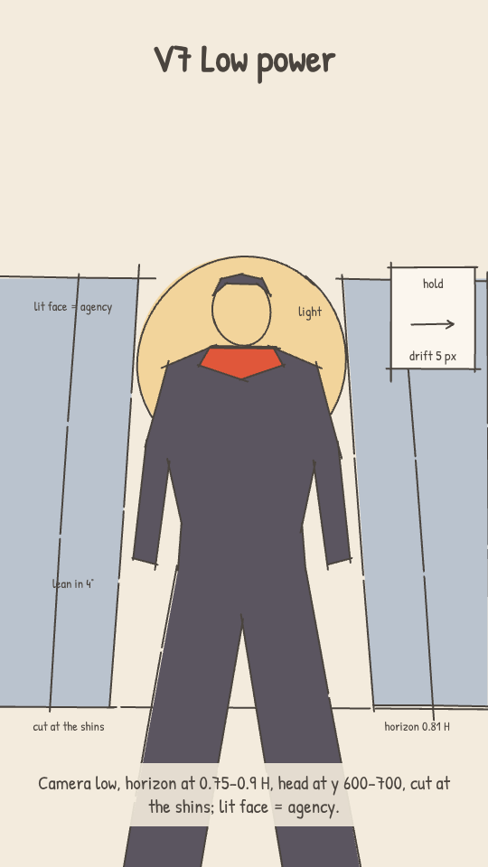 | 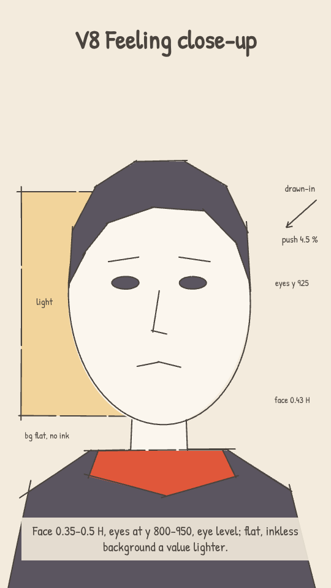 | 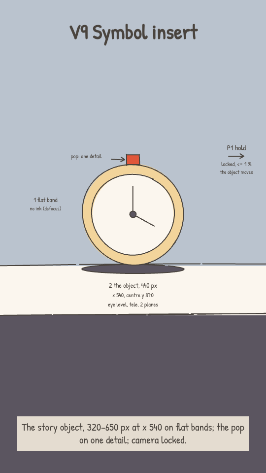 | 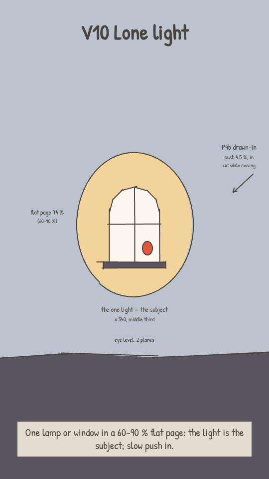 | 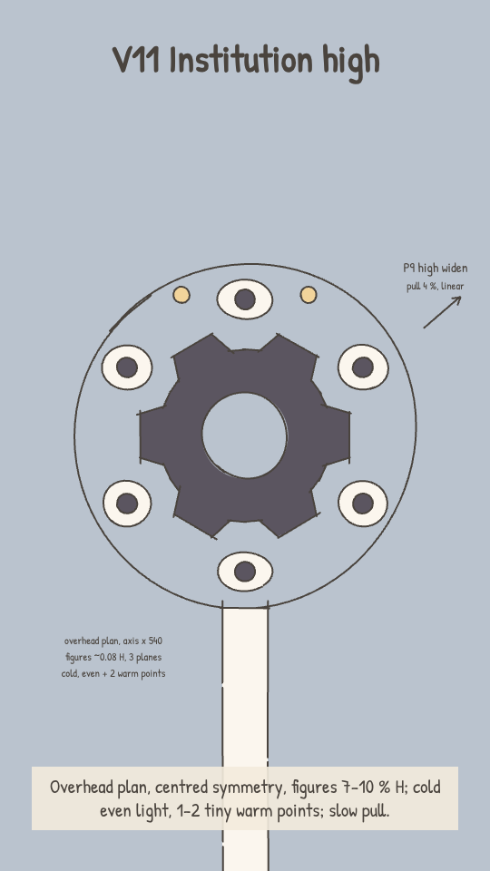 | 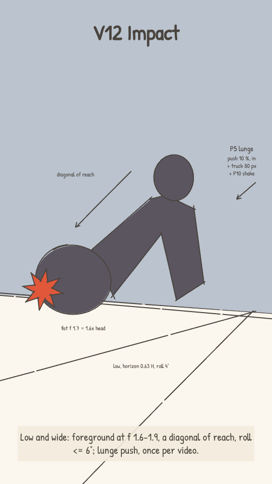 |

## 3. Camera presets
**In SketchReel (G3).** `camera.from` / `to` = `{x, y, z}`: the world point at the screen centre, and the scale; rest
`{540, 960, 1}`. The end frame is the authored one (a pull starts zoomed in, lands at z 1). `s`, `e` = shot times; d = e - s.
- Push p % = z 1 -> 1 + p/100 (a pull reverses it); drift q % W = Dx 10.8 q px; tilt or crane h H = Dy 1920 h px (look up
  or rise: `to.y` < `from.y`). On-screen travel = D x z; a zoom moves the top edge ~960 x Dz / z px.
- Eases: `out` = settle (front-loaded, 3x the average speed on frame 0); `in` = back-loaded (3x at the cut); `inout` =
  sine (1.57x mid-move); `linear`. `start` < `s` = already moving at the cut (carry-in 0.5-1.5 s); `end` < `e` = a still
  tail; `in` ending at `e` = cut at speed; `inout` with `end = s + 0.75d` = Arcane's reveal (peak ~37 %, 25 % still tail).
- Parallax: SketchReel draws one plane; fake the planes that matter with `moves` (eased `inout`): extra offset = (f - 1)
  x the camera's on-screen travel, same direction (a ledge at f 1.4: +0.4x; a colossus at f 0.15: -0.85x).
- Speed: every layer <= 450 px/s (15 px/frame at 30 fps; COZY §4's cap). For T px of the fastest layer's travel, d >=
  T/150 s on `in` / `out`, T/290 on `inout`, T/450 on `linear`.

**In the kit (G5, 60 fps).** `CineCamera` keys; a pull = `{t: 0, push: p}, {t: d, push: 0}`, p = 1 - 1/(1 + zoom). Eases
`CAM.settle` (first segment only), `E.inQuad` (`ease` in `lib/time`), `CAM.reveal`, `trapezoid(a, d)`. `tilt` = no
parallax; `y` / `x` = crane / truck; `<Layer depth={1 - f}>`. Check every move with `scripts/camspeed.py`.

| P | preset | numbers [M-based] | s | ease G3 / G5 | SketchReel `camera` | use |
|---|---|---|---|---|---|---|
| P1 | **Hold** | zoom 0-1 %, drift <= 5 px; `handheld` 1-1.5 px at G5 | 2.5-3.5 (<= 6 with a walk) | `linear` / none | `{from:{x:540,y:960,z:1},to:{x:545,y:960,z:1.008},ease:'linear'}` | V2 V4 V9 V11; power, a threshold, symbols |
| P2 | **Breath-out** (wide default) | pull 1.5-3 %, drift <= 16 px, the last 30 % near-still | 2-3.5 | `out` / `CAM.settle` | `{from:{x:540,y:960,z:1.02},to:{x:552,y:960,z:1},ease:'out',end:s+0.7d}` | let a moment sit; vistas, aftermath |
| P3 | **Retreat pull** | pull 4-7 % + a truck of <= 32 px; never lands, cut at speed into a moving shot | 2.5-3.5 | `in` / `E.inQuad` | `{from:{x:540,y:960,z:1.05},to:{x:560,y:960,z:1},ease:'in'}` | isolation, leaving, "our world gets smaller" |
| P4a | **Lean-in** | push 1.5-3 % | 2-3 | `out` / `CAM.settle` | `{from:{x:540,y:960,z:1},to:{x:540,y:960,z:1.02},ease:'out'}` | contemplation, a held silhouette |
| P4b | **Drawn-in** | push 3-6 %, peaking at 65-80 %; cut while moving | 2.5-5 | `in` / `E.inQuad` or a late bezier | `{from:{x:540,y:960,z:1},to:{x:540,y:960,z:1.045},ease:'in'}` | "this small thing matters", tension |
| P5 | **Lunge** | push 10-15 % + a truck of 75-140 px; one way only; cut on the fastest frame | 0.5-1.5 | `in` (cubic peaks 3x: 12 % alone needs d >= 0.75 s, with the truck >= 1.3 s) / `E.inQuad` (>= 0.9 s with the truck; else allow-list the last 2-3 frames under a smear) | `{from:{x:540,y:960,z:1},to:{x:640,y:960,z:1.12},ease:'in'}` | impact (V12) |
| P6 | **Big reveal** (the ONE) | rise 0.2-0.25 H (380-480 px) + pull 1.3-1.6x; a ledge at f 1.3-1.6 slides out of the bottom; then 1-1.5 s near-still. The top edge sets the speed: 1.3x + 380 px fits 3.5 s, the 1.6x example needs >= 4.5 s; 2x or 580 px breaks 450 px/s inside 5 s | 3.5-5 + 1-1.5 | `inout` with `end` 0.75d / `CAM.unveil` = `trapezoid(0.1, 0.6)` (to add) | `{from:{x:540,y:1340,z:1.6},to:{x:540,y:960,z:1},ease:'inout',end:s+0.75d}` + ledge `moves` dy = +0.4 x 380 | scale: the world they want, or have to face |
| P7 | **Tilt reveal** | tilt 0.3-0.5 H (600-900 px) at <= 0.12 H/s, + a 0-8 % push (2 of Arcane's 4; never a pull); up = wonder, toward warm light; down = into the place, confinement, toward the dark | 3.5-4.5 | `linear` / `trapezoid(0.1, 0.7)` | up: `{from:{x:540,y:1660,z:1},to:{x:540,y:960,z:1.05},ease:'linear'}` | K2 |
| P8 | **Push-through chain** | 2 cuts of +7-9 % in 0.8 s each, then a landing shot that is already moving: crane 0.25 H (480 px) + a 4 % push | 0.8 + 0.8 + 4.5-5 | `in`, then `out` / `E.inQuad`, then `CAM.settle` | a, b: `{z:1 -> 1.08, ease:'in'}`; landing: `{from:{y:1440,z:1},to:{y:960,z:1.04},ease:'out',start:s-0.3}` | leaving the refuge (K9 -> K3) |
| P9 | **High widen** | pull 2-6.5 %, centred; never a push | 2.7-4 | `linear` / linear or `CAM.slow` | `{from:{x:540,y:960,z:1.04},to:{x:540,y:960,z:1},ease:'linear'}` | V11 |
| P10 | **Shake / lurch** | impact: 2 frames of 6-15 px, decaying in <= 0.25 s; lurch: roll <= 6° + tilt <= 0.07 H (130 px) in 0.5 s (more only under a smear) | contact frames | label only / `add` | none (SketchReel has no roll; write it in the label) | contact frames, one per beat |

**SketchReel gaps, CLOSED 2026-10-26:** per-element `f` (true parallax; the end frame is exact for every f), eases `unveil` and `inQuad`, transitions `dip` and `flash`, `transition.dur`, camera roll `r`. Were: the eases `unveil` (`trapezoid(0.1, 0.6)`) and `inQuad`; a per-element
`f` (real parallax at G3); the transitions `dip` and `flash`; a dissolve length (T10 needs 0.5-0.8 s; it is fixed at 0.2 s).

## 4. Composition and depth in 9:16
**The vertical stack.** Arcane's widescreen thirds become bands in our frame:
| band | y | holds | rule |
|---|---|---|---|
| top edge | 0-290 | a top-edge object (lamp, branch, beam, the colossus cut by the top) | never a paper edge, never a flat full-width band (playbook) |
| captions | 317-556 (98 px lines at y 387 / 510) | Arcane's light field: sky, glow, a lit wall, the empty side | flat, L* >= 70, no ink, no lines crossing it (or fading there) |
| the read | 600-1250, x 120-880 | subject, face, object, pop, contact points; <= 2 points of interest per scale shot, in x 380-700 | the brightest field sits behind the head |
| mass | 1250-1920, and x > 780 below y 840 | foreground mass, ledge, legs, desk, hands cut by the bottom | no figures, labels or pop under the UI |

**Translating a 2.39:1 frame.** We keep frame-HEIGHT fractions, so at equal height our frame is the middle ~24 % of
Arcane's width: recompose, don't crop.
| Arcane framing | keep | convert |
|---|---|---|
| silhouette centred on one light (42 %) | the light behind the head, at x 380-700 | its field extends up through the captions |
| a wide lateral world (a city across the frame) | the horizon fraction; the colossus cut by the top | breadth becomes height: stack the far planes upward, the colossus >= 0.7 H, >= 2 elements cut by the side edges |
| two-shot side by side, standoff (symmetry 24 %) | the axis at x 540 | stack them in depth (near and low, far and high), go over the shoulder, or cut between singles |
| thirds, one person in a world (11 %) | the figure's % of H | thirds become the stack: captions top, figure in the read, mass at the bottom |
| negative space to one side (60-90 %) | its share of the frame | it moves above the subject and becomes the caption field |
| a lateral pan or truck (#55 pans 64 % W) | duration and ease | it becomes a tilt or crane; lateral drift <= 3 % W (32 px) |
| a round frame: moon-gate, sun, orb (23 % frame within frame) | the circle and the centring | 760-1000 px at x 540, centre y 800-1050; its top stays below y 560, or its flat sky holds the captions |
| foreground framing mass (~30 %) | 15-40 % W, cut by >= 2 edges | on the sides and bottom (legal under the UI), fill-only, f 1.3-1.6; doubles as the wiper on a cut |

**Depth.** Planes: 3 by default (a flat back, the subject, a foreground frame or haze), 4 for establishing wides, 5 only
on the ONE big move, 2 for inserts and overheads (Arcane: 3 = 49 %, 4 = 34 %, 2 = 10 %, 5 = 6 % [L]). Parallax f: sky
0, far 0.1, city 0.3, near 0.55, subject 1, foreground 1.3-1.6; behind the subject each f <= 0.55x the next. Haze: one band
per gap between planes, a step toward the page; no blur, no gradient.

**Lens feel in flat 2D.** *Normal:* the VP inside the frame. *Wide:* foreground at f 1.5-1.9 (near:far 1.5-2.5 [M]),
the VP near or past an edge, near objects drawn 1.2-1.5x bigger with thicker ink. *Telephoto:* an f spread <= 1.3
(0.8-1.25), a huge back shape behind small people (a sun 780 px behind 420 px figures); "defocus" = fill only, no ink,
one value lighter. **Horizon by angle:** eye level 0.52-0.59 H (0.70-0.85 when the sky is the subject); low camera
(K7a) 0.58-0.64 H; low power 0.75-0.9 H; worm's-eye none (VP at y -200 to -1500); high 0.15-0.30 H; overhead = a plan
view, where zoom = uniform scale.

## 5. Light and colour
**Value.** Radial, not a ground-to-sky ramp: light behind the subject, dark around it. Ours: the light is the page or
the cream core (50-80 % of the frame), the dark a near frame in mids on 2-3 edges (35-55 %), the anchor (~5 %) on
figures. Frame mean ~84 in a Sage interior, ~70 in a Dusk scale wide. A "dark scene" = more near frame and anchor, never
a darker page: mean >= 55, page >= 50 %, captions on L* >= 70; a dark wiper may cross the full frame for <= 0.5 s. A
mini-sequence climbs in value to its payoff (Arcane #126-132: L* 8 -> 55) [P].

**Arcane's sources and hues, mapped to our roles** (any palette: `bg` = light field, `ground` / `line` = mids and near
frame, `hl` / `disc` = lamp and sun, then `anchor`, `hero`, `pop`).
| Arcane [L / P] | our version | Sage Study (interior) | Dusk (scale, night) | G3 fill |
|---|---|---|---|---|
| backlight 44 %, opening 27 % | the light field behind the head: ONE opening 15-30 %, >= 10 L* off its surround | bg `#EEF0E3` (L* 94), core `#F0E2BF` (90) | mist `#D9DEE5` (88) | `paper` |
| silhouette | flat, >= 25 L* under its field, no outline; anchor only on figures <= 0.35 H | anchor `#22332C` | `#8A9AA8` + lip `#545F6D`; anchor `#1F2433` | `dark` |
| practical lamp 19 % | the cozy pool on the hands and face: flat rings, lighter toward the centre | ring `#F2D49B`, core `#F0E2BF`, on desk tan `#D9BBA1` | a lit window in the lamp tint | `warm` |
| low sun / sky 21 % | a disc of 180-780 px, flat, 1-2 halo rings; the sky = the caption field | `hl` `#F2D49B` | disc `#F3B27E` | `warm` |
| self-lit object / FX ~40 % | the HERO (5-15 %) on the story object, one lighter ring (`Glow`), steady | hero `#1F8A78` | hero `#3E5BD0` | label "hero" |
| shafts 6 % | `LightShaft` one step lighter than the air, 25-45 %, from ONE top corner at 20-35°, landing as a pool; 10-20 motes | over the desk | over a plaza | `paper` wedge |
| rim 17 % | 2-3 px, one step lighter, on the lit edge only | | | - |
| opposite-temperature accent (median 1.0 %) | the ONE pop, 1-3 %, only on "look here" | amber `#F2A541` | coral `#FF7A4D` | `pop` |
| cold window at night | a cool inset <= 20 %, low chroma: a field, not an accent | frost `#D9DEE5` | `#BAC3CE` (78) | `cold` |
| crimson menace, fire (28 shots) | never a wash: our threat stays cold, with no glow, rim or hero colour | | Dusk mids | `cold` / `dark` |
| gold = refuge, hope; blue-violet = power, tech; green = toxic | gold -> Sage Study; blue-violet -> Dusk; green -> Dusk mids + one hero glow | | | |

## 6. Transitions and sequencing
In a scene the luminance layout correlates 0.75 across a cut (0.25 between scenes) [P]: a hard cut on a word is our
default; big changes ride on an event (flash, wipe, move). Captions stay in screen space: no wipe ever clips them.
| T | cut | 9:16 recipe | SketchReel `transition.type` |
|---|---|---|---|
| T1 | **Light-match** | same bright shape and place, ONE change (temperature, scale or world); centre within 190 px, size within 1.5x (window -> coin, chip die, clock, sun) | `match-cut` |
| T2 | **Pinned anchor** | 2-4 jump cuts of 0.33-0.5 s; the lamp or the pop held within +-10 px | `cut` (label "pinned") |
| T3 | **Dark wiper** | a near arch from mid to anchor value at f 1.4, 0.4-0.5 s, hides a ~2x scale jump; once per video | `wipe` (label "dark wiper") |
| T4 | **Paper flash** | on impact, the ink and mids drop to the page for 2-4 frames at 30 fps; 1 per beat, <= 3 per second | `cut` (label; `flash` to build) |
| T5 | **Eclipse wipe** | a mid mass covering >= 70 % of the frame on the cut frame, <= 0.5 s (`WipeCut`) | `wipe` |
| T6 | **Temperature flip** | Sage -> Dusk only under a wiper, a whip or the mullion wipe; never on a bare cut | `wipe` / `push-through` |
| T7 | **Bloom push-through** | the opening steps page -> cream -> white over 0.8-1.7 s while pushing (K9) | `push-through` |
| T8 | **Scale cut, light held** | only the size changes (6-20:1); the temperature and the bright spot (within 0.2 H) hold (K1) | `cut` |
| T9 | **Contrast reset** | frame mean -12 to -18 L* (Sage ~84 -> Dusk ~70), once, at the turn, riding on T6 | `wipe` |
| T10 | **Haze-wash dissolve** | a flat page-tint plane 0 -> 70 % over 0.5-0.8 s, with the next shot under it | `dissolve` (label the length) |

**Rhythm [M].** Neighbouring shots: 31 % same size, 28 % one size apart, 21 % 3+ sizes. **Burst, then hold:** at most one
per video, 3 shots of 0.33-0.5 s, each ~1.5x wider (#110-112), handing off to a held wide of 2.5-4 s (Arcane: 2-26x as
long, median 6.5x). **Stillness before violence:** a 2-3 s locked frame, or a 0.33 s still beat, before the jolt. Calm
close-to-wide jumps keep about equal lengths (0.45-1.9x). Half the runs end on the widest shot, half close; a run that
opens wide keeps the wide short (1.5 s).

**Templates** (each keeps ONE light source as its thread):
- **A. Establish -> intimate -> scale (our default, 8-12 s):** V1 2-2.5 s (P2), with the place and its light in frame,
  setting the temperature; cut (size only) to V3 or V8, 2.5-4 s (P4a), our person lit by that light (the warmest value on
  skin), with 0.5-1 s still; T8 to V4, 1.5-3 s (P1), the colossus against the same light, the bright shape within
  0.2 H of shot 1's, 10:1; optionally V9, 1-2 s; a face or hands within 5 s. One temperature throughout.
- **B. Threshold, K9 -> K3 (6-7 s; Arcane #92-94 @236.4, 0.8 / 0.8 / 4.9 s):** V2 window, +8 % in 0.8 s (`in`); cut
  closer through the mullions, +8 % in 0.8 s, the opening a step lighter (T7); the T6 flip under the mullion wipe; then
  the P8 landing crane onto V6 or V4, 4.5-5 s, ending with 1 s near-still. When used, it is the film's ONE big move.
- **C. Lone light -> who -> feeling (8-10 s; Arcane #122-124 @322.9):** V10, the price tag or lamp alone in 90 % page,
  2.5-4 s (P4b); the person under it, 2.5-3 s, at OUR eye level (Arcane looks straight down here; §7 K10); V8, hands
  and face in the pool, 2.5-3 s. The value climbs, and the lit face is held within ~100 px across the last cut.
- **D. Refuge -> world -> refuge (6-8 s; Arcane #10-13 @10.4):** V2 nook 3 s (P3, cut at speed); T3 dark wiper (~2x
  jump); V4 outside 1.5-2.5 s, our window the one lit point (lamp tint); T8 back to the hands within 5 s. Warm throughout.

## 7. What this changes in COZY_AND_SCALE.md
These measurements replace COZY §8's "[UNCERTAIN] until we measure" (season 2 scenes stay unmeasured).
| item | COZY had | now | basis |
|---|---|---|---|
| §1.4 one big move | 2.5-4 s + 0.8-1.5 s hold; other shots push 3-8 % | 3.5-5 s + 1-1.5 s (Arcane 5-12 s, compressed); the default on a wide is a 1.5-3 % pull or a hold; a push needs a reason | [M] #55, #72, #113 |
| §1.2 long wides | "contrast across a cut, not long wides" | half true: locked scale wides 2-3.5 s; long wides travel (9 of the 11 wides >= 5 s move >= 5 %; the 2 held ones carry a walk, #36, or drifting light, #4-9) | [M] |
| §4 easing | "ease in, land over the last 35 %" | no house ease (P1-P10): 36 % front, 34 % back, 28 % mid; the big reveals (#55, #72, #94, #113) peak at <= 42 % and land with a still tail of 1-2 s; add `CAM.unveil` | [M] 92 moving shots |
| §4 "no spins" | no roll | roll drift <= 2° on reveals and floats, <= 6° in action, > 20° only inside a whip under a smear | [M] 38 shots |
| K1 | <= 1/8, wide 2.5-4 s | **measured:** 6-20:1 (median 10:1), from a close shot < 1 s; the wide 2-3.5 s calm, 1.2-1.6 s in action; light and temperature held (T8) | ratio [L], lengths [M], light [P] |
| K2 | 600-900 px in 2.5-3.2 s, `CAM.reveal`, + 3-5 % zoom-out | **measured:** 600-900 px in 3.5-4.5 s (<= 0.12 H/s; Arcane 0.03-0.10 H/s), linear or `trapezoid(0.1, 0.7)`, + a 0-8 % push (2 of 4), never a pull; add K2-down (arriving, confinement, toward the dark); up goes toward warm light | [M] #50, #57, #58, #69 |
| K3 | crane 400-700 px in 2.5-3.5 s, ledge f 1.3 | **measured:** rails run 1.26-1.6x; Arcane also pulls 1.3-1.5x as it rises and lands on an ease-out; as THE big move it takes 3.5-5 s + 1-1.5 s | [M] #72, #94, #113 |
| K4 | <= 2.3x continuous, the rest in a hidden cut | **measured, confirmed:** Arcane's longest continuous pull is 2.4x (#55, 11.5 s); bigger jumps are dipped (~2x, #10 -> #13); a retreat pull accelerates and does not land (P3) | [M] |
| K5 | push 3-8 % in 2-4 s, `CAM.slow`; back view 0.25-0.35 H | **measured:** 1.7-5.4 % in 2.3-5 s, on P4a settle or P4b drawn-in (rarely `CAM.slow`); back view 0.28-0.38 H; push = resolve, pull = isolation | [M] [L] |
| K6 | observer 0.04-0.08 H, 2-3.5 s | **measured, confirmed:** median 0.08 H (range 0.02-0.15); locked wides have a median of 2.7 s, with the life in the frame | [M] [L] |
| K7 | horizon 0.58-0.64 H, optional 2-4 % tilt | **split:** K7a = our low camera (0.58-0.64 H); K7b = a true worm's-eye (V5), with no person; the camera does a 2 % breath-out; the lit V behind the colossus holds the captions | [M] [L] #3, #31, #62 |
| K8 | a shaft core on the axis | shafts come from ONE top corner at 20-35° (6 of 7) and land as pools on seats or people; tilt the core 15-30°; the camera is near-locked | [L]; camera [M] #23 1.7 % |
| K9 | push 0 -> 0.85 in 1.2-2 s, `CAM.ease` | **measured, changed:** 2 accelerating cuts, then a landing shot that is already moving (P8); the opening blooms a step per cut (T7) | [M] [P] #92-94 |
| K10 | calm, linear, once, never on the lone subject | **measured, confirmed:** a 2-6.5 % pull or a hold, centred, figures 7-10 % H, cold with 1-2 tiny warm points. **OPEN owner decision:** a warm top-down at rest on OUR person (>= 0.5 H); until the owner decides, COZY §5 "Respect" stands | [M] [L] |
| §5 horizon | 0.52-0.59 H | add 0.70-0.85 H when the sky is the subject | [L] #24, #61, #108 |
| §4 haze | a value step per plane | holds on vistas; but frames are radial (bright centre 72 %), so use a near frame in mids on 2-3 edges and no forced dark ground band | [P] |

## 8. Source and method
- **Source:** "Amazing Shots of ARCANE SEASON 1" (YouTube channel Amazing Shots, id HzJ7Nvwz1e8): a no-narration
  compilation of season 1 shots (Fortiche / Riot Games / Netflix); the owner's screen recording, letterbox cropped
  (1280 x 542, 2.36:1), 24 fps, 6:19.
- **Measured:** cuts (165 detected -> 136 editorial shots, 376.9 s: 4 recording artefacts dropped, flicker or flare
  splits merged; `cine_shots.md` counts 137, #127-128 split); the camera per shot from optical flow by
  `video/scripts/look/measure_camera.py` (pan, tilt as % W, zoom %, roll, speed peak, top-vs-bottom parallax); light in
  pixels (L*, C*, hue, captions masked, middle 70 % of each shot); size, angle, lens, planes, figure % H by eye (+-1 class).
- **Correction:** tilts use the measured frame (H = 0.42 W); `cine_motion.md` assumed 16:9, so its fractions of H read
  1.33x low (#94's crane is 0.25 H, not 0.18; #50 0.56 H, #58 0.42 H, #57 1.08 H). Its px recipes stand.
- **Caveats:** the compilation's editor cut the clips (57 of 136 shots last 2.5-3.5 s: durations are lower bounds); a
  highlights reel over-samples showy, dark wides; the shot order is the editor's, so rhythm and transition rules come
  only from in-scene runs (#10-13, #77-81, #92-94, #110-113, #119-124, #126-135, #140-143, #146-162); YouTube's
  auto-captions ("[Music]", lyrics) burned onto some frames were masked and ignored; optical flow reads figure and FX
  motion as camera motion (12 shots corrected by eye); season 1 only, from one compilation.
- **Rule:** reference footage, frames, contact sheets and thumbnails NEVER go into the repo (it is public) or a published
  artifact; they live only in the session scratchpad. Only numbers, our words and our own drawings are committed. We
  never trace or copy Arcane's frames, characters or designs; we cite shots by # and timestamp only.
