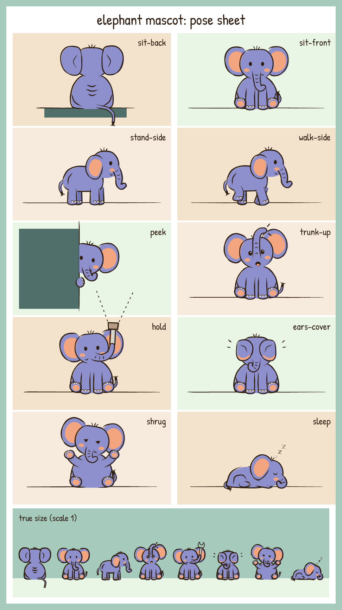
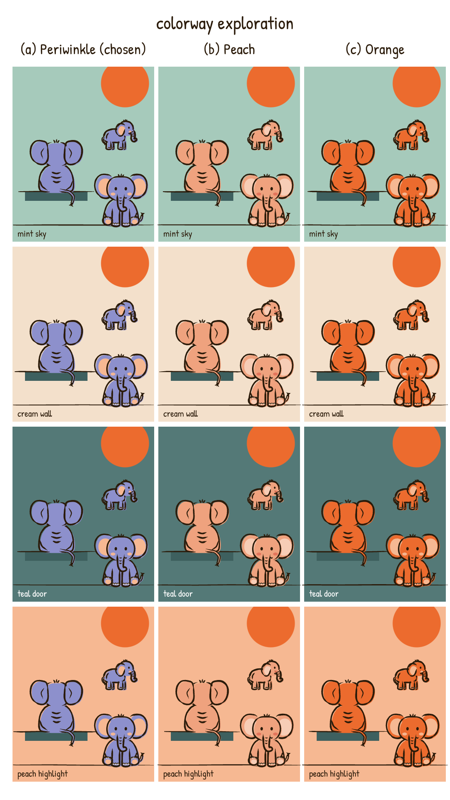
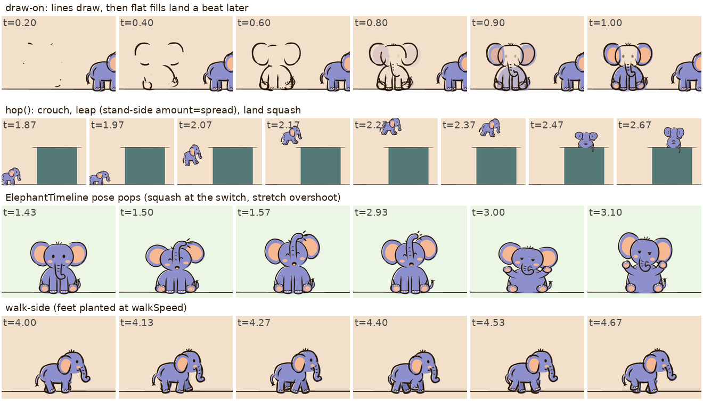

# Mascot: the periwinkle elephant (character stream)

> **v1-era (banner, 2026-10-27).** Keep it for the mascot's API (props, poses, timelines, entrances, the un-build).
> Its look is v1's: the brush ink with corner overshoot and wander, and the colorways' chroma. A new film draws a new
> Pip in its own design (playbook: no reusable assets) at tier B unless the line is about it (`docs/look/CRAFT.md` §b:
> C* <= 25, a same-hue line 1.6-2.2 px, <= 1 % of the frame), drawn by the clean pen's mascot brush; across a join it
> rides the carrier or keeps its spot, never a hop of its own. Current direction: `docs/look/DIRECTION.md`.

An original small elephant that plays the reference cat's role: it is in every scene, perched and watching, reacting,
and now and then doing a small physical gag. It nods to PHP's "elePHPant" (an elephant in a PHP-ish violet-blue)
but copies nothing from the official logo: no "php" lettering, a different body plan (baby proportions, big round
ears, head tuft, teddy-bear soles) and our own hand.

Code: `src/lib/mascot/` (self-contained: plain SVG + React + remotion; it only imports tokens from `src/lib/theme.ts`).
Dev sheet: `src/dev/MascotSheet.tsx` (composition `MascotSheet`, modes below).



## 1. Colorway: periwinkle (chosen)



`docs/mascot_colorways.png`: three candidates on the reference backgrounds (mint sky, cream wall, teal door, peach
highlight), each next to the orange sun. CIELAB ΔE76 between the body colour and each background:

| colorway | mint | cream | teal | peach highlight | **sun** | salmon |
|---|---|---|---|---|---|---|
| (a) periwinkle `#8D90CC` | 47.5 | 54.3 | 42.5 | 62.1 | **93.3** | 65.2 |
| (b) peach `#EFA27E` | 48.0 | 33.5 | 56.4 | **9.5** | 36.0 | **1.8** |
| (c) orange `#EC6B2E` (= the cat) | 82.7 | 68.9 | 83.2 | 44.3 | **0.0** | 35.7 |

Why (a):
- **It pops the way the cat does.** The cat works because it is the one saturated, off-ground hue in an earthy
  mint/teal/cream world. Periwinkle is the only cool violet on screen, so it separates from every background
  (min ΔE 42), and its middle value (L* 62) reads against both the light grounds (L* 78-91) and the dark teal door (L* 44).
- **It never fights the sun.** The sun is the video's anchor and sits just above where the mascot perches. Orange (c)
  is the sun's exact colour and merges with it; peach (b) disappears on the caption highlight and the salmon props.
- **It harmonises.** Violet-blue is the complement of the orange sun and peach accents, and the ear inner, cheeks and
  soles use the theme's `salmon`, toenails the theme's `cream`, so the character is tied into the palette.
- **It says PHP** without any logo.
- Rule (also in the style bible): periwinkle is reserved for the mascot; never reuse it on scene objects.

All mascot colours live in ONE place, `src/lib/mascot/colors.ts` (`COLORWAYS`, `MASCOT_COLORWAY`, `MASCOT`). The only
hex values there are the body and shade per colorway; everything else is a theme token. Ink is always `palette.ink`.

## 2. The look (how it matches the reference hand)

- **Ink**: tapered brush polygons built from centerlines (`ink.ts` `brush()`), constant on-screen weight
  (`stroke.ink x 1.12 / scale`, so ~3.4 px peak at any size), small corner overshoot, slight wander, press-in /
  long-release taper. Outlines are 2 loose strokes per shape with gaps: the top of the head between the ears and the
  body base are left open, like the cat.
- **Fill**: one flat colour per part, misregistered 3 px right / 2 px down (style bible §9: the cat's offset), constant
  in screen space even when flipped.
- **Marks**: 3 downward-bowed back wrinkles (the cat's 3 stripes, 17/21/16 px) + 2 haunch arcs; 2-3 trunk wrinkles;
  a 3-strand head tuft; ear inner in salmon; tiny salmon cheeks; cream toenails; salmon sole pads.
- Nothing boils: the linework is static per seed (the reference is clean vector), only the idle life moves.

## 3. API

```tsx
import {Elephant, ElephantTimeline, hop, popIn, drawIn, unbuild, walkSpeed} from '../lib/mascot';

<Elephant
  x={430} y={395}          // FEET anchor in card space (where it sits / stands)
  scale={0.9}              // 1 = ~96 px tall sitting; line weight stays constant
  pose="sit-back"          // see pose list
  t={t}                    // seconds (frame / fps): drives idle life + walk
  seed={3}                 // per-instance variation (blink timing, stroke wobble)
  flip={false}             // true = mirrored (faces / peeks left)
  look={0.4}               // -1..1 eyes/head direction (before flip); sit-back shows a trunk curl on that side
  expression="neutral"     // neutral | happy | wide | worried | meh | closed (poses pick sensible defaults)
  amount={undefined}       // pose-specific 0..1, see table
  idle={1}                 // 0..1 idle-life multiplier (0 = frozen)
  draw={1}                 // 0..1 build: strokes draw on one by one, each fill GROWS 20%->100% ~0.15 s after its outline starts
  exit={0}                 // 0..1 un-build: fills shrink to their centres (small first), then the ink retracts
  squash={0}               // + squash / - stretch about the feet (from hop / popIn / popSwitch)
  rotate={0}               // degrees about the feet
  ink={1} fill={1}         // states: fill={0} = ink-only (loop frame), ink={0} = fills-only. Intermediate values
                           //   retract strokes / shrink fills: they are NEVER opacities
  // opacity: deprecated. Nothing fades: < 0.5 = not drawn, otherwise fully drawn.
  prop={<Flashlight/>}     // node held at the trunk tip ('hold'; carried in side poses)
  propRot={0}              // extra rotation for the prop (it also follows the trunk's sway)
  walkRate={1.25}          // walk cycles / s for 'walk-side'
  colorway="periwinkle"    // only for exploration; default is the chosen colorway
/>
```

Props are authored **upright around (0,0) = the grip point** (the trunk tip wraps over y ≈ 0..-4), e.g. a flashlight
whose handle starts at the origin and points up. In side poses (`stand-side`, `walk-side`) a `prop` makes the trunk
carry it forward.

### Pose switching, entrances, hops, walking

```tsx
// pose changes on a schedule, with a squash-and-stretch pop at each switch (mode="fade" is deprecated = pop)
<ElephantTimeline x={600} y={392} scale={0.9} t={t} seed={4}
  keys={[{t: 0, pose: 'sit-back'}, {t: 3.2, pose: 'trunk-up', expression: 'wide'}, {t: 4.4, pose: 'ears-cover'}]} />

// pop entrance (scale overshoot + stretch)
const p = popIn(t, 1.0);          // {scale, squash, visible}
{p.visible && <Elephant x={x} y={y} scale={0.9 * p.scale} squash={p.squash} pose="sit-front" t={t} />}

// draw-on entrance (0.9 s) / un-build exit (0.5 s, the engine's recipe)
<Elephant ... draw={drawIn(t, 0.2)} />
<Elephant ... exit={unbuild(t, 69.0)} />            // or exit={useExit()} inside the engine's <UnBuild>
// (drawOut() still works: as `draw` it plays the build in reverse. Also opacity-free.)
// The engine's <ExitShrink x y> (whole mascot shrinks to its feet) is the other approved exit.

// hop onto a ledge: 0.14 s crouch, leap, landing squash (dur = airtime)
const h = hop({t, t0: 8.1, dur: 0.42, from: {x: 500, y: 960}, to: {x: 520, y: 390}, height: 50});
<Elephant x={h.x} y={h.y} squash={h.squash} rotate={h.rotate}
  pose={h.k < 1 ? 'stand-side' : 'sit-back'} amount={h.spread} t={t} />

// walking: move x at walkSpeed(rate) * scale px/s so the feet stay planted
const x = x0 + (t - t0) * walkSpeed(1.25) * 0.9;
<Elephant x={x} y={groundY} scale={0.9} pose="walk-side" walkRate={1.25} t={t} />
```

Other exports: `unbuild(t, t0, dur = 0.5)` (exit progress), `BUILD` (build timing), `popSwitch(t, tSwitch)` (the pop squash curve), `poseAt(keys, t)`, `POSES`, `POSE_BOUNDS`
(approximate local bounds per pose, feet at y = 0), `WALK`, `MASCOT`, `COLORWAYS`, idle functions
(`blink`, `earFlap`, `tailSwish`, `trunkSway`, `breath`). All motion is a pure function of seconds (30/60 fps safe).

## 4. Poses

Previews (scale 2): `docs/mascot_poses/<pose>.png`. Heights are at `scale={1}`.

| pose | preview | what it is | `amount` | default face |
|---|---|---|---|---|
| `sit-back` | `docs/mascot_poses/sit-back.png` | the cat's signature: from behind on a ledge, tail hanging over the edge; `look` turns the head and shows a trunk curl. **Default watching pose.** ~96 px | - | (none) |
| `sit-front` | `docs/mascot_poses/sit-front.png` | sitting facing us, soles out, trunk curled. ~96 px | trunk dangle 0..1: trunk hangs straight down past the feet over a ledge edge and swings (the "hanging-trunk gag") | neutral |
| `stand-side` | `docs/mascot_poses/stand-side.png` | profile standing (faces right; `flip` for left). ~80 px tall, ~106 wide | leap spread 0..1 (legs fore/aft, ears + tail up), use with `hop().spread` | neutral |
| `walk-side` | `docs/mascot_poses/walk-side.png` | 4-beat lateral-sequence walk from `t`, body/head bob, ear flop, trunk + tail swing | - | neutral |
| `peek` | `docs/mascot_poses/peek.png` | head + one ear + trunk peeking out from behind a vertical edge at x (clipped on the hidden side), front foot gripping the edge. Anchor = the grip point on the edge (head ~38 px above it); `flip` peeks left. For vertical edges (door frames, walls, board sides) | how far out 0..1 (default 1) | neutral, looking out |
| `trunk-up` | `docs/mascot_poses/trunk-up.png` | trunk raised and trumpeting, ears spread, mouth open, pulsing trumpet marks. Alarm (`wide`) or celebration (`happy`). ~108 px | - | wide |
| `hold` | `docs/mascot_poses/hold.png` | trunk curled up to the right holding `prop` at the tip | - | neutral |
| `ears-cover` | `docs/mascot_poses/ears-cover.png` | scared / sad: ears flopped forward over each eye, hunched, trunk curled shyly, slight shiver + worry marks | - | (hidden) |
| `shrug` | `docs/mascot_poses/shrug.png` | front feet up and out, head tilt, heavy-lidded "meh", shoulders bob | shoulder height (default animates) | meh |
| `sleep` | `docs/mascot_poses/sleep.png` | lying in profile, head on paws, trunk coiled, slow breathing, floating z's (never mirrored). ~50 px | - | closed |

Idle life (all poses, scaled by `idle`): blink every ~2.6-5 s (sometimes double), slow ear sway + occasional quick ear
flick, lazy tail swish, trunk sway, breathing (~3.2 s). All subtle and deterministic from `t` and `seed`; give
neighbouring instances different seeds.



`docs/mascot_motion.png`: draw-on, hop, timeline pops, walk. `docs/mascot_walk.png`: 8 walk phases + idle.

### No fades (project rule, QUALITY GATES)

Nothing in the mascot ever animates opacity. Build = strokes draw on (the brush polygon is cut along its
centerline, the equivalent of a dash-offset) and every flat fill, eye and prop GROWS from 20% about its own centre
over 0.12 draw units (3-4 frames at the default `drawIn` speed), landing `BUILD.fillLag` = 0.16 (~4-5 frames) after
its own outline starts, matching the engine's `MOTION.fillLag` / `MOTION.fillGrow`. Un-build = fills shrink to their
centres (ease-in, small first), then the ink retracts, in the engine's `MOTION.unbuild` phases. Pose changes pop
(squash-and-stretch), z's in `sleep` pop by scale, cheeks are opaque. Every pixel is fully opaque except the
1-px anti-aliased edges.

Evidence: `docs/mascot_evidence/drawin_frames.png` (every frame of a real rendered draw-in, f14-f37: fills grow solid),
`docs/mascot_build.png` (frame strips: draw-in every 2nd frame, un-build every frame, legacy drawOut,
the ink/fill states, `mode="fade"` mid-switch, sleep z's, prop build) and the alpha check on the same strips rendered
on a transparent canvas, `docs/mascot_evidence/build_alpha.png`: 0 translucent regions (no 3x3 block of partial
alpha). All 1,070 remaining partial-alpha non-ink pixels are 1-px anti-aliased seams touching an opaque pixel (largest
component 20 px, no 2x2 block). Negative control `docs/mascot_evidence/control_translucent.png` (the same elephant inside
`opacity 0.5`): 64,052 translucent-core pixels, so the test does catch fades. Re-run:
`npx remotion still src/index.ts MascotSheet docs/mascot_evidence/build_alpha.png --frame=0 --props='{"mode":"build","alpha":true}'`.

## 5. Size and placement guidance

- **Wide / mid shots: `scale` 0.9-1.0 (≈ 86-96 px sitting)**, matching the cat (85-92 px; style bible §9).
  Close-ups: 1.8-2.0. Allowed range 0.75-1.35 (≈ 70-130 px). Below 0.7 the face details stop reading on a phone.
- Line weight is constant on screen at any scale, so a scaled-up elephant keeps the scene's pen.
- Perch it on something (ledge, board top, kerb) in the right or middle third, watching the scene, mostly `sit-back`;
  use front-facing reaction poses for beats that need a face. Keep it inside the safe zone (canvas x 90-930, y 160-1480).
- Its fill may break the panel edge (like the cat); the tail in `sit-back` hangs ~28 px below the feet,
  the dangling trunk (sit-front `amount={1}`) up to ~22 px.
- `docs/mascot_scene.png`: true-size check in a reference-like scene (sit-back on the board top at scale 1, a flipped
  `peek` behind the door edge, `walk-side` on the ground). At 390 px phone width it still reads clearly as an
  elephant (ears + trunk silhouette) and holds the same footprint as the reference cat.

## 6. Dev sheet

```
npx remotion still src/index.ts MascotSheet docs/mascot_sheet.png --frame=10                       # poses + true-size variants
npx remotion still src/index.ts MascotSheet docs/mascot_colorways.png --frame=10 --props='{"mode":"colorways"}'
npx remotion still src/index.ts MascotSheet docs/mascot_scene.png --frame=10 --props='{"mode":"scene"}'
npx remotion still src/index.ts MascotSheet docs/mascot_walk.png --frame=10 --props='{"mode":"walk"}'
npx remotion render src/index.ts MascotSheet out/mascot_motion.mp4 --props='{"mode":"motion"}'    # 8 s motion demo
npx remotion still src/index.ts MascotSheet docs/mascot_build.png --frame=0 --props='{"mode":"build"}'   # build / un-build strips
#   add "alpha":true for a transparent canvas (alpha check), "control":true for the translucent negative control
```

## 7. Notes for other streams

- The engine's `theme.misreg` is `{dx: -4, dy: -3}` (left/up). The mascot deliberately keeps the cat's measured
  right/down offset (3, 2) as its own constant (`Elephant.tsx` `MISREG`); one offset per object is per the bible.
- If `stroke.ink` / `palette.ink` change in the theme, the mascot follows automatically.
